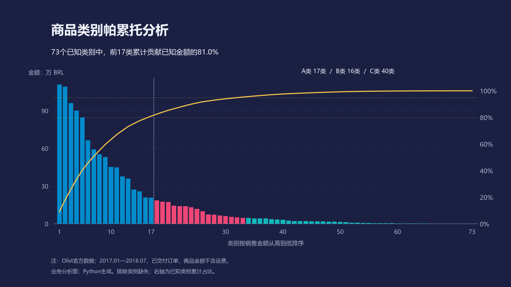
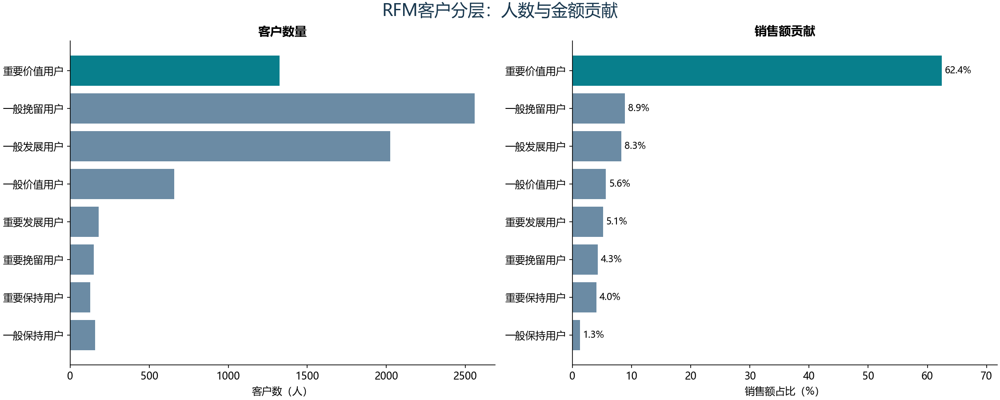

# 商业经营分析与决策建模

**Python Business Analytics Portfolio｜经营诊断 · 客户分析 · 预测建模 · 金融风控**

[](https://github.com/1881188/business-data-analysis-labs/actions/workflows/check.yml)


[](LICENSE)

面向零售、电商与金融场景的数据分析作品集，围绕经营表现、客户价值、履约体验和风险识别，构建从多表数据处理、指标计算、统计分析到预测与交互展示的可复现流程。

项目由两部分组成：**四册教材的系统方法复现**与**Olist真实公开电商数据的综合实战**。已完成四本教材现有配套内容的Python复现，按一级至四级板块保留完整来源目录；在此基础上，通过独立电商分析项目展示业务问题拆解、结果解释和交付过程。

[Olist经营分析实战](#final-project) · [分析能力与成果](#capabilities) · [跨工具复现方法](#reproduction) · [四册复现范围](#course-map) · [完整案例目录](#lab-catalog) · [运行与验证](#quick-start)

## 项目一览

| 组成 | 核心工作 | 可查看成果 |
|---|---|---|
| Olist电商经营分析 | 销售增长、品类贡献、履约体验与短期预测，贯通取数、清洗、分析和展示 | [项目说明](final_project/olist/README.md)、[分析结果](final_project/olist/docs/04_商业分析阶段结果.md)、[看板入口](final_project/olist/run_dashboard.py)、[分析报告PDF](final_project/olist/docs/Olist电商销售与履约分析_公开关键词修订版20261105.pdf) |
| 商业分析与建模案例库 | 将四册配套的Excel、Power BI和Notebook案例迁移、重构为Python流程，实际运行并分析结果 | [80个完整入口](#lab-catalog)、[模型结果速览](docs/advanced-results.md)、[来源与验证索引](docs/experiment-index.md) |

案例库保留79个配套输入已运行入口、113幅公开静态图和209项合成边界测试；原资料缺失情况在对应条目标注。Olist实战另提供15张分析原图、8组报告组合图、3张真实运行截图、Dash交互看板及脱敏Word/PDF报告，使用独立依赖与运行入口。

| 电商实战 · 品类贡献与集中度 | 客户分析 · RFM价值分层 |
|---|---|
|  |  |

<a id="final-project"></a>

## 业务实战｜Olist电商经营分析

**销售增长、品类贡献与履约体验：基于真实公开交易数据的经营诊断与预测。**

使用Olist发布的巴西电商数据，原始数据包含99,441笔订单和112,650条商品明细；经营分析覆盖2017年1月至2018年7月的89,860笔合格已交付订单。商品、支付、客户、评价等表分别按业务粒度处理，形成可核对的分析口径，再回答四类问题。

| 业务问题 | 分析方法 | 本次数据中的发现 |
|---|---|---|
| 销售增长由什么变化伴随？ | 同比/环比、订单数与客单价对照 | 2018年1—7月商品金额同比增长161.59%，订单数增长160.78%，客单价增长约0.31%；增长主要伴随订单量扩大 |
| 哪些品类值得重点关注？ | 品类ABC、帕累托与阈值敏感性分析 | 17个A类品类贡献全部观察商品金额的79.85%，形成品类关注优先级的量化依据 |
| 配送体验与评价如何关联？ | 逾期分组、州×品类分层对照 | 在有效配送/评价样本中，逾期组低评分率约63.69%，按时组约9.38%；结果描述观察关联 |
| 短期预测能达到什么水平？ | SARIMA、时间划分验证、基线比较与预测区间 | 7月独立测试RMSE为1,367.55 BRL，相较四周同星期均值基线降低约1.67% |

销售金额按商品价格汇总，不含运费、不代表利润；预测目标使用各最终状态的下单商品金额，与已交付销售口径分别解释。所有发现对应明确的数据窗口与分母。

**交付形式**包括可复现分析脚本、15张Python原图、8组报告组合图、Dash交互看板及脱敏分析报告。看板支持日期、收货州与品类联合筛选，联动KPI、图表和订单明细，并提供CSV导出与重置。已补3张作者实际操作截图、悬停提示和栏目跟随高亮。HTTP/回调核验记录与页面操作验收范围见[看板说明](final_project/olist/docs/06_交互大屏使用与验收.md)。

[项目全貌与运行方法](final_project/olist/README.md) · [一键分析](final_project/olist/run_all.py) · [交互看板入口](final_project/olist/run_dashboard.py) · [分析报告PDF](final_project/olist/docs/Olist电商销售与履约分析_公开关键词修订版20261105.pdf) · [Word版](final_project/olist/docs/Olist电商销售与履约分析_公开关键词修订版20261105.docx) · [图表与结论索引](final_project/olist/docs/05_图表索引与解读.md)

<a id="capabilities"></a>

## 分析工作与可核验成果

| 分析环节 | 本仓库完成的工作 | 代表成果 |
|---|---|---|
| 数据整理与质量控制 | 多表关联、唯一键和关联基数检查、缺失/异常处理、金额与汇总守恒 | [关系与维度模型](docs/results/B01/report.md)、[ETL流程](docs/results/B03/report.md)、[Olist清洗口径](final_project/olist/docs/02_清洗口径与验证.md) |
| 经营指标与问题拆解 | 同比/环比、渠道增减、RFM、同期群、漏斗与品类ABC | [客户价值分层](docs/results/B05/report.md)、[渠道变化拆解](docs/results/B20/report.md)、[Olist经营分析](final_project/olist/docs/04_商业分析阶段结果.md) |
| 统计分析与模型解释 | 方差分析、回归、PCA/聚类、特征贡献与偏依赖 | [方差分析](docs/results/S08/report.md)、[回归验证](docs/results/S10/report.md)、[模型解释](docs/results/M16/report.md) |
| 预测与资源配置 | 时间留出、朴素基线、SARIMA/LSTM与线性/整数/二次规划 | [销售预测](docs/results/M19/report.md)、[LSTM与基线](docs/results/M20/report.md)、[生产配置](docs/results/M22/report.md) |
| 金融风险分析 | Vintage、WOE/评分卡、观察窗口和历史关系特征 | [账龄分析](docs/results/F05/report.md)、[A卡评分](docs/results/F06/report.md)、[申请反欺诈](docs/results/F08/report.md) |
| 分析交付与复现 | 独立脚本、统一入口、依赖锁定、结果报告、交互展示和来源追踪 | [运行入口](run_labs.py)、[交互看板](final_project/olist/run_dashboard.py)、[结果索引](docs/experiment-index.md) |

<a id="reproduction"></a>

## 从既有工具到Python：复现做了什么

复现工作包含业务理解、代码重构、实际执行和结果分析。源文件保留只读，Python实现、结果与调整说明独立管理。

| 原有实现 | Python迁移与重构 | 运行和分析工作 |
|---|---|---|
| Excel公式、透视表与多表案例 | 使用pandas、NumPy和SQL重建清洗、关联、指标与聚合逻辑 | 复算公式与参考值，核对业务粒度、分母、金额守恒和缺失处理 |
| Power BI业务分析与看板案例 | 以Python重建指标、维度关系和筛选分析，保留聚合报告及部分交互展示 | 梳理字段与业务口径，记录参考核对范围与专有引擎边界 |
| Jupyter Notebook分析代码 | 整理为独立`.py`入口，恢复输入与执行顺序，替换机器专属路径和不兼容API | 实际运行配套数据，分析模型与统计结果，保存逐代码单元迁移对照 |
| 预测、分类与优化示例 | 将数据处理、模型拟合、评估与结果输出组织为可重复执行的流程 | 明确训练/验证/测试范围、随机种子、搜索预算和基线，解释差异与局限 |

四册复现记录了572份来源材料；高级案例的682个非空代码单元均有实现去向。参考核对、方法修正与运行结果分别记录，可从任意案例追溯到输入版本、实现代码和分析说明。

<a id="course-map"></a>

## 四册教材的系统复现

已完成四本教材现有配套内容的Python复现与结果整理，按一级至四级目录保留完整对应关系。四级板块对应第4套金融案例教材。

| 板块 | 复现来源 | Python实现范围 | 完整入口 |
|---|---|---|---|
| 一级 | 《CDA一级认证教材：商业数据分析》 | 数据建模、清洗、业务指标、RFM、留存、看板、归因与预测 | [B01—B22 · 22个迁移单元](#level-1) |
| 二级 | 《CDA二级认证教材：量化策略分析》 | 可视化、统计推断、抽样、降维、回归与聚类 | [S01—S13 · 13份Notebook](#level-2) |
| 三级 | 《CDA三级认证教材：敏捷数据挖掘》 | 监督/无监督学习、关联与序列、预测、运筹、流程与特征工程 | [M01—M29 · 29份Notebook](#level-3) |
| 四级 / 第4套 | 《金融数据分析和数据挖掘案例实战》 | 精准营销、Vintage、A/B卡、反欺诈、工程化与关系网络 | [F01—F16 · 16份来源](#level-4) |

一级编号按实施单元组织，可承接多个源练习；其余编号按Notebook来源组织。F04与F05为相同Vintage代码来源，共享实现并保留对应入口。逐项范围及验证说明见[完整来源索引](docs/experiment-index.md)、[一级迁移范围](docs/level1-completion.md)和[高级案例迁移说明](docs/advanced-migration.md)。

<a id="lab-catalog"></a>

## 完整案例目录 · 四册复现入口

按四册来源列出全部80个入口，便于复核具体案例与复现范围。每行提供方法说明、Python代码和结果报告；[完整来源索引](docs/experiment-index.md)保留原Notebook名称与状态，[预测结果速览](docs/advanced-results.md)汇总模型留出指标。

<a id="level-1"></a>

### 一级 · 商业数据分析

| ID | 分析主题 | 代码与说明 | 结果报告 | 主要内容与验证 |
|---|---|---|---|---|
| B01 | 关系与维度模型 | [方法说明](labs/cda1_business/b01_models/README.md) · [.py入口](labs/cda1_business/b01_models/main.py) | [结果与解释](docs/results/B01/report.md) | 8表关系、3组模型；区分12960个正确缓存与4处错误业务引用 |
| B02 | 函数、查找与透视 | [方法说明](labs/cda1_business/b02_functions/README.md) · [.py入口](labs/cda1_business/b02_functions/main.py) | [结果与解释](docs/results/B02/report.md) | 31张工作表、292格保存公式全覆盖；363项缓存值核对 |
| B03 | ETL清洗、拆列与合并 | [方法说明](labs/cda1_business/b03_etl/README.md) · [.py入口](labs/cda1_business/b03_etl/main.py) | [结果与解释](docs/results/B03/report.md) | 保留真实零，错误单元格单列；拆分不重复计量，追加显式映射 |
| B04 | 波士顿矩阵 | [方法说明](labs/cda1_business/b04_bcg/README.md) · [.py入口](labs/cda1_business/b04_bcg/main.py) | [结果与解释](docs/results/B04/report.md) | 14个品牌的份额/增长及两条阈值核对通过 |
| B05 | RFM客户价值分层 | [方法说明](labs/cda1_business/b05_rfm/README.md) · [.py入口](labs/cda1_business/b05_rfm/main.py) | [结果与解释](docs/results/B05/report.md) | 7,178名客户的R/F/M、消费日期与标签全部对账一致 |
| B06 | 用户忠诚度 | [方法说明](labs/cda1_business/b06_loyalty/README.md) · [.py入口](labs/cda1_business/b06_loyalty/main.py) | [结果与解释](docs/results/B06/report.md) | 990名会员标签一致；705名会员F/M及评分一致 |
| B07 | 同期群日留存 | [方法说明](labs/cda1_business/b07_cohort/README.md) · [.py入口](labs/cda1_business/b07_cohort/main.py) | [结果与解释](docs/results/B07/report.md) | 243个已观察单元核对，未到期不填零 |
| B08 | 转化漏斗 | [方法说明](labs/cda1_business/b08_funnel/README.md) · [.py入口](labs/cda1_business/b08_funnel/main.py) | [结果与解释](docs/results/B08/report.md) | 销售示例24项数值核对；另完成两组练习 |
| B09 | 相关分析与线性趋势 | [方法说明](labs/cda1_business/b09_correlation/README.md) · [.py入口](labs/cda1_business/b09_correlation/main.py) | [结果与解释](docs/results/B09/report.md) | 参考图3项舍入后的系数核对；相关不作因果解释 |
| B10 | 六类分析方法 | [方法说明](labs/cda1_business/b10_methods/README.md) · [.py入口](labs/cda1_business/b10_methods/main.py) | [结果与解释](docs/results/B10/report.md) | 18组区域、838个公式有去向；随机快照差异和桑基流量异常单列 |
| B11 | 基础零售销售看板 | [方法说明](labs/cda1_business/b11_retail/README.md) · [.py入口](labs/cda1_business/b11_retail/main.py) | [结果与解释](docs/results/B11/report.md) | 6644单，12项分组守恒；[离线交互看板](docs/results/B11/dashboard.html) |
| B12 | 分省销售分析 | [方法说明](labs/cda1_business/b12_province/README.md) · [.py入口](labs/cda1_business/b12_province/main.py) | [结果与解释](docs/results/B12/report.md) | 订单/明细模型、缺失雇员保留、18项汇总检查、显式筛选 |
| B13 | 服装零售经营分析 | [方法说明](labs/cda1_business/b13_apparel/README.md) · [.py入口](labs/cda1_business/b13_apparel/main.py) | [方法与合成示例](docs/results/B13/report.md) | 真实输入本地运行；公开只含新增实现、方法与合成图，真实结果不发布 |
| B14 | 人力资源分析 | [方法说明](labs/cda1_business/b14_hr/README.md) · [.py入口](labs/cda1_business/b14_hr/main.py) | [日期口径与结果](docs/results/B14/report.md) | 200份履历，日枚举/人天与月度存量守恒，明细仅本地 |
| B15 | 学生考试多表分析 | [方法说明](labs/cda1_business/b15_exams/README.md) · [.py入口](labs/cda1_business/b15_exams/main.py) | [分母与结果](docs/results/B15/report.md) | 59人三科快照，及格SQL交叉核对，缺考与并列排名边界 |
| B16 | 收入趋势分析 | [方法说明](labs/cda1_business/b16_income/README.md) · [.py入口](labs/cda1_business/b16_income/main.py) | [结果与分母修正](docs/results/B16/report.md) | 1187条省月记录，52个原公式复算，缺记录与省份贡献明确 |
| B17 | 财务期间费用分解 | [方法说明](labs/cda1_business/b17_expenses/README.md) · [.py入口](labs/cda1_business/b17_expenses/main.py) | [两版对照与对账](docs/results/B17/report.md) | 两版独立分析，11个公式复算；完整版未解释差额不强行归因 |
| B18 | 电商精准营销 | [方法说明](labs/cda1_business/b18_marketing/README.md) · [.py入口](labs/cda1_business/b18_marketing/main.py) | [客群与参考纠错](docs/results/B18/report.md) | 3926个唯一客户，3978个公式核对；52处错行、8处标签差异，旧图混入男性人数 |
| B19 | 银行产品购买看板 | [方法说明](labs/cda1_business/b19_bank_products/README.md) · [.py入口](labs/cda1_business/b19_bank_products/main.py) | [目标与筛选口径](docs/results/B19/report.md) | 440条购买记录；40项SQL核对、6个PBIX容器迁移，隐藏DAX未解码 |
| B20 | 银行申请渠道归因 | [方法说明](labs/cda1_business/b20_channels/README.md) · [.py入口](labs/cda1_business/b20_channels/main.py) | [贡献与总计纠错](docs/results/B20/report.md) | 1597笔申请，3195个公式及98项数字缓存；贡献分解不作因果结论 |
| B21 | SQL与信用卡画像 | [方法说明](labs/cda1_business/b21_profiles/README.md) · [.py入口](labs/cda1_business/b21_profiles/main.py) | [历史窗口与SQL](docs/results/B21/report.md) | SQL1—9、19组查询与11596项逐卡核对，180/365窗口分别保留 |
| B22 | 效应分解与预测 | [方法说明](labs/cda1_business/b22_forecasting/README.md) · [.py入口](labs/cda1_business/b22_forecasting/main.py) | [时间留出与预测](docs/results/B22/report.md) | 三条序列、九组留出评价，WPS预测只作未知算法快照对照 |

<a id="level-2"></a>

### 二级 · 量化策略分析

| ID | 分析主题 | 代码与说明 | 结果报告 | 主要内容与验证 |
|---|---|---|---|---|
| S01 | 数据整合和清洗 | [方法说明](labs/cda2_statistics/s01_cleaning/README.md) · [.py入口](labs/cda2_statistics/s01_cleaning/main.py) | [结果与解释](docs/results/S01/report.md) | 12个小节，分块读取、关联、汇总等关键检查通过 |
| S02 | Python数据可视化 | [方法说明](labs/cda2_statistics/s02_visualization/README.md) · [.py入口](labs/cda2_statistics/s02_visualization/main.py) | [结果与解释](docs/results/S02/report.md) | 22个非空代码单元，13幅图，模拟数据明确标注 |
| S03 | 描述性统计 | [方法说明](labs/cda2_statistics/s03_descriptive/README.md) · [.py入口](labs/cda2_statistics/s03_descriptive/main.py) | [结果与解释](docs/results/S03/report.md) | 12项缓存值核对，包含重复标准差检查；方差另用精确公式复算 |
| S04 | 抽样设计 | [方法说明](labs/cda2_statistics/s04_sampling/README.md) · [.py入口](labs/cda2_statistics/s04_sampling/main.py) | [结果与解释](docs/results/S04/report.md) | 六种设计运行通过，修正系统抽样并提供分层权重 |
| S05 | 数据预处理 | [方法说明](labs/cda2_statistics/s05_preprocessing/README.md) · [.py入口](labs/cda2_statistics/s05_preprocessing/main.py) | [结果与解释](docs/results/S05/report.md) | 24项描述统计缓存值核对，包含重复房屋价值检查 |
| S06 | 电信主成分分析 | [方法说明](labs/cda2_statistics/s06_pca/README.md) · [.py入口](labs/cda2_statistics/s06_pca/main.py) | [结果与解释](docs/results/S06/report.md) | 28项缓存值核对，白化得分样本协方差检查；中间省略行不作参考对账 |
| S07 | 地区主成分旋转 | [方法说明](labs/cda2_statistics/s07_factors/README.md) · [.py入口](labs/cda2_statistics/s07_factors/main.py) | [结果与解释](docs/results/S07/report.md) | 148项缓存值核对，保持教材单位特征向量旋转语义 |
| S08 | 消费额方差分析 | [方法说明](labs/cda2_statistics/s08_anova/README.md) · [.py入口](labs/cda2_statistics/s08_anova/main.py) | [结果与解释](docs/results/S08/report.md) | 70条观察样本主分析；空单元格与HC3处理，25项兼容值另核对 |
| S09 | 列联表检验 | [方法说明](labs/cda2_statistics/s09_contingency/README.md) · [.py入口](labs/cda2_statistics/s09_contingency/main.py) | [结果与解释](docs/results/S09/report.md) | 检验排除All合计，明确未加权样本和217条缺失；旧结果仅作诊断 |
| S10 | 线性回归 | [方法说明](labs/cda2_statistics/s10_regression/README.md) · [.py入口](labs/cda2_statistics/s10_regression/main.py) | [结果与解释](docs/results/S10/report.md) | 70条真实响应、5折OOF；89项教材兼容OLS值与8个VIF另核对 |
| S11 | 电信客户流失逻辑回归 | [方法说明](labs/cda2_statistics/s11_churn/README.md) · [.py入口](labs/cda2_statistics/s11_churn/main.py) | [结果与解释](docs/results/S11/report.md) | 主模型运行通过；教材未正则多元拟合不收敛，改动已说明 |
| S12 | Kmeans银行分群 | [方法说明](labs/cda2_statistics/s12_kmeans/README.md) · [.py入口](labs/cda2_statistics/s12_kmeans/main.py) | [结果与解释](docs/results/S12/report.md) | 10万客户，固定随机性；39项缓存值核对，解释树排除ID |
| S13 | 地区层次聚类 | [方法说明](labs/cda2_statistics/s13_hierarchy/README.md) · [.py入口](labs/cda2_statistics/s13_hierarchy/main.py) | [结果与解释](docs/results/S13/report.md) | 42项打印缓存值及18项方向算法容差核对，原表只读 |

<a id="level-3"></a>

### 三级 · 敏捷数据挖掘

| ID | 分析主题 | 代码与说明 | 结果报告 | 主要内容与验证 |
|---|---|---|---|---|
| M01 | 客户价值预测：线性回归与正则化 | [方法说明](labs/cda3_mining/m01/README.md) · [.py入口](labs/cda3_mining/m01/main.py) | [结果与解释](docs/results/M01/report.md) | OLS、残差诊断、AIC、岭回归、Lasso与弹性网；训练内选择和样本外评分 |
| M02 | 客户响应预测：逻辑回归 | [方法说明](labs/cda3_mining/m02/README.md) · [.py入口](labs/cda3_mining/m02/main.py) | [结果与解释](docs/results/M02/report.md) | RFECV与正则搜索、ROC/阈值评估；缩放与特征选择在训练范围拟合 |
| M03 | 经济发展画像：主成分与因子旋转 | [方法说明](labs/cda3_mining/m03/README.md) · [.py入口](labs/cda3_mining/m03/main.py) | [结果与解释](docs/results/M03/report.md) | 标准化、稀疏PCA、单位特征向量varimax旋转和Ward聚类 |
| M04 | 贷款申请主成分评分 | [方法说明](labs/cda3_mining/m04/README.md) · [.py入口](labs/cda3_mining/m04/main.py) | [结果与解释](docs/results/M04/report.md) | 五主成分与一主成分评分；投影恒等式核验 |
| M05 | 变量聚类与代表变量选择 | [方法说明](labs/cda3_mining/m05/README.md) · [.py入口](labs/cda3_mining/m05/main.py) | [结果与解释](docs/results/M05/report.md) | 稀疏主成分分组，按相关性比率筛选代表变量；修正辅助脚本 |
| M06 | 经济发展层次聚类 | [方法说明](labs/cda3_mining/m06/README.md) · [.py入口](labs/cda3_mining/m06/main.py) | [结果与解释](docs/results/M06/report.md) | 旋转得分、Ward树和两簇画像；保留原尺度的距离语义 |
| M07 | Kmeans客户细分 | [方法说明](labs/cda3_mining/m07/README.md) · [.py入口](labs/cda3_mining/m07/main.py) | [结果与解释](docs/results/M07/report.md) | 家庭/爱好双维度、轮廓系数与SSD、交叉客群和解释树 |
| M08 | 银行产品关联规则 | [方法说明](labs/cda3_mining/m08/README.md) · [.py入口](labs/cda3_mining/m08/main.py) | [结果与解释](docs/results/M08/report.md) | 客户篮子、Apriori、支持度/置信度/提升度；以客户为分母 |
| M09 | 银行产品序列模式 | [方法说明](labs/cda3_mining/m09/README.md) · [.py入口](labs/cda3_mining/m09/main.py) | [结果与解释](docs/results/M09/report.md) | 有序订单项集、相对与绝对支持阈值；完整模式增长与穷举核验 |
| M10 | 关联规则课堂版 | [方法说明](labs/cda3_mining/m10/README.md) · [.py入口](labs/cda3_mining/m10/main.py) | [结果与解释](docs/results/M10/report.md) | 布尔篮子、频繁项集和规则筛选；迁移机器专属路径与旧依赖 |
| M11 | 关联规则课后版 | [方法说明](labs/cda3_mining/m11/README.md) · [.py入口](labs/cda3_mining/m11/main.py) | [结果与解释](docs/results/M11/report.md) | 完整规则指标及财务通、好享贷的定向规则提取 |
| M12 | 申请反欺诈：树与集成模型 | [方法说明](labs/cda3_mining/m12/README.md) · [.py入口](labs/cda3_mining/m12/main.py) | [结果与解释](docs/results/M12/report.md) | 决策树、随机森林、AdaBoost、XGBoost与LightGBM；CV和训练内早停 |
| M13 | 申请反欺诈：KNN、贝叶斯、SVM与MLP | [方法说明](labs/cda3_mining/m13/README.md) · [.py入口](labs/cda3_mining/m13/main.py) | [结果与解释](docs/results/M13/report.md) | 四类模型的调参与留出评估；标准化随交叉验证折拟合 |
| M14 | XGBoost专题 | [方法说明](labs/cda3_mining/m14/README.md) · [.py入口](labs/cda3_mining/m14/main.py) | [结果与解释](docs/results/M14/report.md) | 原生/sklearn接口、早停、单调与交互约束、并行树森林 |
| M15 | LightGBM专题 | [方法说明](labs/cda3_mining/m15/README.md) · [.py入口](labs/cda3_mining/m15/main.py) | [结果与解释](docs/results/M15/report.md) | HistGB对照、类别特征、早停、单调/交互约束与二进制回读核验 |
| M16 | 模型解释专题 | [方法说明](labs/cda3_mining/m16/README.md) · [.py入口](labs/cda3_mining/m16/main.py) | [结果与解释](docs/results/M16/report.md) | TreeSHAP加和核验、偏依赖、决策路径、简化规则与随机反事实 |
| M17 | 无监督异常识别 | [方法说明](labs/cda3_mining/m17/README.md) · [.py入口](labs/cda3_mining/m17/main.py) | [结果与解释](docs/results/M17/report.md) | 孤立森林与500邻居LOF；明确拟合抽样、标签辅助选择及时间留出 |
| M18 | 销售趋势预测：Prophet | [方法说明](labs/cda3_mining/m18/README.md) · [.py入口](labs/cda3_mining/m18/main.py) | [结果与解释](docs/results/M18/report.md) | 加法/乘法模型、节假日与变点；12月留出及36月未来投影 |
| M19 | 销售预测：SARIMA | [方法说明](labs/cda3_mining/m19/README.md) · [.py入口](labs/cda3_mining/m19/main.py) | [结果与解释](docs/results/M19/report.md) | 季节分解、64组参数搜索、残差诊断、留出基线与预测区间 |
| M20 | 股价预测：LSTM | [方法说明](labs/cda3_mining/m20/README.md) · [.py入口](labs/cda3_mining/m20/main.py) | [结果与解释](docs/results/M20/report.md) | 双层32单元、双输出、100 epoch；统一目标日期与前日值基线比较 |
| M21 | ARIMA过程与诊断 | [方法说明](labs/cda3_mining/m21/README.md) · [.py入口](labs/cda3_mining/m21/main.py) | [结果与解释](docs/results/M21/report.md) | AR、MA、ARMA、ARIMA四类过程；ACF/PACF、ADF与残差检验 |
| M22 | 线性规划：生产配置 | [方法说明](labs/cda3_mining/m22/README.md) · [.py入口](labs/cda3_mining/m22/main.py) | [结果与解释](docs/results/M22/report.md) | LP文件解析、HiGHS求解、约束检查与独立顶点最优值核验 |
| M23 | 整数规划：营销资源配置 | [方法说明](labs/cda3_mining/m23/README.md) · [.py入口](labs/cda3_mining/m23/main.py) | [结果与解释](docs/results/M23/report.md) | 保留原文件变量类型，披露漏写声明并与全整数版本对照 |
| M24 | 二次规划 | [方法说明](labs/cda3_mining/m24/README.md) · [.py入口](labs/cda3_mining/m24/main.py) | [结果与解释](docs/results/M24/report.md) | 严格凸目标、等式与边界约束；独立KKT方程验证最优解 |
| M25 | 流程挖掘：XES事件日志 | [方法说明](labs/cda3_mining/m25/README.md) · [.py入口](labs/cda3_mining/m25/main.py) | [结果与解释](docs/results/M25/report.md) | 日志导出回读、直接跟随频次与平均耗时；案例边界守恒 |
| M26 | 模型参数优化 | [方法说明](labs/cda3_mining/m26/README.md) · [.py入口](labs/cda3_mining/m26/main.py) | [结果与解释](docs/results/M26/report.md) | 网格、逐次减半、随机与TPE搜索；三折训练目标和独立测试 |
| M27 | 保险响应Pipeline | [方法说明](labs/cda3_mining/m27/README.md) · [.py入口](labs/cda3_mining/m27/main.py) | [结果与解释](docs/results/M27/report.md) | 填补、编码、缩放和模型完整封装；折内调参、新客预测与模型回读 |
| M28 | 电信特征工程 | [方法说明](labs/cda3_mining/m28/README.md) · [.py入口](labs/cda3_mining/m28/main.py) | [结果与解释](docs/results/M28/report.md) | 异常/缺失处理、分箱/编码、白化PCA、LDA与多类特征选择 |
| M29 | 类别不平衡专题 | [方法说明](labs/cda3_mining/m29/README.md) · [.py入口](labs/cda3_mining/m29/main.py) | [结果与解释](docs/results/M29/report.md) | 六类采样演示、SMOTE/SMOTENC、类别权重；测试分布保持原样 |

<a id="level-4"></a>

### 四级 · 金融数据分析与数据挖掘案例

| ID | 分析主题 | 代码与说明 | 结果报告 | 主要内容与验证 |
|---|---|---|---|---|
| F01 | 贷款营销辅助实验 | [方法说明](labs/finance_cases/f01/README.md) · [.py入口](labs/finance_cases/f01/main.py) | 原资料缺失 | 原配套数据 data12261.csv 缺失；Python入口与资料说明已整理 |
| F02 | 银行贷款产品精准营销 | [方法说明](labs/finance_cases/f02/README.md) · [.py入口](labs/finance_cases/f02/main.py) | [结果与解释](docs/results/F02/report.md) | Logit与ROC评估；统一训练分位数清洗，补齐新客评分 |
| F03 | 多维特征客户细分 | [方法说明](labs/finance_cases/f03/README.md) · [.py入口](labs/finance_cases/f03/main.py) | [结果与解释](docs/results/F03/report.md) | 家庭/爱好旋转、Kmeans与交叉画像；固定随机性和解释树 |
| F04 | Vintage检查点来源 | [方法说明](labs/finance_cases/f04/README.md) · [.py入口](labs/finance_cases/f04/main.py) | [结果与解释](docs/results/F04/report.md) | 与F05代码相同，共享离线实现；保留来源映射 |
| F05 | Vintage账龄分析 | [方法说明](labs/finance_cases/f05/README.md) · [.py入口](labs/finance_cases/f05/main.py) | [结果与解释](docs/results/F05/report.md) | SQL备份离线重建、成熟MOB；pandas与SQLite聚合交叉核对 |
| F06 | 贷前信用风险：A卡 | [方法说明](labs/finance_cases/f06/README.md) · [.py入口](labs/finance_cases/f06/main.py) | [结果与解释](docs/results/F06/report.md) | IV、分箱、WOE、AIC、PSI/VIF与评分卡；原始输入转分独立核验 |
| F07 | 贷中信用风险：B卡 | [方法说明](labs/finance_cases/f07/README.md) · [.py入口](labs/finance_cases/f07/main.py) | [结果与解释](docs/results/F07/report.md) | 3/6/12月还款、逾期及额度特征；第13期排除，账户关联防放大 |
| F08 | 申请反欺诈与关系网络 | [方法说明](labs/finance_cases/f08/README.md) · [.py入口](labs/finance_cases/f08/main.py) | [结果与解释](docs/results/F08/report.md) | 收入异常、按日图特征、客户分组验证与GP调参；快照对齐限制明示 |
| F09 | 算法工程化：时间特征 | [方法说明](labs/finance_cases/f09/README.md) · [.py入口](labs/finance_cases/f09/main.py) | [结果与解释](docs/results/F09/report.md) | 可克隆日期/日历/历史转换器；滞后修正、分组与未来扰动核验 |
| F10 | 社交网络基本理论 | [方法说明](labs/finance_cases/f10/README.md) · [.py入口](labs/finance_cases/f10/main.py) | [结果与解释](docs/results/F10/report.md) | 有向/无向图、自环、重复边语义与出入度 |
| F11 | 广度与深度遍历 | [方法说明](labs/finance_cases/f11/README.md) · [.py入口](labs/finance_cases/f11/main.py) | [结果与解释](docs/results/F11/report.md) | BFS最短路、DFS路径及起终点相同、不可达等边界处理 |
| F12 | 社交网络核心指标 | [方法说明](labs/finance_cases/f12/README.md) · [.py入口](labs/finance_cases/f12/main.py) | [结果与解释](docs/results/F12/report.md) | 度、紧密、介度、特征向量中心性；星形图恒等式核验 |
| F13 | PageRank实现 | [方法说明](labs/finance_cases/f13/README.md) · [.py入口](labs/finance_cases/f13/main.py) | [结果与解释](docs/results/F13/report.md) | 矩阵迭代、悬挂节点、阻尼与收敛；与NetworkX独立核对 |
| F14 | 社交网络小案例 | [方法说明](labs/finance_cases/f14/README.md) · [.py入口](labs/finance_cases/f14/main.py) | [结果与解释](docs/results/F14/report.md) | 边表读取、有向网络与聚合度分布；不公开关系明细 |
| F15 | 网络子图与社区分割 | [方法说明](labs/finance_cases/f15/README.md) · [.py入口](labs/finance_cases/f15/main.py) | [结果与解释](docs/results/F15/report.md) | Louvain分区、社区规模和模块度；固定随机种子 |
| F16 | 银行交易圈社区发现 | [方法说明](labs/finance_cases/f16/README.md) · [.py入口](labs/finance_cases/f16/main.py) | [结果与解释](docs/results/F16/report.md) | 客户关系图和无权Louvain；公开社区聚合规模 |

<a id="quick-start"></a>

## 快速运行

### 方法复现案例库

实测Python 3.13.0 / Windows。先按[数据准备说明](data/README.md)准备四套教材资料，将四个教材目录的父目录传给`--data-root`。

```powershell
python -m venv .venv
.\.venv\Scripts\python.exe -m pip install -r requirements-advanced-lock.txt

# 运行全部已登记且具备配套输入的分析案例
.\.venv\Scripts\python.exe run_labs.py --lab all --data-root "你的教材配套资料目录"

# 或按业务场景选择案例；完整ID见四册目录
.\.venv\Scripts\python.exe run_labs.py --lab B05 S11 M19 F06 --data-root "你的教材配套资料目录"
```

完整环境见[高级依赖锁定清单](requirements-advanced-lock.txt)；基础实验与合成测试使用[基础依赖](requirements.txt)。数据位置也可通过`BDA_DATA_ROOT`或本地配置指定，结果默认写入`outputs/<实验ID>/`。

### Olist电商经营实战

Olist项目实测Python 3.12，使用独立虚拟环境与依赖。从仓库根目录执行：

```powershell
cd final_project/olist
python -m venv .venv
.\.venv\Scripts\python.exe -m pip install -r requirements.txt
.\.venv\Scripts\python.exe run_all.py
.\.venv\Scripts\python.exe run_dashboard.py
```

看板默认地址为`http://127.0.0.1:8050/`。数据下载、分阶段重跑及端口配置见[Olist项目说明](final_project/olist/README.md)。

<a id="validation"></a>

## 验证与复现说明

方法复现案例库已执行209项合成边界测试，覆盖金额守恒、关联粒度、分母、日期窗口、训练分区、PCA白化/旋转、序列模式及图算法等行为。运行记录区分“运行通过”与“指定参考核对通过”：14个入口完成报告所列范围的参考核对，其余65个为运行通过。随机模型和调整后的方法分别记录验证边界。

```powershell
.\.venv\Scripts\python.exe -m unittest discover -s tests -v
.\.venv\Scripts\python.exe tools/check_project.py
```

每份结果摘要记录输入和实现代码哈希。CI核查无需教材私有数据的测试与项目完整性；真实配套数据运行记录在各报告中。模型效果由留出结果与基线共同说明，复现完成不意味着复杂模型一定更优。

[GitHub Actions](https://github.com/1881188/business-data-analysis-labs/actions) · [当前进度与验证范围](docs/progress.md) · [材料来源映射](docs/source-map.csv) · [版本记录](CHANGELOG.md)

## 仓库结构

```text
business-data-analysis-labs/
├── labs/
│   ├── cda1_business/          一级：B01—B22
│   ├── cda2_statistics/        二级：S01—S13
│   ├── cda3_mining/            三级：M01—M29
│   └── finance_cases/          四级：F01—F16
├── src/bda_labs/               商业分析计算模块
├── config/                     来源、实验与公开产物登记
├── data/                       教材数据准备说明
├── docs/results/               案例聚合报告、图表与运行摘要
├── final_project/olist/        Olist综合实战及独立运行环境
├── tests/                      合成数据与边界检查
├── tools/                      文档构建与项目完整性检查
├── run_labs.py                 分析案例统一运行入口
└── outputs/                    本地中间结果，不纳入Git
```

## 数据与许可

新增代码使用[MIT许可](LICENSE)，教材、第三方库和数据的权利范围见[来源说明](THIRD_PARTY_NOTICES.md)。教材原文件、个人标识、逐人预测、账户与关系明细及模型文件保留在本地；公开成果包括方法、允许发布的聚合结果和图表。B13按原资料的传播限制，仅公开新增实现、方法与独立合成示例。

Olist项目的数据许可及使用范围单列在[DATA_LICENSE.md](final_project/olist/DATA_LICENSE.md)；论文公开版已去除个人标识，AI辅助使用见[披露说明](final_project/olist/docs/AI使用披露.md)。
