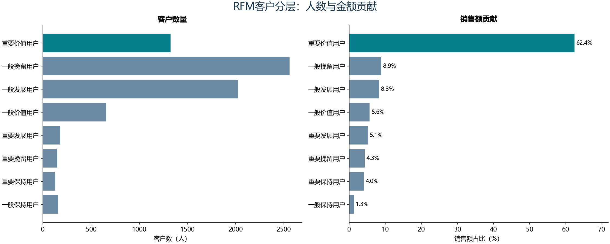

# 商业数据分析实验集

将四套教材中的 Excel、Power BI 案例迁移为 Python，把 Jupyter Notebook 整理为独立脚本，记录业务问题、指标口径、结果和解释。

当前 **79 个编号入口已用配套输入运行**：一级 B01—B22 全部 22 个规划迁移单元、二级 S01—S13 全部 13 份 Notebook、三级 M01—M29 全部 29 份 Notebook，以及金融 F02—F16 共 15 份来源。金融 F04 是 F05 的重复检查点，共享实现，不能算额外业务案例。**F01 缺少原输入 data12261.csv，仍待补资料；未计入完成。**

本批补齐三级与金融可运行来源，包含模型解释、LSTM、三类运筹规划、流程日志、评分卡和关系网络。[预测结果速览](docs/advanced-results.md)汇总留出指标；[三级与金融迁移说明](docs/advanced-migration.md)列明方法、搜索预算、抽样与时点验证边界；[实验索引](docs/experiment-index.md)提供每份 `.py`、逐单元格对照、图表和报告。14 个入口完成指定范围的参考核对，65 个为运行通过，不把随机结果称为旧输出逐值复现。

一级完成范围与专有引擎、参考模板限制见[一级完成说明](docs/level1-completion.md)。B13 真实结果继续留在本地，仅公开新增代码、方法和独立合成示例。所有个人标识、逐行预测、关系边及新训练模型均不公开。



## 已完成实验

| ID | 实验与教材 | 代码说明 | 结果报告 | 验证状态 |
|---|---|---|---|---|
| B01 | 一级：关系与维度模型 | [实验入口](labs/cda1_business/b01_models/README.md) | [结果与解释](docs/results/B01/report.md) | 8表关系、3组模型；区分12960个正确缓存与4处错误业务引用 |
| B02 | 一级：函数、查找与透视 | [实验入口](labs/cda1_business/b02_functions/README.md) | [结果与解释](docs/results/B02/report.md) | 31张工作表、292格保存公式全覆盖；363项缓存值核对 |
| B03 | 一级：ETL清洗、拆列与合并 | [实验入口](labs/cda1_business/b03_etl/README.md) | [结果与解释](docs/results/B03/report.md) | 保留真实零，错误单元格单列；拆分不重复计量，追加显式映射 |
| B04 | 一级：波士顿矩阵 | [实验入口](labs/cda1_business/b04_bcg/README.md) | [结果与解释](docs/results/B04/report.md) | 14个品牌的份额/增长及两条阈值核对通过 |
| B05 | 一级：RFM客户价值分层 | [实验入口](labs/cda1_business/b05_rfm/README.md) | [结果与解释](docs/results/B05/report.md) | 7,178名客户的R/F/M、消费日期与标签全部对账一致 |
| B06 | 一级：用户忠诚度 | [实验入口](labs/cda1_business/b06_loyalty/README.md) | [结果与解释](docs/results/B06/report.md) | 990名会员标签一致；705名会员F/M及评分一致 |
| B07 | 一级：同期群日留存 | [实验入口](labs/cda1_business/b07_cohort/README.md) | [结果与解释](docs/results/B07/report.md) | 243个已观察单元核对，未到期不填零 |
| B08 | 一级：转化漏斗 | [实验入口](labs/cda1_business/b08_funnel/README.md) | [结果与解释](docs/results/B08/report.md) | 销售示例24项数值核对；另完成两组练习 |
| B09 | 一级：相关分析与线性趋势 | [实验入口](labs/cda1_business/b09_correlation/README.md) | [结果与解释](docs/results/B09/report.md) | 参考图3项舍入后的系数核对；相关不作因果解释 |
| B10 | 一级：六类分析方法 | [实验入口](labs/cda1_business/b10_methods/README.md) | [结果与解释](docs/results/B10/report.md) | 18组区域、838个公式有去向；随机快照差异和桑基流量异常单列 |
| B11 | 一级：基础零售销售看板 | [实验入口](labs/cda1_business/b11_retail/README.md) | [结果与解释](docs/results/B11/report.md) | 6644单，12项分组守恒；[离线交互看板](docs/results/B11/dashboard.html) |
| B12 | 一级：分省销售分析 | [实验入口](labs/cda1_business/b12_province/README.md) | [结果与解释](docs/results/B12/report.md) | 订单/明细模型、缺失雇员保留、18项汇总检查、显式筛选 |
| B13 | 一级：服装零售经营分析 | [实验入口](labs/cda1_business/b13_apparel/README.md) | [方法与合成示例](docs/results/B13/report.md) | 真实输入本地运行；公开只含新增实现、方法与合成图，真实结果不发布 |
| B14 | 一级：人力资源分析 | [实验入口](labs/cda1_business/b14_hr/README.md) | [日期口径与结果](docs/results/B14/report.md) | 200份履历，日枚举/人天与月度存量守恒，明细仅本地 |
| B15 | 一级：学生考试多表分析 | [实验入口](labs/cda1_business/b15_exams/README.md) | [分母与结果](docs/results/B15/report.md) | 59人三科快照，及格SQL交叉核对，缺考与并列排名边界 |
| B16 | 一级：收入趋势分析 | [实验入口](labs/cda1_business/b16_income/README.md) | [结果与分母修正](docs/results/B16/report.md) | 1187条省月记录，52个原公式复算，缺记录与省份贡献明确 |
| B17 | 一级：财务期间费用分解 | [实验入口](labs/cda1_business/b17_expenses/README.md) | [两版对照与对账](docs/results/B17/report.md) | 两版独立分析，11个公式复算；完整版未解释差额不强行归因 |
| B18 | 一级：电商精准营销 | [实验入口](labs/cda1_business/b18_marketing/README.md) | [客群与参考纠错](docs/results/B18/report.md) | 3926个唯一客户，3978个公式核对；52处错行、8处标签差异，旧图混入男性人数 |
| B19 | 一级：银行产品购买看板 | [实验入口](labs/cda1_business/b19_bank_products/README.md) | [目标与筛选口径](docs/results/B19/report.md) | 440条购买记录；40项SQL核对、6个PBIX容器迁移，隐藏DAX未解码 |
| B20 | 一级：银行申请渠道归因 | [实验入口](labs/cda1_business/b20_channels/README.md) | [贡献与总计纠错](docs/results/B20/report.md) | 1597笔申请，3195个公式及98项数字缓存；贡献分解不作因果结论 |
| B21 | 一级：SQL与信用卡画像 | [实验入口](labs/cda1_business/b21_profiles/README.md) | [历史窗口与SQL](docs/results/B21/report.md) | SQL1—9、19组查询与11596项逐卡核对，180/365窗口分别保留 |
| B22 | 一级：效应分解与预测 | [实验入口](labs/cda1_business/b22_forecasting/README.md) | [时间留出与预测](docs/results/B22/report.md) | 三条序列、九组留出评价，WPS预测只作未知算法快照对照 |
| S01 | 二级：数据整合和清洗 | [实验入口](labs/cda2_statistics/s01_cleaning/README.md) | [结果与解释](docs/results/S01/report.md) | 12个小节，分块读取、关联、汇总等关键检查通过 |
| S02 | 二级：Python数据可视化 | [实验入口](labs/cda2_statistics/s02_visualization/README.md) | [结果与解释](docs/results/S02/report.md) | 22个非空代码单元，13幅图，模拟数据明确标注 |
| S03 | 二级：描述性统计 | [实验入口](labs/cda2_statistics/s03_descriptive/README.md) | [结果与解释](docs/results/S03/report.md) | 12项缓存值核对，包含重复标准差检查；方差另用精确公式复算 |
| S04 | 二级：抽样设计 | [实验入口](labs/cda2_statistics/s04_sampling/README.md) | [结果与解释](docs/results/S04/report.md) | 六种设计运行通过，修正系统抽样并提供分层权重 |
| S05 | 二级：数据预处理 | [实验入口](labs/cda2_statistics/s05_preprocessing/README.md) | [结果与解释](docs/results/S05/report.md) | 24项描述统计缓存值核对，包含重复房屋价值检查 |
| S06 | 二级：电信主成分分析 | [实验入口](labs/cda2_statistics/s06_pca/README.md) | [结果与解释](docs/results/S06/report.md) | 28项缓存值核对，白化得分样本协方差检查；中间省略行不作参考对账 |
| S07 | 二级：地区主成分旋转 | [实验入口](labs/cda2_statistics/s07_factors/README.md) | [结果与解释](docs/results/S07/report.md) | 148项缓存值核对，保持教材单位特征向量旋转语义 |
| S08 | 二级：消费额方差分析 | [实验入口](labs/cda2_statistics/s08_anova/README.md) | [结果与解释](docs/results/S08/report.md) | 70条观察样本主分析；空单元格与HC3处理，25项兼容值另核对 |
| S09 | 二级：列联表检验 | [实验入口](labs/cda2_statistics/s09_contingency/README.md) | [结果与解释](docs/results/S09/report.md) | 检验排除All合计，明确未加权样本和217条缺失；旧结果仅作诊断 |
| S10 | 二级：线性回归 | [实验入口](labs/cda2_statistics/s10_regression/README.md) | [结果与解释](docs/results/S10/report.md) | 70条真实响应、5折OOF；89项教材兼容OLS值与8个VIF另核对 |
| S11 | 二级：电信客户流失逻辑回归 | [实验入口](labs/cda2_statistics/s11_churn/README.md) | [结果与解释](docs/results/S11/report.md) | 主模型运行通过；教材未正则多元拟合不收敛，改动已说明 |
| S12 | 二级：Kmeans银行分群 | [实验入口](labs/cda2_statistics/s12_kmeans/README.md) | [结果与解释](docs/results/S12/report.md) | 10万客户，固定随机性；39项缓存值核对，解释树排除ID |
| S13 | 二级：地区层次聚类 | [实验入口](labs/cda2_statistics/s13_hierarchy/README.md) | [结果与解释](docs/results/S13/report.md) | 42项打印缓存值及18项方向算法容差核对，原表只读 |

RFM样本中18.45%的重要价值客户贡献62.45%的销售额。流失实验使用1,039名独立测试客户，L2正则多元模型ROC AUC为0.9290。这些是教材样本上的结果，不代表实际营销干预效果。

## 运行

实测环境为 Windows、Python 3.13.0，基础依赖见[requirements.txt](requirements.txt)，运行全部模型使用[高级依赖锁定清单](requirements-advanced-lock.txt)。原始教材配套数据不随仓库分发，先按[数据准备说明](data/README.md)准备四个教材目录。

```powershell
python -m venv .venv
.\.venv\Scripts\python.exe -m pip install -r requirements-advanced-lock.txt
.\.venv\Scripts\python.exe run_labs.py --lab all --data-root "你的教材配套资料目录"
```

也可以单独运行：

```powershell
python run_labs.py --lab M01 M02 M18 M19 M20 M21
python run_labs.py --lab F02 F03 F05 F06 F07 F08
python run_labs.py --lab B20 B21 B22
python run_labs.py --lab B18 B19
python run_labs.py --lab B16 B17
python run_labs.py --lab B14 B15
python run_labs.py --lab B12 B13
python run_labs.py --lab B10 B11
python run_labs.py --lab B01 B02 B03
python run_labs.py --lab B05
python run_labs.py --lab B04 B06 B07 B08
python run_labs.py --lab B09 S02 S03 S04 S05
python run_labs.py --lab S06 S07 S08 S09
python run_labs.py --lab S01 S11
python run_labs.py --lab S10 S12 S13
python -m unittest discover -s tests -v
python tools/check_project.py
```

数据位置支持`--data-root`、`BDA_DATA_ROOT`环境变量或不纳入Git的`config/datasets.local.json`。将本仓库与`a商业数据分析平时作业`并列放置时可自动找到资料。输出默认写入`outputs/<实验ID>/`，可用`--output-root`改变位置。

`--lab all`只运行当前已实现并登记的实验；失败会返回非零状态，未实现项目不会被静默算成完成。原始输入按SHA-256检查，不匹配的资料版本需要先审查。

新增三级与金融的入口和聚合结果见[完整实验索引](docs/experiment-index.md)；按主题的实现与注意事项见[迁移说明](docs/advanced-migration.md)。

## 四个教材板块

| 板块 | 整理范围 | 当前进度 |
|---|---|---|
| CDA 一级：商业数据分析 | 建议22个迁移单元，涵盖数据处理、RFM、留存、看板、归因与预测 | B01—B22共22个规划单元全部运行；专有引擎、参考模板及数据限制见完成说明 |
| CDA 二级：量化策略分析 | 13份Notebook及辅助代码 | S01-S13均已独立运行，覆盖全部13份Notebook |
| CDA 三级：敏捷数据挖掘 | 29份Notebook及辅助算法 | M01—M29全部迁移并运行；实际搜索预算见迁移说明 |
| 金融数据分析与挖掘案例 | 16份Notebook，含一份代码重复的Vintage检查点 | F02—F16运行（F04/F05共享）；F01缺data12261.csv待验证 |

[source-map.csv](docs/source-map.csv)记录572份原材料的相对路径、哈希、类型和实现去向，插件与参考资料不按独立实验计数。[迁移说明](docs/migration-guide.md)记录首批关键修正。

## 目录

```text
labs/                  每个实验的独立入口与业务说明
src/bda_labs/           计算逻辑、路径与输出处理
config/                可移植的输入清单与配置示例
data/                  数据准备方法；原始数据不提交
docs/results/          可公开的聚合报告、图表和运行摘要
docs/source-map.csv    教材材料到实验的映射与真实状态
tests/                 使用合成数据的业务边界与流程检查
tools/                 文档构建、格式导出与项目检查
outputs/               本地运行产物，不纳入Git
```

已实现入口、计算模块及公开产物统一登记在[implemented_labs.json](config/implemented_labs.json)，避免各工具各维护一套名单。当前209项合成数据测试覆盖订单粒度、分位数边界、登录去重、未到期观察、模型训练分区、抽样数量、白化与旋转、设计矩阵可识别性、检验合计行排除、日期筛选、零支付、流量不守恒及输入数据不变等行为。

## 数据、许可与后续

本仓库新增代码使用[MIT许可](LICENSE)，教材、第三方代码和数据的权利范围另见[来源说明](THIRD_PARTY_NOTICES.md)。公开成果只保留聚合表和必要图表，客户级RFM、预测与分区记录留在本地输出。

GitHub公开仓库：[1881188/business-data-analysis-labs](https://github.com/1881188/business-data-analysis-labs)。检查运行见[GitHub Actions](https://github.com/1881188/business-data-analysis-labs/actions)，详细状态见[进度记录](docs/progress.md)。按当前交付约定仅发布GitHub。剩余 F01 待取得原数据后登记哈希、运行并审核；不以其他输入替代。
