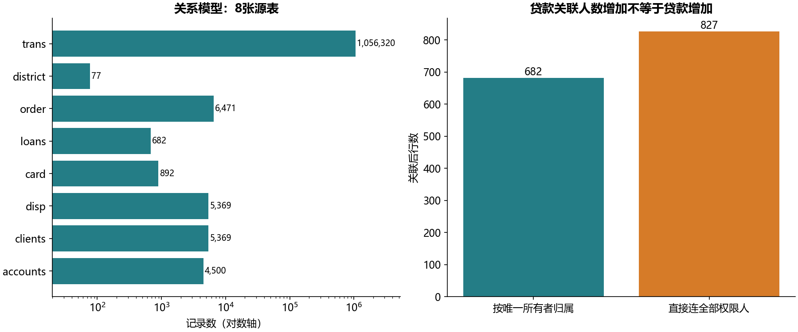
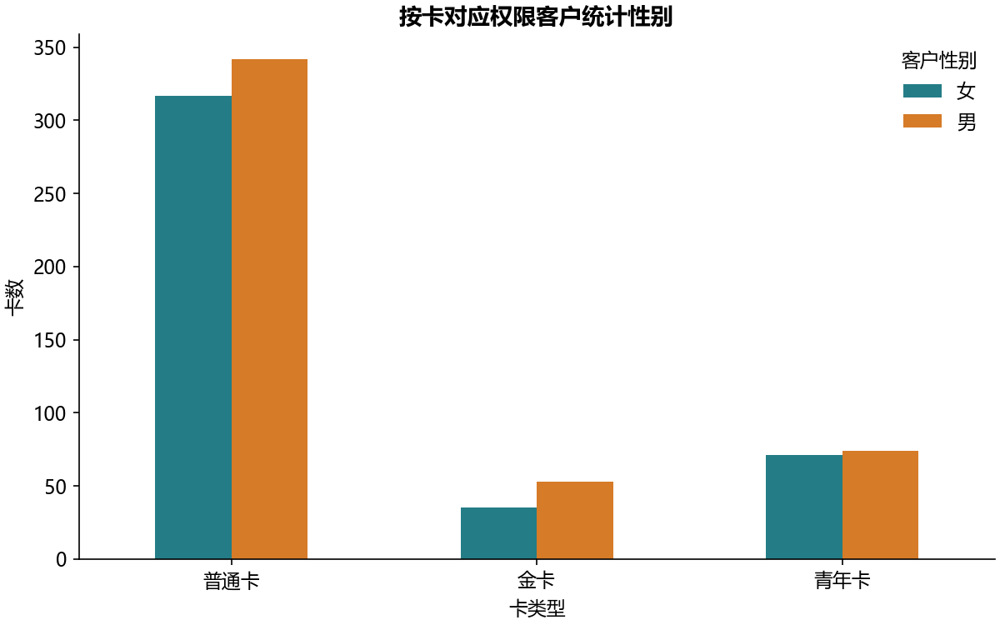
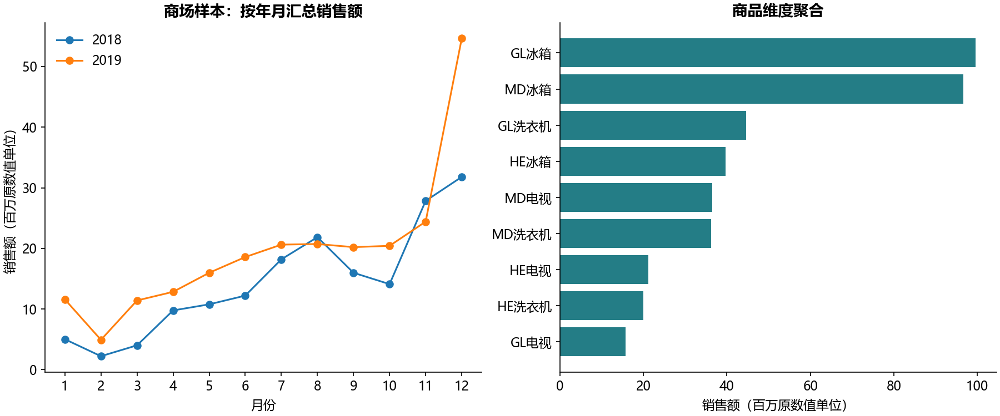

# B01 关系与维度数据模型

## 业务问题与数据粒度

本实验覆盖银行8表关系模型、商场6表维度模型和销售4表星型示例。银行4,500账户、5,369客户、1,056,320笔交易；全部8张表行数与教材数据库介绍一致，主键唯一、外键完整。课件中的“可以多个账户”等描述是模型能力，本样本的具体基数另作检查，不强行假设每个关系都有多个匹配。

## 三个关键实现

1. 卡通过disp_id对应具体权限客户，按卡类型、性别同时输出卡数及去重持卡人数；本样本892名持卡客户、4477名无卡客户。无卡客户不是未知性别或未知卡类型，不能把空白组当成一种卡。
2. 贷款先归属唯一账户所有者，再按贷款年度、所有者性别汇总，并与独立SQLite查询核对。若直接关联全部权限人，682笔贷款会成为827行，金额也被重复；它表示借助同一账户的关联人数，不能再当贷款笔数或按人可加的贷款额。
3. 交易、支付指令和贷款分别按account_id聚合后再关联。本样本直接把交易与支付指令连起来将得到1,858,450行。分地区输出在4500账户粒度保留所有事实总量。交易金额只按借/贷分别统计正量，未擅自改成净现金流，余额是存量不作求和；不同表的金额不是同一业务量。

## 维度模型与PowerBI迁移

商场12,960行销售记录的产品键为小写，产品维表为大写；只对该业务键统一大写后关联。产品名、品牌、类别逐项一致，但2075行的事实单价与产品维表单价不同（两个产品，见mall_price_differences.csv）。来源没有价格有效期，不能断定是历史调价或错误，更不能用维表价覆盖事实价。

逐一解析12,960个原乘法公式，其缓存均与所引用单元格一致；另按“本行数量×本行单价”核对时发现4处错误。I1587、I1588、I11238、I11239实际都引用下一行的G/H，缓存一致不代表业务公式正确。mall_formula_issues.csv保留4个坐标及原式/应有式，不执行任意Excel表达式。正式销售额按本行重算为410,068,720，源缓存合计410,116,740，差48,020个原数值单位。教材未明确货币单位，不擅自标注人民币。日期表730天，实际仅702天有销售记录，记录止于2019-12-30，不能把年度样本汇总解释为完整全年业绩。

mall_filter对应年份/月切片，按年月、城市、产品分组对应度量汇总。PBIX第二页有“平均值”配置但内部引用名仍叫Sum，因此结果同时保留每条记录销售额的均值与总额，避免仅按字段名误读；均值不是客单价，因为没有订单ID。创建模型示例保留原表金额（$M）单位，三个维度连接不改变2035行及总量，未与商场或银行金额相加。

原始CSV、工作簿和PBIX不改写；客户、账户、交易及商场销售行级结果仅在本地。公开输出为聚合表、图形、[模型图](schema.md)和[来源/迁移边界](source-map.md)。PBIX自动影响因素对象只记录配置，未声称复刻专有算法或验证PowerBI刷新后的界面。当前状态为运行通过，教材数字缓存核对与独立SQL控制有明确边界。
