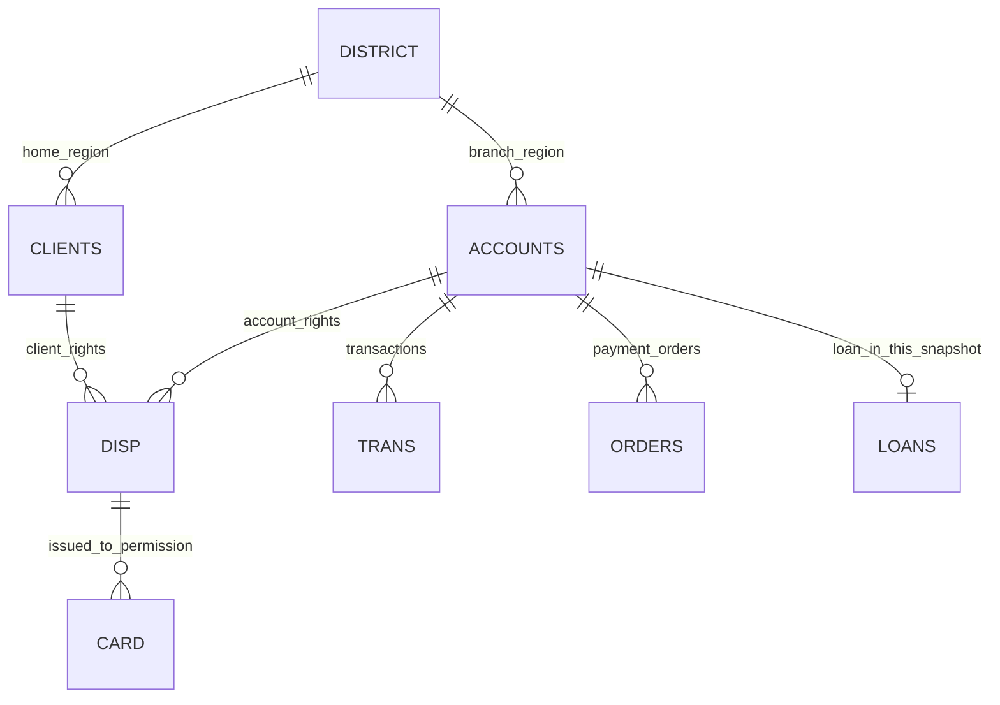

# 模型与粒度

主键不缺失且唯一。账户开户地区与客户居住地区是两种角色；不能混为一列。disp是账户与客户之间的权限桥。分析贷款按唯一“所有者”归属，分析卡按disp关联具体持卡客户。跨事实表先按account_id各自聚合，再一对一合并。

商场源表一行是销售记录，没有订单ID，不把日期/城市/商品组合强当主键，也不删除相同内容的记录。产品键按案例统一大写，连接产品→品牌/类别形成雪花维度；城市和日期直接连接事实。每次连接核查行数及销售额守恒。

创建模型示例中本次客户表与销售表的客户ID实际上都是唯一，样本表现为一对一；城市和产品则是一对多。理论模型的基数与这个具体样本的观察基数分别解释。
