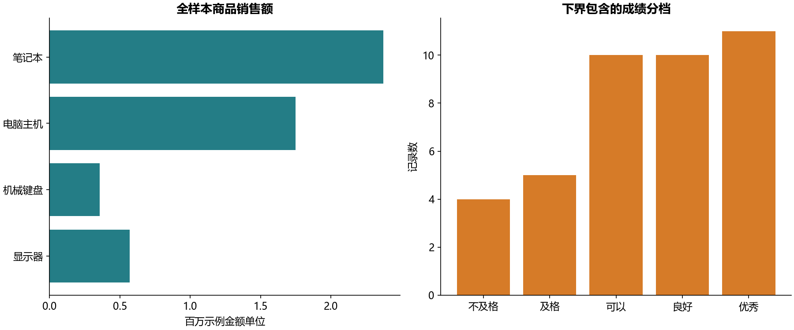
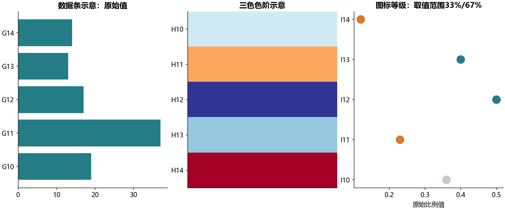

# B02 Excel与WPS函数、引用、透视

5个工作簿的全部31张工作表已映射为独立Python步骤。覆盖全部292个已保存公式单元格；其中随机数2格只生成新固定种子演示，不与旧随机状态逐值比较。另核对三个透视区域的数值，所有检查及确认差异见formula_checks.csv、cache_differences.csv。没有缓存答案的练习标记为运行与规则验证，不假装有参考数值。

## 发现并修正的教材问题

两个版本D7的公式不同：Excel基础文件是ROUND(C7,3)，结果21.346；WPS文件是ROUND(C7,1)，结果21.3。两者缓存都正确，不能把显示差异误判为错误。本次按各自精度用Decimal的ROUND_HALF_UP重算，避免把Python默认的银行家舍入当作Excel四舍五入。OR练习误把H列文字评价放进>=60判断，应检查E/F/G三门原始数值；本组9条样本修正前后恰好相同，不代表原式对其他分数也正确。合成边界样例验证三门都不及格必须返回未通过。本次确认的缓存数值差异0格，检查表仍保留原值、重算值和公式。函数定义参照[Microsoft ROUND文档](https://support.microsoft.com/en-us/excel/functions/round-function)。

水电气截图还存在错列：气费截图引用E3自身，水费引用C列电用量，电费引用D列气用量。本实验修正为B列水、C列电、D列气。截图的档位算法对全部用量使用一个档位价格，和分段累进收费不同；两种口径并列输出，不擅自把其中之一说成教材唯一答案或现实账单。只有案例给定的价和阈值，气费无分段阈值，按3.27计算；各项先舍入到分再合计。

## 查找、日期与透视的关键口径

精确查找先隔离字典中62条#VALUE!错误键，再检查有效键唯一及标签非空；错误标记不是一种商品编码。100条查询未匹配时保留缺失并计数，不默取重复键第一条。近似查找要求下界严格升序，60、70、80、90归入从该分值开始的档。INDEX/MATCH、OFFSET用实际坐标演示，灰色区域B6:D8与4个偏移练习均有结果。INDIRECT迁移为教材所给省市词表的依赖选择，不运行字符串代码，也不把旧行政区划当现行名录。

日期演示使用教材NOW快照2025-02-02 22:05:45，不是执行当天。WORKDAY从起始日之后计数，NETWORKDAYS包含两个端点；采用表中明确给出的2017-10-01至10-07假日，不补造其他调休。闰年含世纪规则、月末与EDATE按日历处理，手机号按题意隐藏第8至10位，明细仅留本地。

透视原始36行总金额5,049,500，数量2774。第一个人员透视在缓存定义中筛选销售地区济南，所以合计2,000,000，不是全表5,049,500；占比分母与筛选后的集合一致。另两个透视按商品、商品×地区汇总；交叉检查各小计与总计。公开人员汇总用S1/S2/S3匿名标签。

九九乘法表保留上三角空白与45个等式，全部81格对照；成绩40条以升序下界近似查找，频数FREQUENCY的区间则是上界包含，60分的频数位置与等级口径不同。函数清单和各步骤去向见function_map.csv，额外重复显示合并为说明。

## 条件格式的迁移边界

条件格式输出数值阈值、相对引用、偶数行和偶数值的布尔标记；G19<H19会随目标列平移，不能把一次比较结果复制给整行。图标分段按min到max范围的33%/67%，不是将数值直接与0.33/0.67比较。源同一H区间同时保存两套色阶，Python图仅作数据条/三色色阶/图标等级示意，未声称Excel交互或像素级复刻。切片器迁移为明确地区筛选，数据验证列表迁移为给定词表选择。全部来源保留只读，[逐工作表对照](workbook-map.md)说明实现范围。
