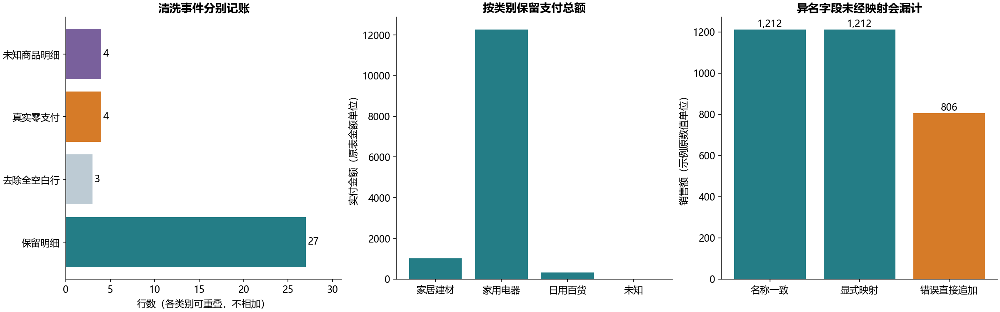

# B03 ETL清洗、拆列与合并

## 清洗不是删除所有异常记录

从“数据清洗示例数据”的第二行读取列名，保留Excel源行号。标题下30行中去除3条全空白行，保留27条明细。7个Excel错误单元格变为显式缺失并记录原坐标；4条真实零支付与零数量明细保留，未知商品并不自动等于无效订单。按订单号不能贸然去重，因为原表名是订单明细，没有完整业务行键；本次同订单号重复0条、完全相同明细0条。

金额从字符串严格转成整数分，不把解析失败改成0；日期列和year/month/day独立拼装核对一致。商品名称仅修剪首尾空白，不重写中间文本。源列“ip地址”实际含城市名、-911、其他或错误值；27条都不是有效IP地址。本实现保留原文本、另标记异常，不把它转成IP，也不把其他城市直接改成下单城市。

## 拆列保持源粒度

2行示例各有3个逗号分隔订单号，先横向拆成3列，分别把地址拆为省/市/区、数量拆为数值/单位、CamelCase名字拆成片段。另建6行订单桥，仅含源行号与订单号，不带数量。原8件和10本对应的是哪一订单、是否每单都有相同数量，教材未说明，不能展开后复制成24件和30本；也不把件和本混成一个总数量。地址规则只针对这两个省市示例，不是通用全国地址解析器；名字片段不当作已确认的姓/名。

## 横向关联与纵向追加

课程表、学生表先查唯一键，再用选课表作为事实进行many_to_one连接。13条选课、7名去重学生，0名学生无选课；课程通过率按选课记录为分母，不把总选课行数叫总学生数。姓名、手机号和逐人分数仅留本地。

季度追加保留8条原记录；异名示例明确将“金额”映射为“销售额”，与同名示例结果逐值相同。若直接concat，第二季度的4条销售额落入另一列，sum会漏掉406；正确合计1212，错误分支806。两文件门店A1与A等未提供关系，不擅自统一编码。

5个工作簿的全部11张工作表（含2张空表）见[迁移对照](workbook-map.md)。本章课件第24至26页的合并列、提取、拆列、合并及追加分别落实到这些函数；没有数据分配规则的地方不伪造答案。原件只读，公开聚合结果及过程说明，明细和订单桥只留本地。
