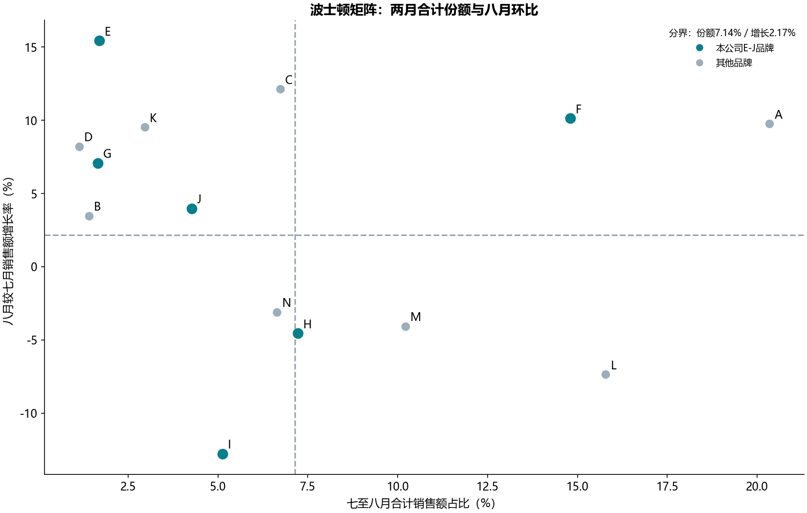

# B04 波士顿矩阵

## 结果与业务问题

原始9,284笔销售，覆盖14个品牌。七月市场销售额284,939.00元，八月291,129.60元，市场环比2.1726%。本公司有E、F、G、H、I、J六个品牌。

按本例阈值：E：问题产品、F：明星产品、G：问题产品、H：金牛产品、I：瘦狗产品、J：问题产品。这是一组销售位置标签，无法单凭两月销售判断利润或资金回收，不应直接据此退出某个品牌。

## 教材迁移口径

单笔金额=单价×销量，先转整数分再汇总。横轴为七八月合计销售额/两月全市场销售额；纵轴为八月/七月销售额-1。不同规格销量不直接相加比较市场份额。

份额分界为14个品牌的平均份额7.1429%，增长分界为市场环比2.1726%。这遵循本教材的销售额份额定义，不改写成“相对最大竞争对手份额”。等于阈值归高是本实现明确约定；教材没有边界样本可供标签核对。

## 核对与限制

14个品牌的份额和环比共28项，以及两条数值阈值，与参考答案缓存一致（浮点容差1e-12）。参考未提供可读取的逐品牌象限标签，标签依据公开说明的规则计算，不能声称该部分也逐标签对账。

若前期销售为0，增长率不可比较，标“无法比较”，不填0或无穷大。当前数据只覆盖两个月，不包含利润、推广成本和长期市场潜力。完整聚合见brands.csv，原始材料保持只读。
