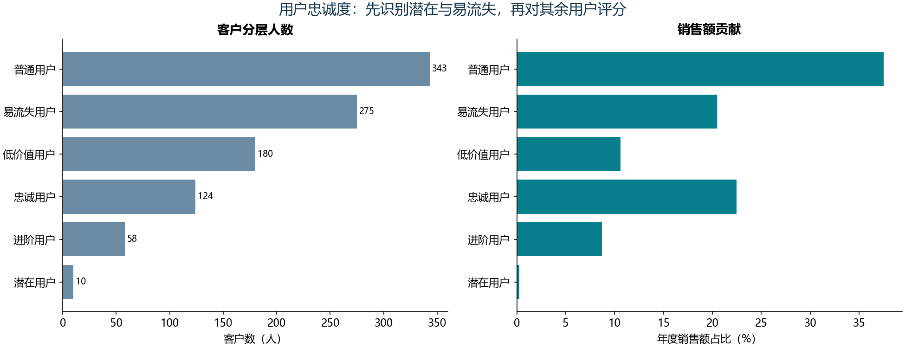

# B06 用户忠诚度模型

## 结果

2020年共80,111条商品明细，5,001笔订单，990名会员，金额4,044,576.00元。分析时点2021-01-01。潜在与易流失会员先单独识别，其余705人按年度消费次数、年度消费金额评分。

## 规则与参考核对

F按不同订单编号计数，M按商品明细金额求和。潜在用户在最近13周之前无消费、最近13周只有一笔订单；易流失用户最后消费日在边界之前。排除这两类后，F的25%/75%分位数为4/7，M为3198/5724元。

低于下分位数计1分，高于上分位数计3分，等于边界计2分。F+M总分6/5/4/2至3分别对应忠诚/进阶/普通/低价值用户。不是把最近13周的消费金额当成年金额。

全部990名会员的类别与参考一致；其余705名可评分会员的F、M、两项分数和总分逐项一致。客户级对照仅留本地，公开目录只有聚合表。

## 13周边界的原始差异

边界为2020-10-02。原Excel用“消费日期>边界”判断近期，却用“最后消费日期<边界”判断易流失，两处对等于边界的处理不对称。为保证可核对，主结果忠实保留这两条公式。

另计算一致的[边界日,分析日)近期窗口作敏感性检查，产生0名会员标签变化。这个结果单独记录，不悄悄替换教材结果；用于实际业务前应先确认窗口定义。

## 业务解释

标签描述本观察期的行为结构，不能直接当作客户终身价值或真实流失标签。对易流失用户的召回、潜在用户的培育都应另做效果验证；缺少利润与营销成本时不直接断言投入回报。
