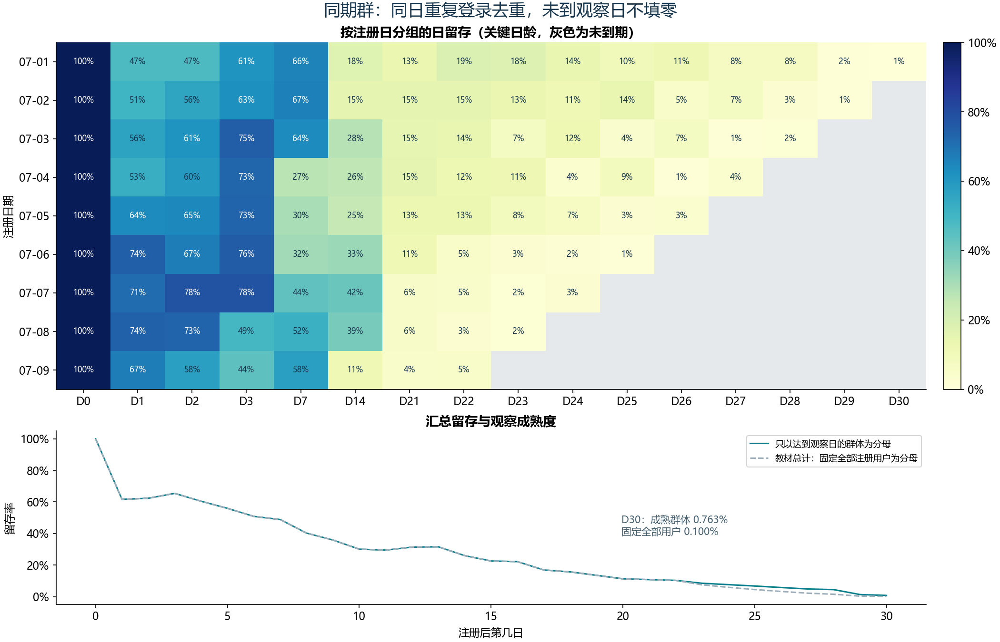

# B07 同期群日留存

## 结果

资料有13,102条登录记录、1,001名可识别注册用户。同一用户同日登录去重后为8,794条用户日记录，分为9个注册日期群体。活动期为2020-07-01至07-09，观察截止2020-07-31。

## 定义与参考核对

日留存=该注册群体在注册后第d日登录的不同用户数/该群体注册人数。首日为D0，次日为D1，不能把同日多次登录计为多人。注册日期不一致、登录早于注册会报错。

活动期间的每日注册/登录人数、243个已观察的群体日留存单元，以及教材固定分母的31个总计值均通过对照。36个尚未到期的群体日格子保留为空；已到期但没有登录才填0。

## 对总计分母的补充

教材总计行将所有1001名注册用户固定作为每个日龄的分母。到D30，只有7月1日注册的131名用户达到观察日。固定分母结果为0.0999%，按成熟群体计算为0.7634%。两条口径都保存，后一条用于跨日龄汇总，避免把未到期群体算成流失。

## 解读范围

日留存不要求每天单调下降，用户可以间隔几天后回来。曲线变化本身不能证明促销或竞品活动的因果影响。当前分母来自登录资料可识别用户，没有独立注册总表，无法验证完全未登录用户是否被遗漏。完整31日群体矩阵和两种汇总口径见CSV聚合结果。
