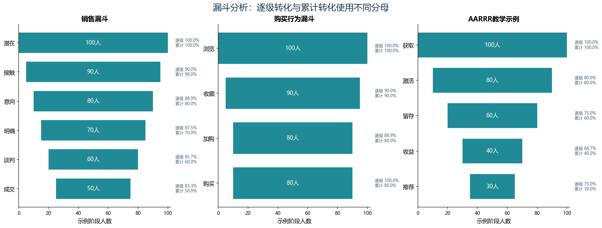

# B08 转化漏斗

## 三组教学结果

- 销售漏斗：100名潜在用户到50名成交用户，累计转化50%。
- 购买行为：100名示例浏览用户到80名购买用户，累计转化80%。
- AARRR示例：100名获取用户到30名推荐用户，累计比例30%。

## 计算方法

逐级转化=本阶段人数/上一阶段人数；累计转化=本阶段人数/首阶段人数。比如销售漏斗的“意向”阶段为80/90=88.89%，累计是80/100=80%，两者不能混用。首阶段在分母非零时为100%。分母为0时明确保留不可用，不把0/0填为0%。

居中漏斗使用(首阶段人数-本阶段人数)/2作为绘图占位，对应Excel的透明堆积辅助列。

## 参考核对与限制

销售漏斗的6个阶段，对人数、逐级转化、总体转化和绘图占位共24项逐项核对参考缓存。另两组练习只有原始阶段人数，没有配套答案，不声称它们也通过参考答案核对。

资料是汇总教学人数，没有逐用户事件路径。递减数量不能证明每一级都由上一级同一批人进入，AARRR也不是天然严格嵌套的路径。因此这些比率是给定示例的算术展示，不能用来推断真实客户的逐级条件转化或归因。实际业务需要核对用户集合、阶段顺序、去重和观察窗口。
