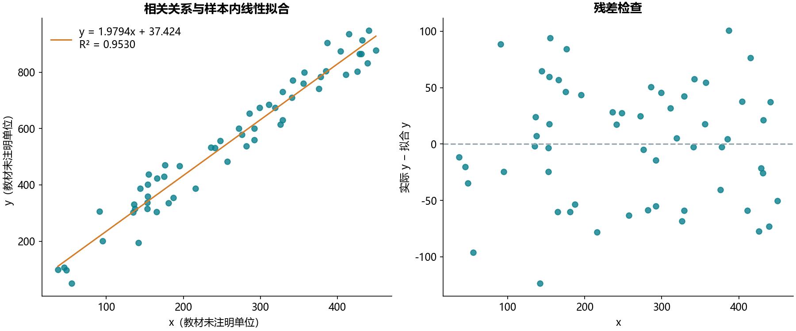

# B09 相关分析与线性趋势

## 结果

教材给出58对x/y观测，没有行业、采样时间或单位字典。Pearson相关系数为0.976229，Spearman为0.975144，Kendall为0.869171。

线性拟合为 **y = 1.979437x + 37.423900**，样本内R²为0.953023。这说明本样本中存在较强正相关，不能解释为x变化导致y变化，也不能把样本内R²当作预测集表现。

## 从Excel迁移

Excel散点图的线性趋势对应scipy.stats.linregress。相关系数描述共同变化，斜率描述x每增加一单位时拟合y的变化，截距是x=0的拟合值。只有在适用范围内解释截距才有意义。另计算两种秩相关以说明线性关联与单调关联的区别。

原始与参考表的全部116个输入数值一致。参考图仅显示四舍五入后的斜率、截距与R²，因此只按各自显示精度核对这3项，不能宣称有完整精度的参考系数。Pearson和两种秩相关没有单独参考答案。metrics.csv保留本实现完整精度，行级拟合值仅留本地。

缺失、非有限值和常量变量会明确报错，避免自动删行改变样本范围。这里没有划分训练测试集，也没有进行因果识别或样本外预测。
