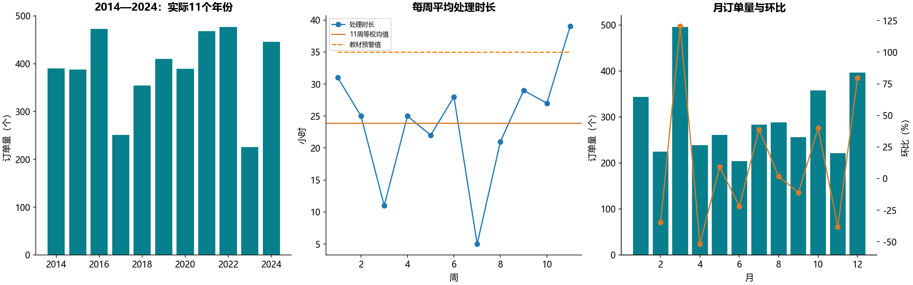
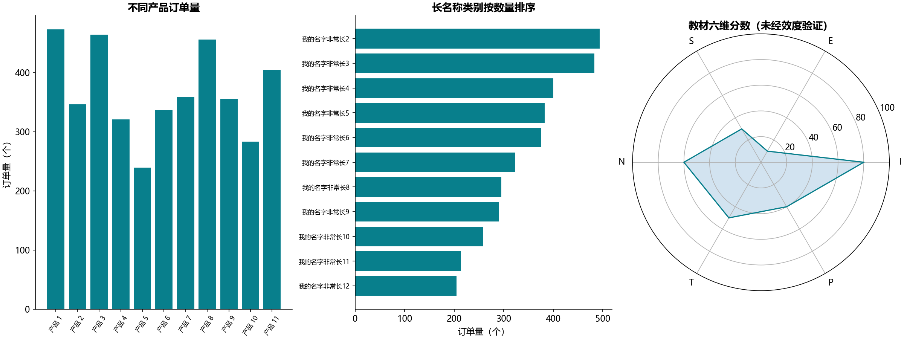
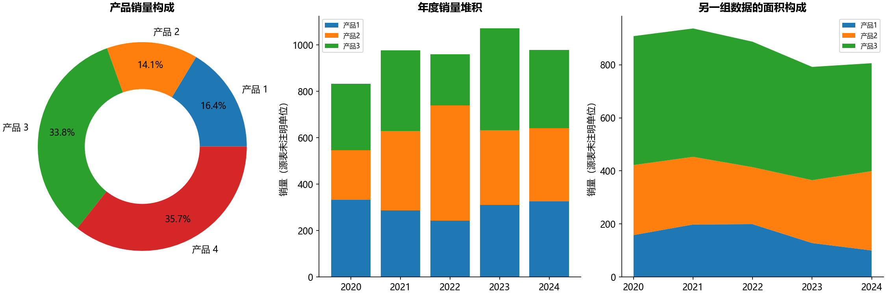
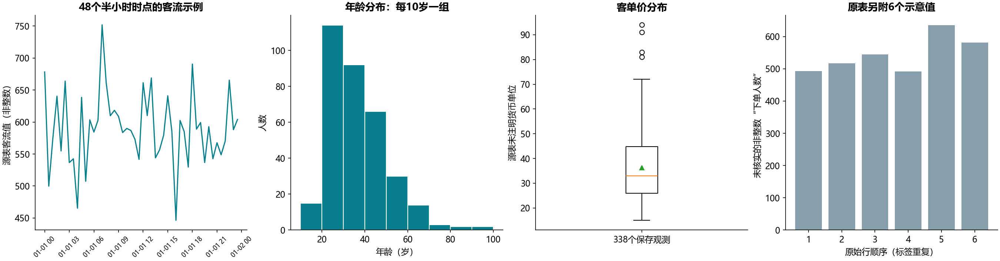
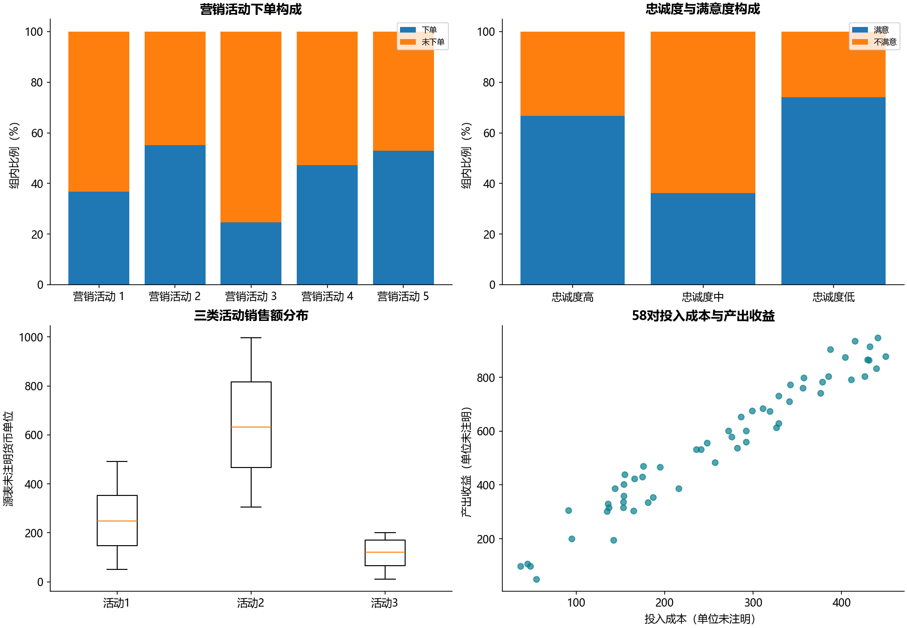
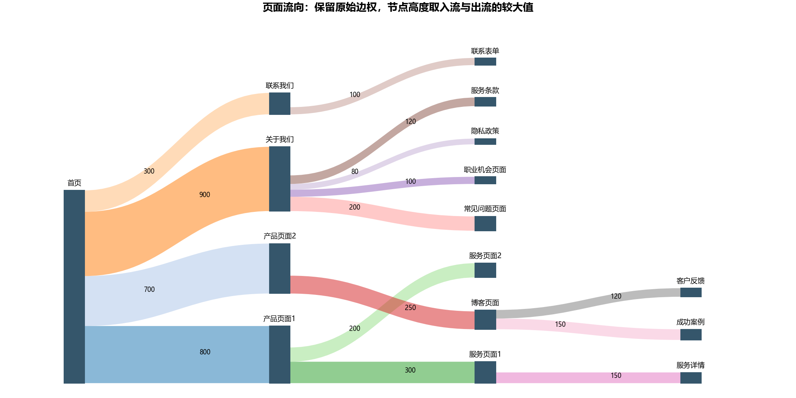

# B10 六类分析方法

## 教学范围与来源

完成6份原始工作簿中的18组数据区域，以及5份参考工作簿的快照与公式检查；13张工作表均有去向，其中桑吉图的Sheet2、Sheet3为空。详见[工作表对照](workbook-map.md)。参考文件把“分布”和“构成”的3/4编号交换，按内容配对。

这些是描述分析练习。带RANDBETWEEN的保存值作为固定教材快照读取，本次不重新抽样，也不当作真实经营观测。原表与参考表共比较1332个数字单元，410个不相同；差异包括随机值及其依赖均值、环比，不把不同快照强行对齐。

共覆盖838个保存公式：60个均值、环比与分位数公式独立重算符合各自缓存；778个随机公式仅检查整数及上下界，没有逐值复现随机序列。snapshot_summary.csv按题汇总差异，formula_checks.csv记录公式坐标和检查类型；包含逐格输入值的snapshot_comparison.csv仅留本地。

## 趋势与对比

原标题写“近10年”，实际为2014—2024共11年。周均处理时长为23.909091小时，最长39小时，比等权均值多15.090909小时。每周工单数未给出，不能解释成全部工单的加权均值。环比为本月/上月−1，首月未知；上月为0时保留未知，不填0。月序与week1—week11按数值顺序，避免按量排序或字典序。

产品比较保留11类；长名称用水平条形图；雷达图六维I/E/S/N/T/P按原表顺序保留，不额外推断人格或营销标签。

## 构成与分布

产品构成为各产品销量/同表总销量。两组年度构成是不同随机快照，堆积柱图与面积图分别使用各自区域，不混用。量与比例不在同一轴上混画。

年龄与客单价各338条，未因两列数值相似就假设为独立采样或合并。客单价均值36.215976，Q1=26.00、Q3=44.75，IQR=18.75，上界72.875；采用与QUARTILE.INC相同的线性分位数。箱线图标记4个界外值，保留观测，不自动删异常。原表货币单位未知。

客流是48个半小时时点的非整数值。B54:C59另有6条“年龄/下单人数”示意，年龄标签重复且人数为小数，单列展示，不把它冒充338人年龄分组统计；实际直方图直接从逐人年龄计算，左闭右开、最后一组含右端点。

## 关系与流向

下单/未下单、满意/不满意按各组总数算比例。三次活动销售额使用98条保存行；原ID有跳号，未补造客户。成本收益有58对观测，只作散点关系，不推断因果、利润率或营销增量。

桑基图保留15条边。首页出流2700；博客页面入流250、出流270，多出20，来源未解释，不能把全图当作同一批用户的严格守恒漏斗。其他节点的净减少也没有事件时间或退出字段支持，不直接称为流失。flow_balance.csv列出全部节点。本图按max(入流,出流)绘制节点，保留差额，不补造来源。

## Power BI 对照边界

两份PBIX的33个视觉容器逐项登记在pbix_visual_map.csv（08版16个、09版17个）。queryRef的CountNonNull字样可能是旧名称：年度图的Function=1实际为Avg，长名称图Function=0为Sum；按保存配置解释。聚合枚举见[微软表达式说明](https://github.com/microsoft/skills-for-fabric/blob/main/skills/powerbi-report-cli/references/authoring/expressions.md)。

PBIX中的产品类别/订单量箱线图和渠道/流量箱线图未提供同结构的独立Excel表，分别用本节Excel的客单价、活动销售额完成相应方法教学，并明确标记来源差异。二进制DataModel未解码；因此本实验状态为运行通过，只对报告所列Excel快照与60项确定性公式作核对，不宣称PBIX全部数值或第三方插件像素复现。
