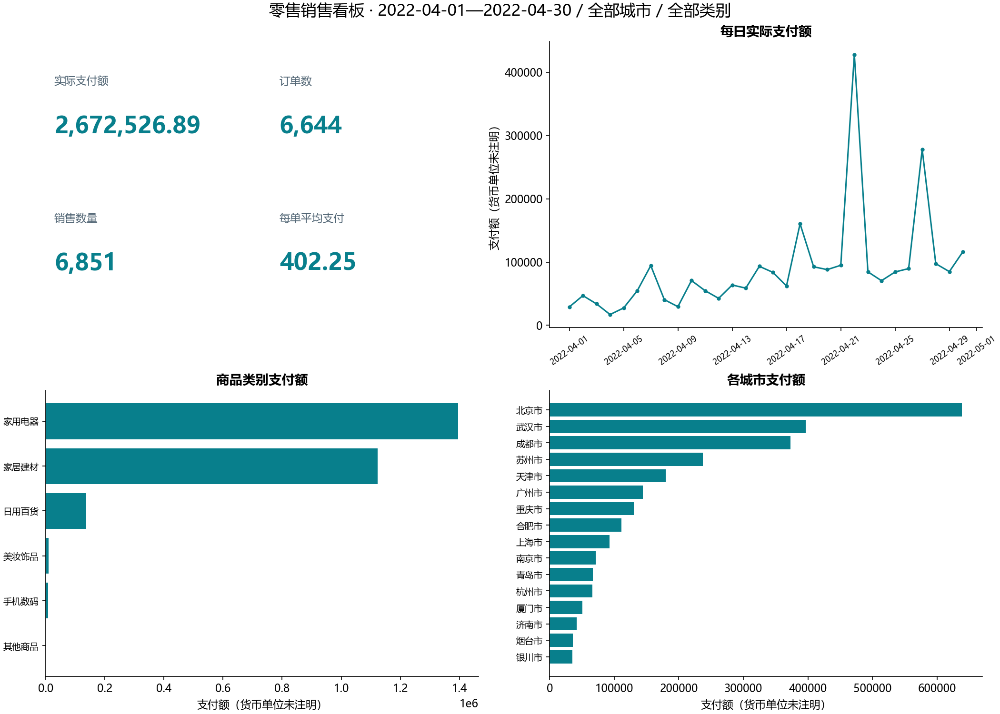

# B11 基础零售销售看板

## 范围与结果

配套零售订单表共6644行、6644个唯一订单、7个字段，时间为2022-04-01 00:05:08至2022-04-30 23:47:38，包含16个城市、6个商品类别；无缺失、无重复订单号、无完全重复行。当前筛选为`{"start_date": null, "end_date": null, "city": null, "category": null}`，选中6644行。

| 指标 | 当前结果 | 定义 |
|---|---:|---|
| 实际支付额 | 2,672,526.89 | 逐行实际支付求和，不再乘数量 |
| 订单数 | 6,644 | 订单号去重计数 |
| 非空订单号计数 | 6,644 | 与PBIX保存的Function=5配置对应 |
| 销售数量 | 6,851 | 数量求和 |
| 每单平均支付 | 402.246672 | 当前支付额/当前唯一订单数 |

金额按整数分计算后展示，不假设未注明的币种。20条零支付记录保留；没有订单状态、退款或成本字段，不能把零支付自动当成取消，也不推断净收入、利润或转化率。



[打开离线交互看板](dashboard.html)：下载后用浏览器打开。内嵌全量日期×城市×类别聚合数据，筛选日期、城市、类别会同步更新4个指标和3组明细表。GitHub文件预览不会执行HTML。该页面默认全量，独立于本次CLI筛选；本报告及PNG、CSV使用上述CLI范围。

## 迁移与筛选口径

PBIX两页9个视觉容器全部映射在pbix_visual_map.csv。支付额与数量卡片按Sum；订单号卡片queryRef为Min(sheet1.订单号)，实际Function=5为CountNonNull，并非最小订单号。枚举依据[微软表达式说明](https://github.com/microsoft/skills-for-fabric/blob/main/skills/powerbi-report-cli/references/authoring/expressions.md)。本版本每行一个唯一订单，因此非空计数与去重计数都为6644（全量）。未来多商品明细必须重新审查，不能直接相加分组订单数。

源柱图标题写“各城市支付额”，字段却是商品类别/商品名称，Python按字段命名为商品类别支付额；商品级下钻products.csv仅在本地输出。源地图只有城市名，没有坐标，改用城市排序条形图。源日期层级迁移为显式日期列，可按年、季度、月份再汇总；默认按日展示。二进制DataModel未解码，未宣称参考PBIX显示值已逐项对账。

CLI日期用YYYY-MM-DD，结束日包含全天，以次日00:00为排他上界。所有指标、每日、类别、城市、商品表共用同一筛选。无匹配订单时支付与数量为0，每单平均支付保持未知。原始输入只读，重复明细、空值、非整数数量和超过两位小数的金额都会报错，避免静默改口径。

## 验证边界

12项分组守恒检查全部通过，支付额以整数分精确相等。独立从原始支付列累加核对全量总额；这些是输入及内部计算检查，没有独立参考答案，因此状态为运行通过。工作表去向见[工作表对照](workbook-map.md)。订单明细和商品下钻表不公开。

```powershell
python labs/cda1_business/b11_retail/main.py --start-date 2022-04-01 --end-date 2022-04-07 --city 广州市 --output-root outputs/filtered
```

生成的过滤结果写入单独目录，默认全量公开报告使用无筛选运行结果。离线HTML用相同日期边界与分母；不同商品可分属同一订单时，必须先改变聚合模型，现有脚本会拒绝该数据版本。
