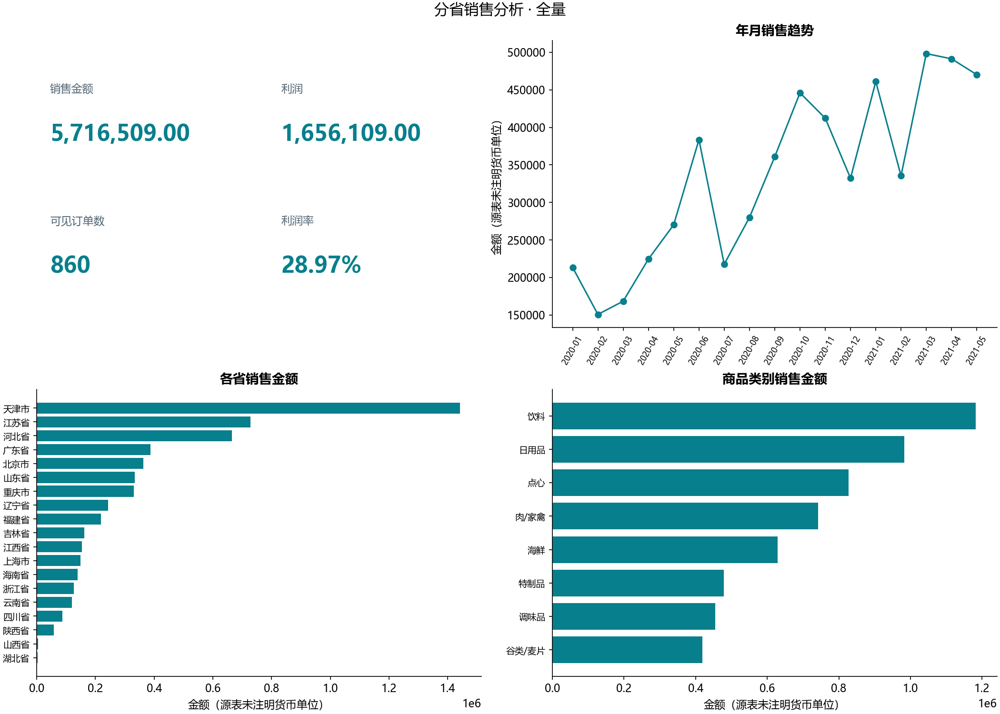

# B12 分省销售分析

从订单头、商品明细、商品、类别和雇员五张CSV表建立星型分析。订单头860行、明细2185行；商品按ProductID连接，两个同名商品不能按名称合并。源明细列“产口ID”显式映射为product_id，未改原文件。

## 当前范围与结果

筛选：`{"year": null, "month": null, "province": null, "category": null}`。所有Python指标及维度表共用当前可见明细；年份与月份用数值字段，趋势保留年月。

| 指标 | 结果 | 定义 |
|---|---:|---|
| 销售金额 | 5,716,509.00 | 明细销售金额合计 |
| 销售成本 | 4,060,400.00 | 明细销售成本合计 |
| 利润 | 1,656,109.00 | 销售金额−销售成本 |
| 可见订单数 | 860 | 当前明细订单ID去重 |
| 利润率 | 28.970636% | 合计利润/合计销售金额 |



金额用整数分，货币单位源表未注明。类别/商品订单数可能交叉，不把各类去重订单数相加当总订单数；各省、月份也分别计算去重订单数。商品层下钻表保留product_id，名称重复不误并。

## 关联与来源问题

订单明细→订单头→雇员及明细→商品→类别均为多对一，禁止维度重复键、关键关联缺失及空主键。雇员维表缺少的员工涉及201单，保留订单和金额并标为“雇员维表缺失”，不内连接删单。诊断见missing_employees.csv。订单头按主键验证唯一，不把头表数量按明细行重复计算。

PBIX共11个容器全部映射。保存的年份切片器选择2020，而折线还保存了2020年第三季度August的局部筛选；这两个范围不同。pbix_saved_states.csv保留实际过滤状态，saved_scope_metrics.csv分别重算两个范围。默认Python展示全部输入年份，显式参数可选原范围，不将局部折线伪装成全年趋势。

源订单数卡片用头表OrderID非空计数；分类筛选是否反向传播到头表依赖二进制模型关系，未解码确认。Python明确定义为当前可见商品明细涉及的去重订单，不宣称所有筛选下与原卡片等价。sales/利润计算列在PBIX中没有可读取公式，因此用已提供销售金额、销售成本作透明定义，不假定税费、退款或折扣。源矩形树图迁移为便于比较的省份水平条形图。

## 验证与运行

18项检查通过：SQLite独立汇总金额/成本/去重订单，五组维度表各三项金额守恒。没有独立参考数值，状态为运行通过。原始表、雇员姓名和选中订单明细只留本地。

```powershell
python run_labs.py --lab B12
python labs/cda1_business/b12_province/main.py --year 2020 --month 8 --output-root outputs/filtered
```

支持--year、--month、--province、--category。无匹配时合计为0、利润率未知；筛选结果使用独立输出目录，公开报告只接受无筛选全量运行。
