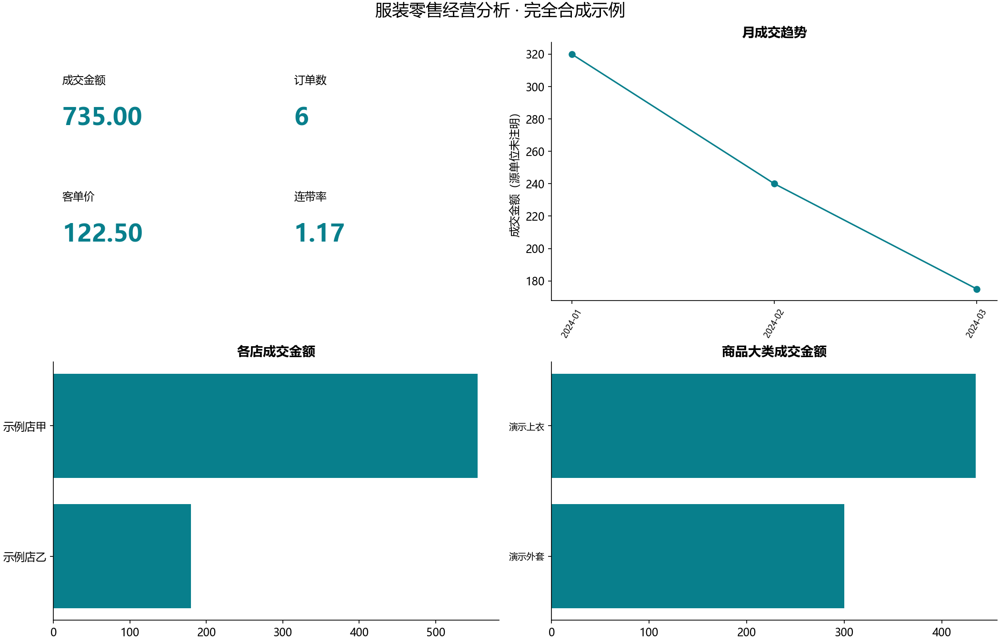
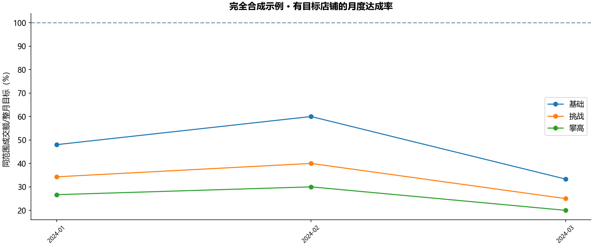
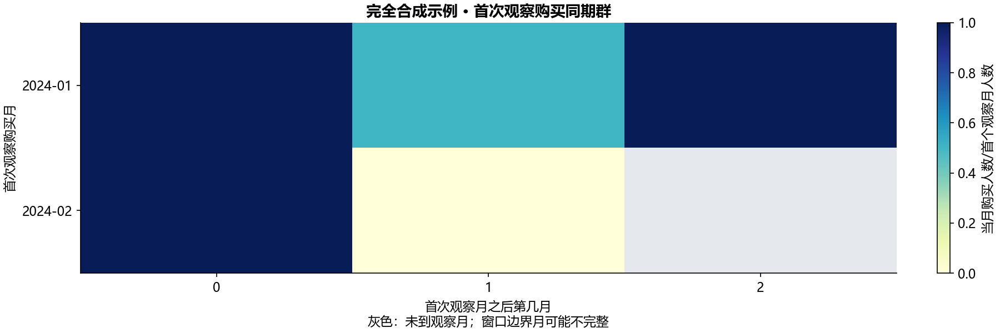

# B13 服装零售经营分析

本实验已用本地配套数据运行，完成订单/明细星型关联、经营指标、同星期日比较、店铺与员工月目标、首次观察购买同期群。资料中的传播限制适用于原数据及案例内容，因此真实业务结果、原图、逐人信息和原说明文件均留在本地outputs/B13。此公开报告中的图与表完全由代码内的独立合成输入生成，不是教材真实结果，也不作为教材参考答案。

## 模型与计算口径

订单头以order_id唯一，明细以detail_id唯一。先逐订单核对数量、吊牌金额、成交金额，再把店铺、员工及SKU/款号/品牌/大类/年份/季节/颜色/尺码作为多对一维度关联。空会员ID表示非会员，不计成一个“空会员”；空销售人员与维表未匹配分开记录。订单所属店铺来自订单，不被员工当前登记店铺覆盖。会员联系字段不参与模型或输出。



成交金额与吊牌金额按整数分汇总，折扣率为合计成交额/合计吊牌额，不平均逐行折扣。会员人均消费只以非空会员ID涉及的成交金额/去重会员数计算；客单价以总成交额/去重订单数计算；件单价以总成交额/件数；连带率以件数/订单数。数量与明细行数不同。坪效按所选店铺维表面积合计，面积只计一次。无分母时保留未知。

同星期比较对比指定日期与7天前：金额及人均/单均价格用相对变化；人数、单数、件数、连带率用绝对差；折扣率用比例差，显示为百分点。报告“环比”不混用日差、周总额和月变化。源PBIX中的会员成交额卡片字段与截图的人均标签存在差异，因此两项指标分别计算，不由标签猜测DAX。

## 月目标与同期群

月目标只按month×store_id或month×employee_id与相同粒度实际成交关联。目标不连接到订单明细逐行相加。无目标保持未知，目标为0时完成率未知；仅在输入时间窗口内，有目标而没有销售的月份实际为0，窗口外保持未知。边界月是否被输入日期覆盖整月另行标记，不擅自按日分摊目标。三个目标名称遵循源字段，不替换层级。月度目标图只汇总有目标的主体，分子与分母是同一主体范围。



同期群以文件内首次观察到的会员购买月份为基准，每会员每月只计一次；后续购买人数/该首月人数为同期群月复购比例，第0月是群体基数。会员注册日或累计消费字段不替代首次观察购买日。观察窗口之前的购买历史未知，因此不能称为真实终身首次购买或新客获取。未来月份保持未知，末月是否完整另有标记。



## 异常、验证与边界

逐订单三项金额/数量守恒、维度唯一键、必需外键和分组金额守恒均在真实数据运行中检查。逐行保存折扣与成交/吊牌比例的差异、折扣大于1、标准价×数量与吊牌额不一致均进入本地诊断，保留原成交事实，不静默裁剪到100%或以维表价格覆盖。成本不在本次经营指标中推断利润。

原始文件的重复副本按SHA-256确认一致，仅计算一次；两份说明和两份原表的工作表都登记在[迁移对照](workbook-map.md)。Power BI容器映射留在本地；装饰、导航与内嵌模型不是额外实验。二进制DataModel未解码，不宣称全部DAX或像素复现。参考截图的同日指标与店铺周范围使用不同筛选，实际核对记录保留本地；公开状态为运行通过。

```powershell
python run_labs.py --lab B13
python labs/cda1_business/b13_apparel/main.py --as-of YYYY-MM-DD --output-root outputs/review
```

as-of仅选择“当日与7天前”的比较日期；月度目标及同期群仍使用完整输入，不用某一天的成交额冒充月度目标完成率。本地local_report.md、private_summary.json及相关CSV包含真实结果，文档构建器只发布明确允许的合成结果与方法报告。
