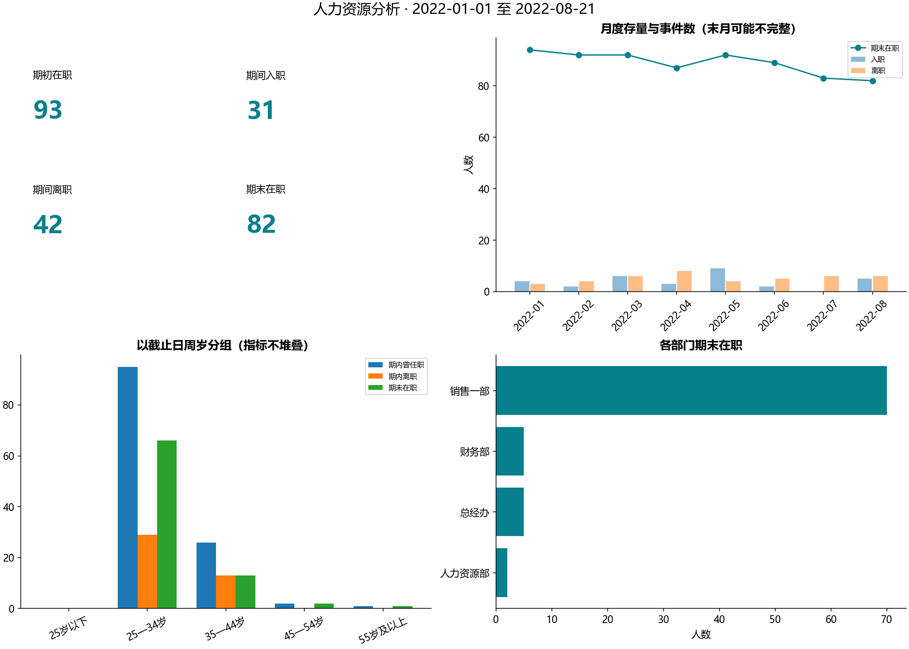

# B14 人力资源分析

## 范围与结果

源履历共200名不同工号员工。默认开始日期读取PBIX保存的切片器，截止日期冻结为最后一笔入/离职事件；本次为2022-01-01至2022-08-21，部门筛选为全部。事件截止不等于完整经营观察期，末月明确标记，不用运行当天日期外推。

| 指标 | 结果 | 定义 |
|---|---:|---|
| 期初在职 | 93 | 开始日前入职，且尚未在开始日前离职 |
| 期间入职 | 31 | 入职日期在闭区间内 |
| 期间离职 | 42 | 离职日期在闭区间内 |
| 期末在职 | 82 | 截止日已入职，离职日为空或晚于截止日 |
| 期内曾任职 | 124 | 期初人员与期间新入职人员的并集 |
| 在职人天 | 21013 | 每日收盘在职人数累计 |
| 平均每日在职 | 90.184549 | 在职人天/区间自然日数 |



## 日期与分母

采用任职区间[入职日,离职日)，离职当天不计日末在职；同日入离职两类事件都计数，日末在职及暴露可为0。期初+入职−离职=期末，在各月和各维度均核查。源“员工状态”只是源快照，不直接用于过去时点。源状态与日期不一致共0条，保留诊断，不以状态覆盖事件。

最后一个月离职6人，上个已展示月为6人；相对变化为0.0000%。末月可能只覆盖到某一天，不能当作两个完整月的同比表现。monthly_workforce.csv保留完整月标记。period_exits_per_average_headcount另作明确描述的区间事件/平均存量比，不年化，也不解释成个人离职概率。

年龄使用截止日周岁，按25岁以下、25—34、35—44、45—54、55岁及以上分组；2月29日出生在非闰年到3月1日递增。年龄分组边界是本实现明示约定，原PBIX未公开计算式。任职天数遵循同一日期区间，未来尚未入职者不填0。源部门没有变动历史，只能按提供部门标签分组，不推断历史转岗。

## 迁移和验证

PBIX6个容器均有去向，明细表仅写入本地employees_private.csv。未解码DataModel中的DAX，因此“员工人数”等未提供公式的源度量不冒充已逐值复现。Python分列来源总人数、期内曾任职和事件人数，避免混同存量与流量。

每日逐人枚举与区间人天独立核对，月份期末/下月期初连续，四组维度的六项指标守恒。没有独立参考数值，状态为运行通过。姓名、工号、生日、个人离职/任期数据不公开；公开只有聚合结果和方法。

```powershell
python run_labs.py --lab B14
python labs/cda1_business/b14_hr/main.py --start-date 2022-01-01 --end-date 2022-06-30 --output-root outputs/filtered
```

可选--department。截止日不得超出提供事件边界。筛选运行使用单独输出目录，公开报告只使用默认范围。
