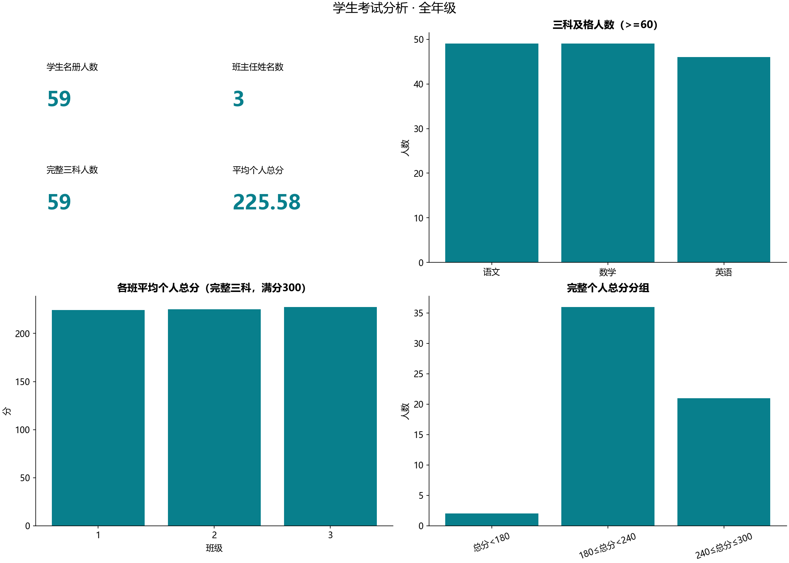
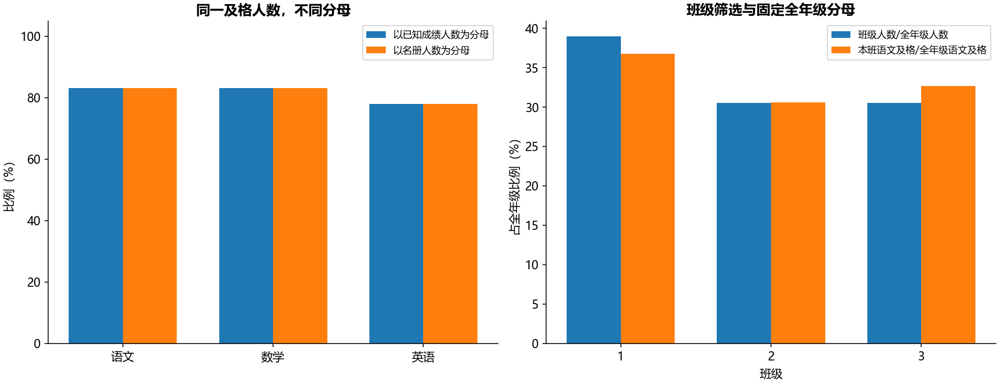

# B15 学生考试多表分析

## 范围与结果

输入为一张学生名册、一张班主任表及一次三科考试快照；没有考试日期或考试ID。按学号一对一关联成绩，再按班级多对一关联班主任。本次班级筛选为全年级，名册59人、考试记录59条、完整三科59人；不同班主任姓名3个，源无教师ID，姓名数不推广为真实唯一身份计数。

| 科目 | 已知成绩 | 缺失/缺考 | 及格 | 已知成绩及格率 | 占名册比例 |
|---|---:|---:|---:|---:|---:|
| 语文 | 59 | 0 | 49 | 83.0508% | 83.0508% |
| 数学 | 59 | 0 | 49 | 83.0508% | 83.0508% |
| 英语 | 59 | 0 | 46 | 77.9661% | 77.9661% |



平均个人总分为225.576271，按完整三科学生计算、满分300；另有所有已知单科成绩的均值，两个分母不同，不混称“平均分”。各科0—100分、>=60及格是本实现明示规则。

已知至少一科不及格24人、已知三科全及格35人、尚不能判断0人。多科不及格可能属于同一学生，不能把各科不及格人数相加当作总人数。

## 缺失、区间与排名

无成绩不填0、不当成不及格；任何已知科目低于60可确认至少一科不及格，剩余科目缺失且尚无失败时结论未知。只有三科齐全才算总分并进入总分段。总分段明确为<180、[180,240)、[240,300]，不是另行定义“三科全部及格”。

并列总分采用竞争排名：1、1、3；完整全年级排名在筛选前算，选中范围排名在筛选后重算，两者均留在本地ranking_private.csv。多次考试没有日期无法选择最近一次，因此学号重复记录明确报错，不求和或猜测最新记录。

语文60—80、数学60—90的文字标题未公开DAX端点，query_examples.csv同时给出双端包含与不含上端点的结果。任意科不及格与“语文>80且任意科不及格”分别计算，不从计算表名称猜测隐藏公式。1班或3班使用集合包含，其补集明确为不属于两班。

## 筛选上下文与验证



班级占全年级比例及本班语文及格占全年级语文及格比例，分母固定来自完整名册；当前范围与1班交集和移除班级筛选后的1班人数分别展示。语文及格人数用掩码、筛选去重及SQLite三种方法交叉核对，不把这些新增等价实现冒充原DAX的三个版本。

原PBIX20个容器均有迁移去向。保存的Basic切片器有2/2数值边界，但未见显式成员过滤，不能仅据此认定原报告默认已选2班。内嵌DataModel未解码，所以最高/最低/平均分、分组、排名和重复及格度量均明示Python定义，不宣称完整DAX逐值复现。

生日数值按源工作簿日期系统解码，不当Unix时间或普通整数；源1900日期系统的虚构1900-02-29会明确报错。没有考试日期，不计算考试年龄。公开只含聚合表和新图，学生/教师姓名、学号、生日、逐人成绩和排名均留本地。班级差异是该快照描述，不用于推断教学因果或学生长期能力。状态为运行通过。

```powershell
python run_labs.py --lab B15
python labs/cda1_business/b15_exams/main.py --classes 1 3 --output-root outputs/filtered
```

筛选运行写入独立目录，公开报告仅使用无班级筛选的完整名册。
