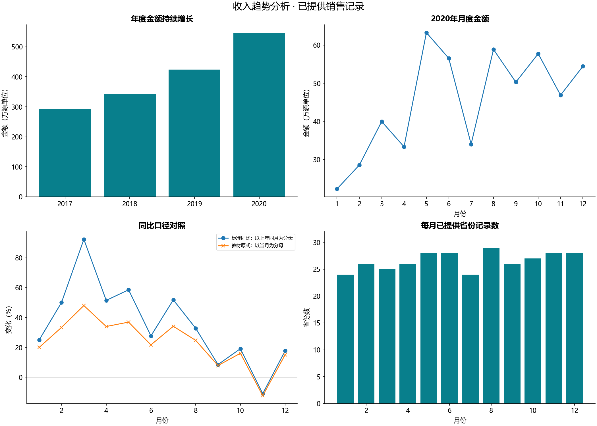
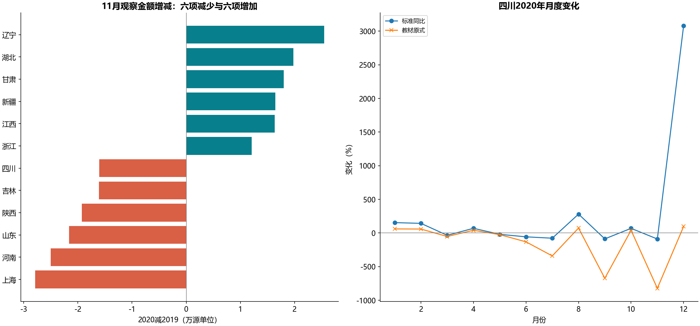

# B16 收入趋势分析

## 业务问题与结论

线上超市平台2017—2020年销售趋势，从年度→2020月度→11月省份→四川月度逐层定位。输入为1187条唯一年月省份记录，两份工作簿的原始区域逐行一致。源金额单位未注明，图按“源单位/万源单位”展示。

年度金额分别为2017年 2,931,068, 2018年 3,431,930, 2019年 4,243,549, 2020年 5,462,455。2020年已观察合计比2019年增长28.7237%；年度未显示增长放缓，11月局部下降需单独解释。11月从526,730降至468,821，标准同比-10.9941%，金额减少57,909。



## 原式错误与缺失记录

标准同比=(当期−上年同期)/上年同期；教材52个保存公式为(当期−上年同期)/当期。代码逐式确认并复算缓存，兼容列明确命名textbook_current_denominator，不当作标准同比。四川11月标准同比约−89.15%，教材原式约−821.69%，差异来自分母。

以已出现的31个省份×48个月构造覆盖网格，共1488个组合，其中只提供1187条，未提供301个组合；未提供不等于真实零销售。总额表示已提供记录的合计，province_records公开覆盖数。缺少整月保持未知，不能用上一条记录代替上一自然月/上一年。个别省份缺一侧时，标准同比未知，保留observed标记。原准备区把2020年11月没有宁夏、青海记录时的增长率手填为0，本实现仅在参考核对表保留这两个常量，不带入主指标。贵州、西藏自治区、新疆的原式还利用Excel空白引用当0，与主分析的缺记录规则分开。

## 下钻与解释边界

november_province_bridge.csv按省份外连接，金额桥为“当期已观察合计−上期已观察合计”。仅为对观察合计分解，缺一侧的项在求和桥中用0表示没有求和项，原金额列仍未知，不宣称停业/新开省份。贡献百分点以11月上年已观察总额为分母，和等于整体同比；不能平均各省同比。



图选金额下降和增长各六项，完整省份表在CSV。四川是教材指定下钻例，不宣称它是金额下降最大省份。省份金额变化只定位现象，缺少订单数、客户、品类或价格数据，不能推断具体经营原因。

## 教材覆盖与验证

5张来源工作表均有去向（业务需求/看板页主要是绘图文本和图表）。238个数字缓存及缺失位置逐项核对，全部52个公式有映射；10幅图的140个数值缓存核对。年度和月度源引用虽然覆盖总计行，其保存图缓存实际未纳入总计，Python同样只画真实期间。两份11月省份图的类别29项、数值30项，缺重庆标签，Python按省份键修正。

状态为指定范围参考核对通过：核对保存快照及原式，主指标修正分母，未声称重建Excel透视表交互。教材原文件只读且不随仓库分发。

```powershell
python run_labs.py --lab B16
```
