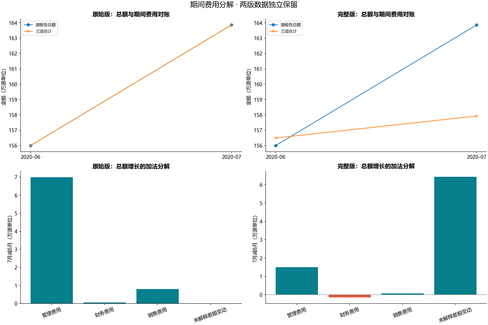
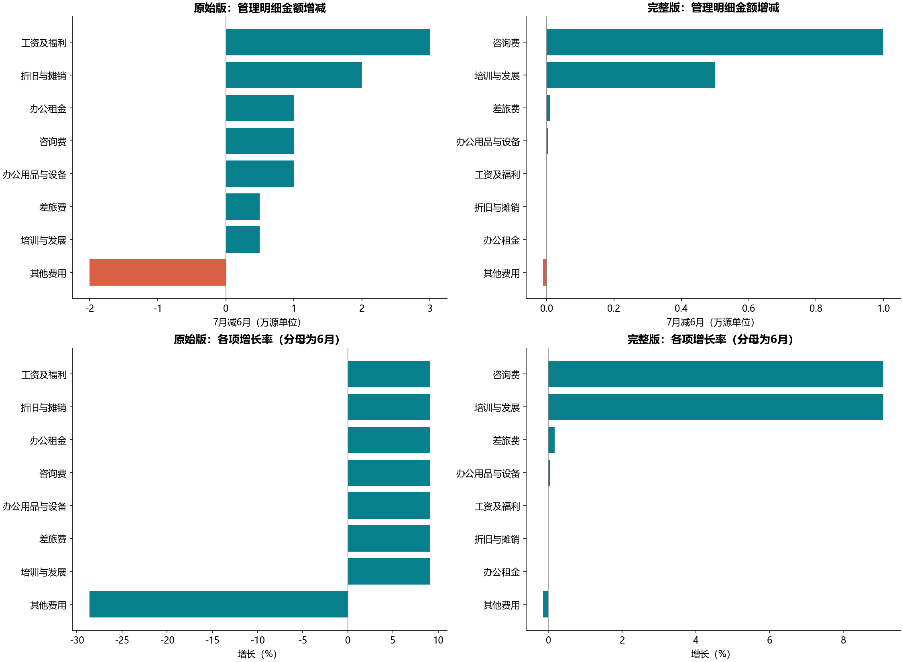

# B17 财务期间费用分解

## 业务问题与两版结论

零售企业2020年6、7月期间费用增长定位。这里的“财务费用”在源标题中同时指总费用和三大期间费用之一，Python分别命名“报告总费用”“管理费用”“销售费用”“财务费用”，不混用。源金额单位未注明。

两版报告总额都是1,560,000→1,638,600，增加78,600，环比5.0385%；但两版的分项金额不同，不能把原始版当成完整版公式的输入。

| 版本 | 期间三项增量 | 管理费用增量 | 总额未解释差额变动 |
|---|---:|---:|---:|
| 原始版 | 78,600 | 70,000 | 0 |
| 完整版 | 14,350 | 15,050 | 64,250 |



## 分层对账

原始版总额与三项合计一致，管理父项与8项明细也一致。增加78,600中，管理+70,000、销售+8,000、财务+600。管理内部工资福利+30,000、折旧摊销+20,000，其他费用−20,000有抵消；金额变化比只看百分比更适合解释总额增量。

完整版6月三项合计1,564,900，高于报告总额4,900；7月三项合计1,579,250，低于报告总额59,350。未解释差额从−4,900变为59,350，变动64,250；三项增量14,350+64,250=报告总额增量78,600。管理+15,050、财务−1,500、销售+800。管理8项与父项对账一致，咨询费+10,000、培训发展+5,000，其他净增50。完整管理增长15,050不能解释报告总增长78,600的全部。

差额仅命名“未解释差额”，未假设它属于某费用或把源总额改成分项合计。snapshot_differences.csv按期间、类别与层级核对两版输入，不相同的金额有明确记录。缺少进一步台账，不能认定业务原因或擅自修正原数据。

## 分母、缺失与贡献



增长率=(7月−6月)/6月；占比用各版对应父项金额，金额差额可以相加，增长率不能相加或简单平均。contribution_to_parent_growth_pp用父项6月金额为分母；signed_share_of_parent_change用父项总增量为分母，可能为负或超过100%，不当作概率。总费用占比在完整版可能不合计100%，差额继续可见。

缺失金额不填0，零分母保持未知，真实零和负的费用冲回保留。按年月键比较连续两个月，原表总费用的“6月/7月”文本、期间费用名称前导空格和原始管理页“份”表头均显式规范。原始版右侧L:N透视只作核对，不重复加入A:D输入。

## 教材覆盖与验证

共9张工作表均有去向，包括只有绘图对象的业务需求与数据看板页。59个保存数字缓存逐项核对，完整11个公式全部检查结构并复算；6幅图26个数字缓存相符。原始版和完整版分别做两层金额桥检查。参考核对通过仅指保存表格、原式与图缓存，不能消除源总分不一致，也不宣称重建Excel图表交互。

```powershell
python run_labs.py --lab B17
```
