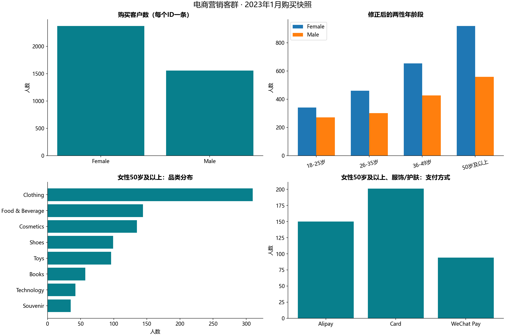
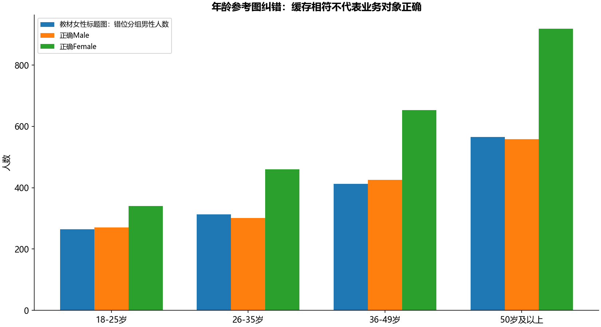

# B18 电商精准营销客群分析

## 数据与活动方向

2023年1月共3926个不同客户ID，每个ID恰有一条购买快照，共11661件商品。两份工作簿的8个原始字段逐行一致。没有订单ID、金额、未购买访客、活动成本或历史活动反馈，因此人数、件数、销售额和转化率不可混称。

女性2371人，占全部60.3923%；女性50岁及以上918人。该组Clothing与Cosmetics合计445人，占该组48.4749%。这是以现有购买人群为基础的候选促销方向。支付方式分布用于活动入口兼容性观察，不能仅凭Card人数多就认定补贴Card带来最大新增收益。



可把“女性50岁及以上的服饰/护肤组合活动”作为下月试验假设，先定义触达名单和随机留出组，记录触达、购买、毛利与活动成本，再比较增量。当前样本只说明谁买过，不能代表全体访客的性别比例，也不证明该人群更容易被活动改变。年龄段宽度不同，较宽组人数多不代表每一岁购买倾向更强。受众人数筛选链和各阶段分母见scope_counts.csv；逐人名单只保存在本地。

## 教材参考中的两类错误

原始数据页3926个年龄公式及缓存均与源18—69岁相符。公式最后else把所有其他值叫“50岁以上”，边界外不安全；Python明确分18岁以下、18—25、26—35、36—49、50岁及以上，50岁属于末组。未来缺失或非法年龄需核实，不直接归入末组。

准备区D23:D74共52个年龄公式全部引用非本行单元格，前两格引用标题/表头，其余多为向上错2行。其中8格的年龄段标签与本行年龄不同。全部52个保存缓存符合其实际错位公式，故不能仅以缓存一致声称业务正确。

E23:E74的52个“客户数”实际等于各年龄男性人数；它们再按错位D列分组，得到265/313/412/565，合计1555，图标题却写女性。正确男性应为270/301/426/558；正确女性为340/460/653/918（按四年龄段顺序）。B23:B74女性逐年龄人数本身正确，后续女性50岁及以上的品类918与目标子集445仍可由原始表独立复算。



prepare_formula_issues.csv列出52格的引用及标签问题，formula_audit.csv按块汇总全部3978个公式缓存核对；逐人3926格核对表不公开。兼容旧图只用于诊断，主营销看板使用修正后的两性分组。

## 验证范围

5张工作表均有去向，125个数字缓存、3978个公式缓存和8幅图的34个数值缓存核对通过。状态为指定范围参考核对通过，核对同时保留上述错误及修正，不等于认可源图的业务对象。每个互斥分组的人数与件数均守恒。原工作簿和客户ID、逐行购买记录均不分发。

```powershell
python run_labs.py --lab B18
```
