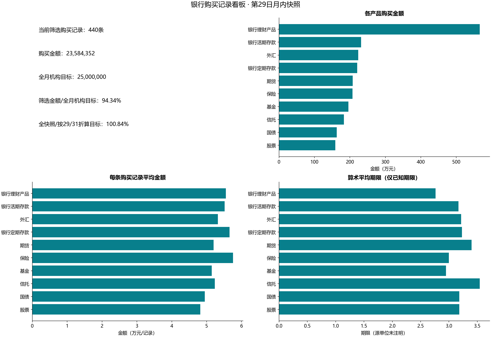
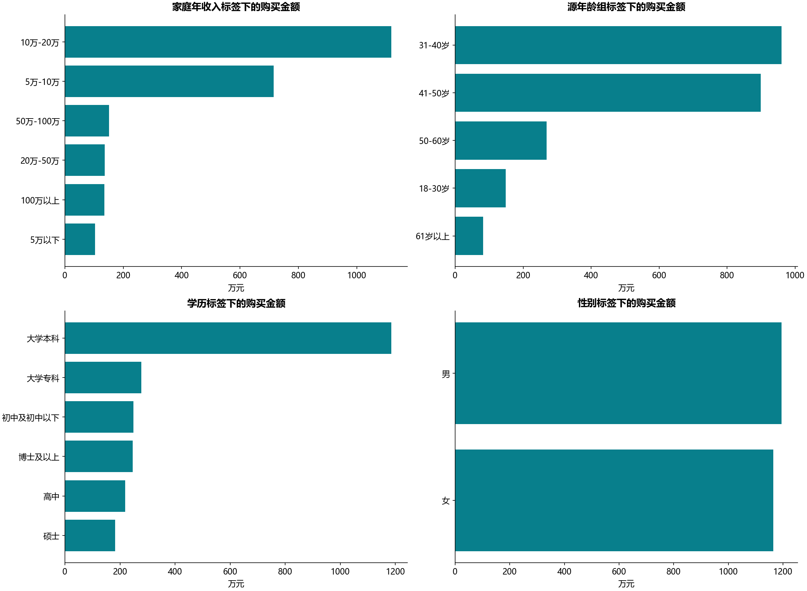
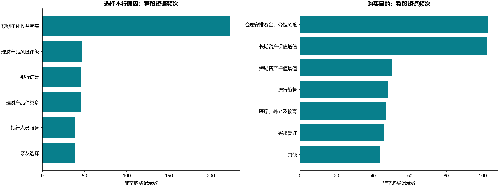

# B19 银行产品购买看板

## 业务范围与目标进度

源表440条购买记录，无客户编号、订单ID、交易日期和具体年月，不能称作440名独立客户，也不能计算去重客户客单价、留存或每日趋势。业务描述B1明确：本月31天，当前第29日，月目标25,000,000元。仅作为提供的月内快照，不使用运行当天时间。当前筛选为{"income": null, "age_band": null, "education": null, "gender": null, "category_code": null, "risk_code": null, "saved_path": null}，选中440条。

全快照金额23,584,352元；全月目标达成94.337408%。按29/31线性折算的时间进度目标为23,387,096.77元，实际/该进度目标为100.843436%。剩余2天，全月目标尚差1,415,648元，平均每天需707,824元。这是均匀进度比较，不是统计预测。



PBIX卡片中MTD销售额使用购买金额SUM，但隐藏“MTD销售目标达成率”公式未解码，不能断言对应以上哪个分母。Python两种率分列；在任意客群/产品筛选后，机构目标仍固定，选中金额/全机构目标只是贡献，不虚构客群目标。summary中whole_snapshot_progress与selected_amount_against_institution_target分别保存，公开只采用默认全量运行。

## 产品、客群和平均数

三个维表均以唯一编号多对一关联，丢失或重复维度键会报错。产品/风险汇总、四种客群汇总及原因/目的汇总的人数口径均为记录数，金额与记录守恒。category与risk使用编号筛选，避免按名称误并。

“客单”源图虽然queryRef包含Sum，实际Function=1是购买金额的算术平均；Python称“每条购买记录平均金额”，不推断每名客户金额。期限亦用已知期限记录的算术平均，observed_terms明确分母，不按金额加权。期限1—5的单位没有给出，收益字段没有持有期间，不能称年化收益率或据此比较真实产品投资回报；源负收益保留，未当异常删掉。



收入和年龄是源分组标签，不从字符串造精确年龄或收入。源“41-50岁”和“50-60岁”文字边界重叠，保持标签，不能确定50岁的真实归组规则。分解树保存展开路径为{"income": "10万-20万", "age_band": "31-40岁", "education": "大学本科"}，对应37条、1,994,382元。这是保存的展开分支，不等于已激活筛选。默认全量；--saved-path才显式选择该分支。完整四级组合仅在本地decomposition_private.csv，公开一维分布及该展开路径，避免把逐条特征组合作为公开明细。

## 原因、目的与源页面



源两个WordCloud视图按非空短语计数（Function=5），queryRef名称Min不代表取最小值。Python用整段短语频次条形图，保留可核对人数，不执行或分发pbiviz插件，不做未知中文分词。第二图实际字段是购买目的，原“选择产品原因”标题据字段澄清。

源页6个容器全部登记。两个图间存在交互关系，但二进制模型及DAX未解码，不宣称完整复制跨图筛选传播；Python所有分组共享同一组显式筛选。没有独立参考显示数值，本实验为运行通过。按产品编号独立SQLite核对记录数、金额和期限分母/均值共40个数值；全默认输入10个产品为40项。

```powershell
python run_labs.py --lab B19
python labs/cda1_business/b19_bank_products/main.py --saved-path --output-root outputs/filtered
python labs/cda1_business/b19_bank_products/main.py --category-code c01 --risk-code S1 --output-root outputs/filtered
```

其他筛选：--income、--age-band、--education、--gender。源购买明细、四级组合仅在本地outputs；原表和PBIX不随仓库分发。描述性倾向只用于理解教材样本，不证明营销干预效果。
