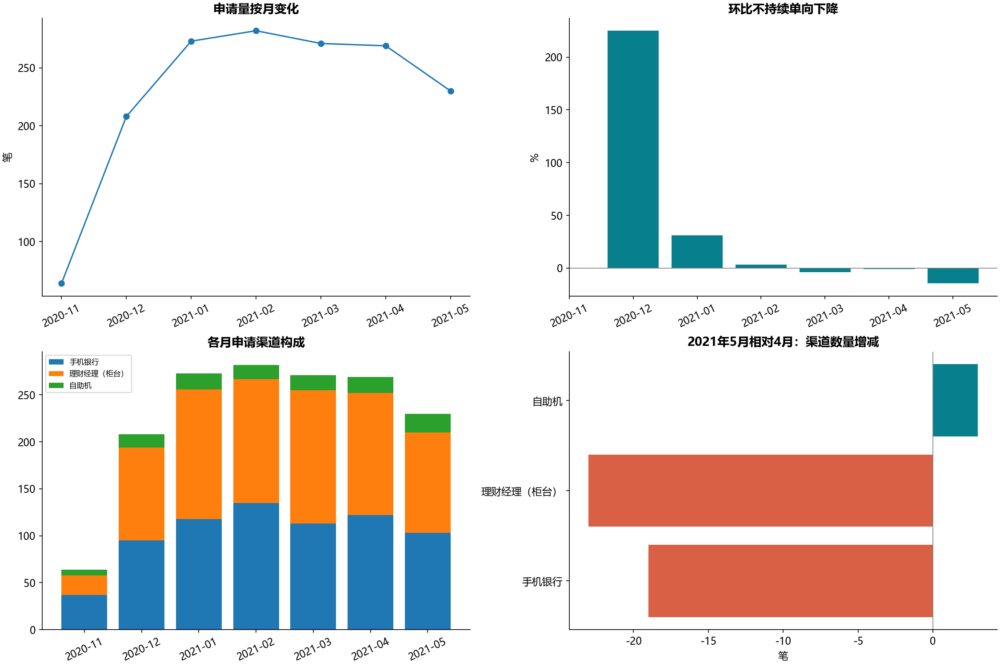

# B20 银行申请渠道贡献分解

1597个唯一申请，2020年11月至2021年5月，原始表与两个参考副本逐行一致，只计量一次。5月230笔，4月269笔，减少39笔，环比−14.4981%。柜台−23、手机银行−19、自助机+3，和为−39。



标准有符号净变化贡献=各渠道增量/整体增量：柜台58.9744%、手机48.7179%、自助机−7.6923%，合计100%。自助机为抵消下降的正向数量变化，贡献负号并非渠道变差。增长贡献百分点=渠道增量/上月总量，合计为总体环比；不是各渠道环比的平均。

源C47:E47用各渠道增量/净变化绝对值，和为−100%，但B47标100%；C58:E58则使用净变化分母且和为100%。两种约定分别保留，主表明确命名不混用。源C59:E59“总计”符合把差异行−23/−19/+3再加入七个月总数、除以1597−39=1558的结果，不等于真实全期间769/1597、723/1597、105/1597；核查时只作旧表诊断，不把差异行当申请。

原DOCX的230笔、下降14.5%、58.97/48.72/−7.69%与本次按显示精度对应。报告称环比持续下降，但2021年4月较3月的环比从−3.9007%回升至−0.7380%，不是严格单调。5月柜台与手机合计210/230=91.3043%，没有曝光/工时/流量分母，不能据此计算渠道转化或客户经理工作压力变化。

宣传不足、APP路径过深是源报告提出的待验证解释，不能由申请量直接证实。机构协调可按分支机构分组随机试验，APP入口可按用户随机试验，预先确定总申请/转化口径和分母；跨渠道迁移与新增业务需分开。未开展实验，不编造效果。

4张工作表、3195个公式缓存均有去向（逐申请年月核对只汇总公开），98项数字缓存及34个图缓存逐项核查；保留稀疏图点索引，首月无环比不填0。整月无记录与观察月内某渠道0笔分开。无外部完整性证明，不把首末日期自动当完整自然月。

```powershell
python run_labs.py --lab B20
```
