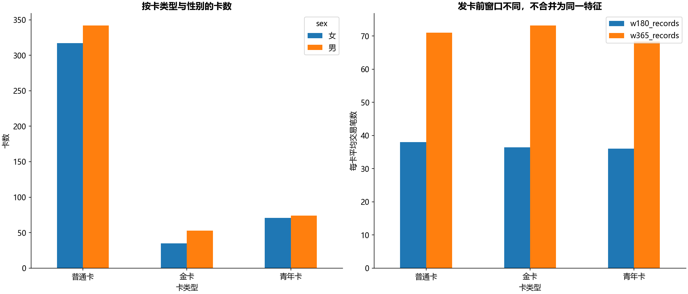
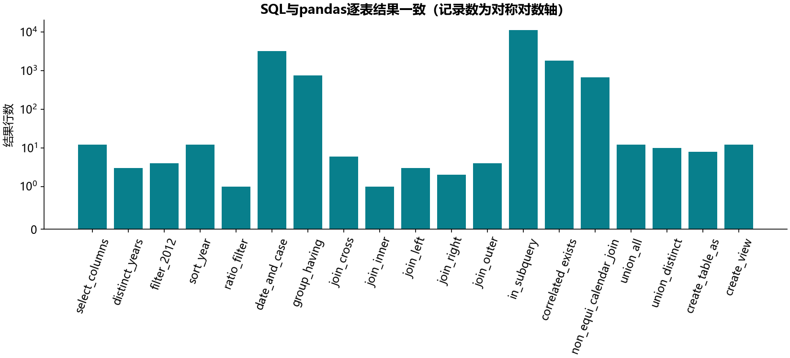

# B21 SQL取数与信用卡时点画像

## 重建范围

第8章SQL1—SQL9全部教学主题分别对应独立SQLite/pandas实现，19组查询逐表一致，包含去重、过滤、日期/CASE、GROUP BY/HAVING、五种连接、非等值窗口、IN/相关子查询、UNION/UNION ALL、临时表和视图。无表头的sale/One/Two/Table1/Table2按无表头读取，第一行不丢失；所有新建对象仅在内存库。源MySQL脚本含旧注释、服务器建库/导入路径，不原样执行，不要求本机安装MySQL。portable_queries.sql为新写的可移植查询，原SQL只读。

8张银行实体表共1,056,320笔交易，892张卡，关联disp确定该卡的具体权限客户。客户号不作模型变量，也不从账户所有者替代真实持卡人。源金额有$和千分位，只按源金额单位处理，不据符号假定真实币种。



## 发卡时点和窗口

所有特征严格使用交易日<发卡日，同日交易排除。原SQL简版注明180天，复杂版实际365天，二者分别计算0<days<180与0<days<365；不是“功能完全相同”。源a.issued-180这类日期减整数写法迁移为明确日历日期运算，贷款非等值教学例另保留<=365端点。

年龄以发卡日已满周岁为主，另存DATEDIFF/365兼容值。最近交易日有253张卡并列，直接关联得到1175行；画像仍保持892行。无法确定当日顺序，不按交易ID猜日终余额；保留当日余额均值、最小/最大和笔数。窗口余额均值按交易行加权，并非每日资产均值。

源SQL把借标签金额称“入”、贷标签称“出”，主实现保留借/贷原标签及兼容比值，不在缺明确映射时宣称真实现金流方向。无交易窗口计数与金额0，余额/最近间隔未知，零分母比率未知。不能把365天金额当月收入，也不将已有持卡类别当未来营销响应标签。

## 独立验证与指标规范

两窗口的笔数、借/贷金额和交易行余额均值，以及最近日期/并列笔数/余额均值最小最大，合计11596个数值由独立SQL逐卡核对。完整SQL/pandas结果不公开，只发布核对计数、卡类型/性别聚合和分年度发卡数量。



第7章指标设计、两份第13章数据标准、营销/反欺诈模板共17张表都有去向：将粒度、时点、窗口、分母、缺失和发布规则落实为profile_dictionary。模板中的职业、婚姻、设备/手机号网络等缺上游事实，不伪造标签或典型个人；模板含XXX占位SQL，不当可执行事实查询。信用卡画像PPT要求的业务描述、卡类型/性别、年龄和办卡前行为已按现有字段落实；未来金卡响应预测缺观察后标签，不冒充完成预测模型。无独立保存数值参考，状态为运行通过。

```powershell
python run_labs.py --lab B21
```

客户/卡/交易标识、日期及逐卡特征只留本地card_features_private.csv。导入脚本及重复CSV资源仅记录去向，不把未执行服务器脚本计作执行通过。
