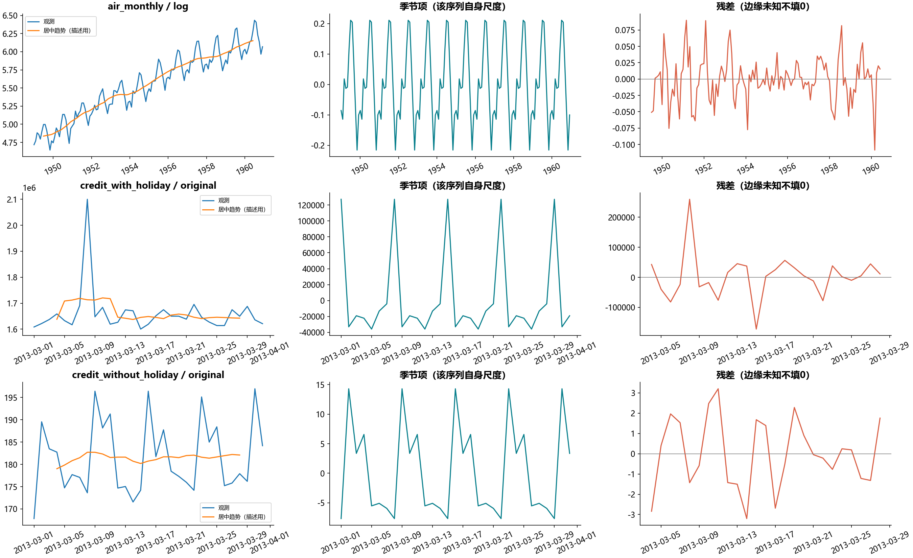
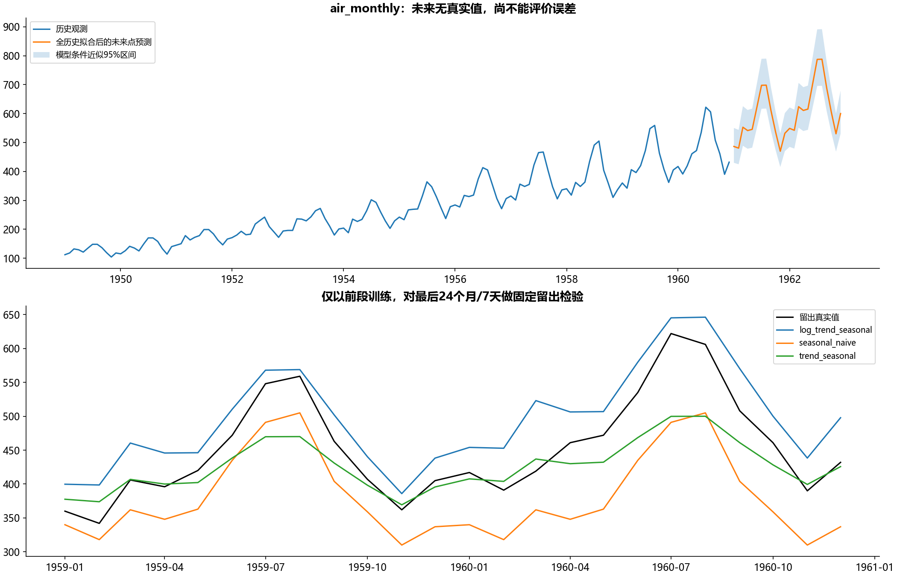
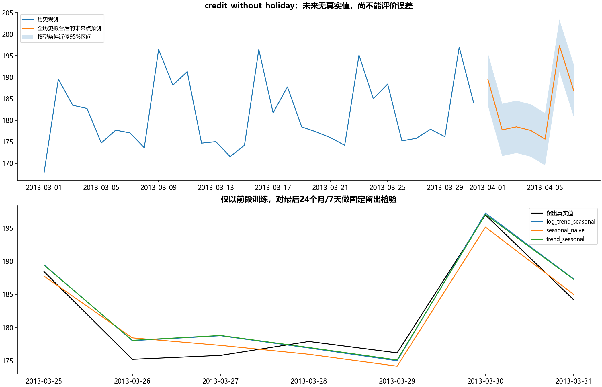

# B22 效应分解与时间序列预测

## 三条序列分别处理

AirPassengers为1949—1960年144个月；信用卡“含节日”和“去除节日”各31天，日期均2013年3月，但数值尺度显著不同。未提供节日日期、单位换算或调整公式，不能从两个文件名推断逐值剔除关系，更不能相减作真实节日效应。两条信用卡序列分别分析，误差不跨量纲比较。

AIR的CSV、Excel原值、重复区域、WPS输入和历史快照核对；ln_AIR只保留9位小数，以1e−9核查。WPS信用卡输入与去节日原始表一致，显示历史两位小数按0.005绝对容差单独核查。没有原Excel公式，5份工作簿的7张表都有去向；PBIX两页预测参数均登记，24期/12季节/95%等保存配置不等于模型算法公开。

## 分解与未来信息



描述性分解对AIR取log后作12月加性分解，对两条日序列作7天加性分解，完整内点满足观测=趋势+季节+残差，边缘未知不填0。居中移动平均使用相邻未来观测，仅用于历史解释，不参与留出预测。log尺度的加法对应原尺度的乘法关系。

预测另用仅训练前段估计的线性趋势+季节哑变量回归。AIR预先指定log版本，日序列指定原尺度版本；另比较季节朴素、原尺度和log模型的留出表现，不按测试误差挑一个再宣称独立验证。只做固定一次时间切分：AIR前120月训练/后24月检验，日序列前24天训练/后7天检验。所有参数和残差方差都从训练段估计，未先全序列分解再切分。





forecast_metrics列MAE、RMSE、MAPE和训练段季节差分尺度MASE。真实值含0则MAPE未知，训练季节差分尺度0则MASE未知；不默默剔除零误差对。31天只有四周多，短样本误差不代表长期部署可靠性。

| 序列 | 方法 | 留出MAE | 留出RMSE |
|---|---|---:|---:|
| air_monthly | seasonal_naive | 71.2500 | 76.9946 |
| air_monthly | trend_seasonal | 34.6378 | 47.9440 |
| air_monthly | log_trend_seasonal | 42.9704 | 46.8704 |
| credit_with_holiday | seasonal_naive | 22495.4286 | 29233.3607 |
| credit_with_holiday | trend_seasonal | 23835.9327 | 27929.9685 |
| credit_with_holiday | log_trend_seasonal | 23195.4330 | 25988.8723 |
| credit_without_holiday | seasonal_naive | 1.7152 | 1.8898 |
| credit_without_holiday | trend_seasonal | 1.7114 | 2.0576 |
| credit_without_holiday | log_trend_seasonal | 1.7725 | 2.0739 |

日“去节日”序列的预先指定趋势季节模型RMSE约2.0576，季节朴素约1.8898，复杂方法在该指标上没有改进；不隐去这一结果。各序列使用各自原单位比较，不把百万级原金额与约180的另一序列作绝对误差排名。

未来AIR24月及信用卡7天用全历史重拟合后生成，尚无真实值。log反变换exp给条件中位点预测，不冒称无偏均值。95%区间基于线性模型同方差独立残差假设的条件预测区间，未验证真实覆盖；不是PowerBI置信区间等价复刻。每日含节日序列的未来与回测也在CSV完整保留。

WPS保存的24+7个预测值单独与Python数值并列，差异只是不同未知算法输出差异，不能算预测误差。原SARIMA标签未给阶数/训练配置，不猜参数拟合答案。图缓存按原索引核查，历史144/31和未来24/7的空位置不当0。状态为运行通过，不宣称未知WPS/PowerBI预测引擎逐值重建。

```powershell
python run_labs.py --lab B22
```
