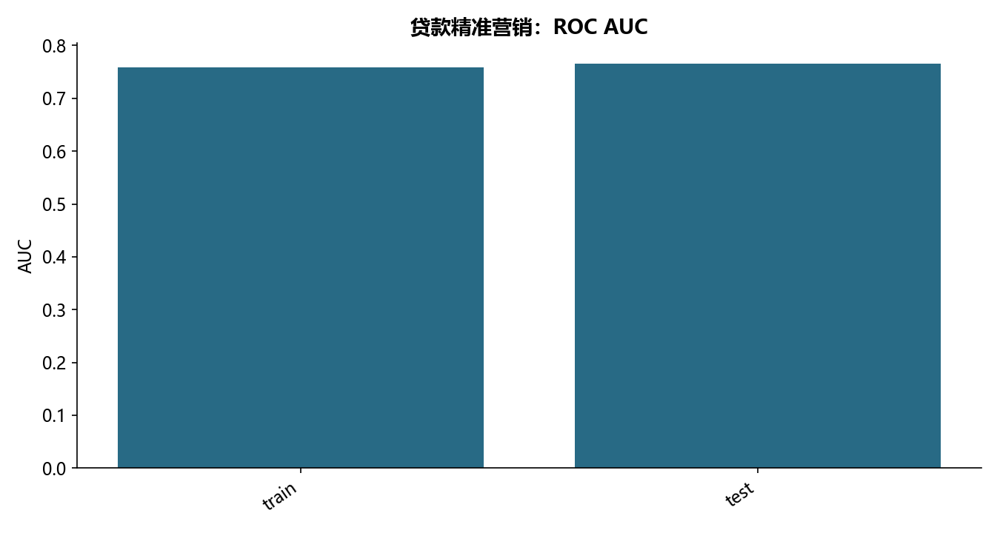

# F02 · 第二章某银行贷款产品精准营销模型代码通过

理解客户金额、客户响应或贷款营销的回归与样本外评分。

## 实现与调整

保留源模型、诊断及选择方法，修复指标口径与清洗不一致；模型选择和预处理只拟合训练范围，个人评分不公开。

保留教材逻辑回归公式。原脚本对训练与预测数据使用不同列、不同分位数且未执行预测；此版统一使用训练集的盖帽规则，再生成本地预测。新增客群没有标签，只报告评分分布，不伪造 AUC。

## 运行结果

完整聚合结果见 [metrics.csv](metrics.csv)，原单元格去向见 [notebook-map.md](notebook-map.md)。

源文件按 SHA-256 校验；不加载教材附带的序列化模型。本报告的运行通过表示代码可执行并完成内部校验，不表示与旧 Notebook 的随机结果或未提供的线上结果完全一致。
