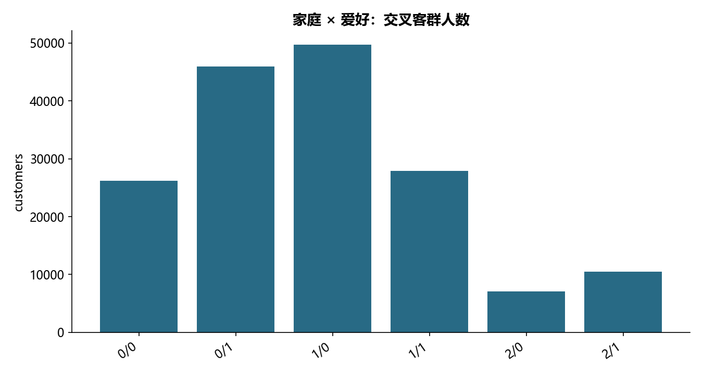

# F03 · 第3章多维特征的客户细分代码通过

理解变量压缩、经济特征与客户细分，形成可解释的聚合画像。

## 实现与调整

保留标准化、主成分/旋转方向、稀疏性或聚类的教学目标。固定随机种子；旋转单位特征向量以保持 fa_kit 语义；不发布客户逐行得分。

### household

```text
|--- marital <= 7.50
|   |--- risk_score <= 993.50
|   |   |--- loan_ratio <= 64.50
|   |   |   |--- truncated branch of depth 20
|   |   |--- loan_ratio >  64.50
|   |   |   |--- truncated branch of depth 19
|   |--- risk_score >  993.50
|   |   |--- class: 2
|--- marital >  7.50
|   |--- risk_score <= 996.50
|   |   |--- loan_ratio <= 69.50
|   |   |   |--- truncated branch of depth 16
|   |   |--- loan_ratio >  69.50
|   |   |   |--- truncated branch of depth 20
|   |--- risk_score >  996.50
|   |   |--- home_value <= 931986.00
|   |   |   |--- truncated branch of depth 6
|   |   |--- home_value >  931986.00
|   |   |   |--- truncated branch of depth 3

```

### hobby

```text
|--- interest <= 0.50
|   |--- interested_sport <= 286.50
|   |   |--- auto_member <= 618.50
|   |   |   |--- truncated branch of depth 14
|   |   |--- auto_member >  618.50
|   |   |   |--- truncated branch of depth 15
|   |--- interested_sport >  286.50
|   |   |--- auto_member <= 514.50
|   |   |   |--- truncated branch of depth 13
|   |   |--- auto_member >  514.50
|   |   |   |--- truncated branch of depth 14
|--- interest >  0.50
|   |--- interested_sport <= 208.50
|   |   |--- interest <= 0.70
|   |   |   |--- truncated branch of depth 11
|   |   |--- interest >  0.70
|   |   |   |--- truncated branch of depth 14
|   |--- interested_sport >  208.50
|   |   |--- auto_member <= 416.50
|   |   |   |--- truncated branch of depth 12
|   |   |--- auto_member >  416.50
|   |   |   |--- truncated branch of depth 16

```

## 运行结果

完整聚合结果见 [metrics.csv](metrics.csv)，原单元格去向见 [notebook-map.md](notebook-map.md)。



源文件按 SHA-256 校验；不加载教材附带的序列化模型。本报告的运行通过表示代码可执行并完成内部校验，不表示与旧 Notebook 的随机结果或未提供的线上结果完全一致。
