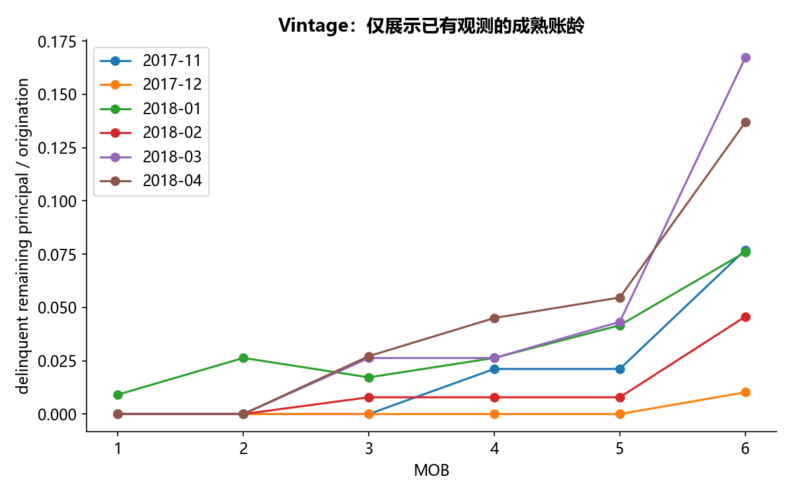

# F05 · Vintage

理解Vintage、A卡或B卡的业务口径与风险建模流程。

## 实现与调整

离线重建SQL备份、账户观察窗口、分箱WOE和评分卡；核查关联与成熟账龄。只发布聚合统计，不发布客户行或数据库连接信息。

从教材 SQL 备份仅解析字面量行，不连接 MySQL、不执行备份语句。按原查询的期限、放款日期和分组范围重建 MOB；以 SQLite 独立聚合核对 pandas 分子。原 SQL 未成熟账龄的 0 另保留 source_rate，展示曲线只使用已有观测的成熟账龄，避免把未观察当零风险。F04 是 F05 的相同代码检查点，只共享实现，不计作新的业务案例。

## 运行结果

完整聚合结果见 [metrics.csv](metrics.csv)，原单元格去向见 [notebook-map.md](notebook-map.md)。

源文件按 SHA-256 校验；不加载教材附带的序列化模型。本报告的运行通过表示代码可执行并完成内部校验，不表示与旧 Notebook 的随机结果或未提供的线上结果完全一致。
