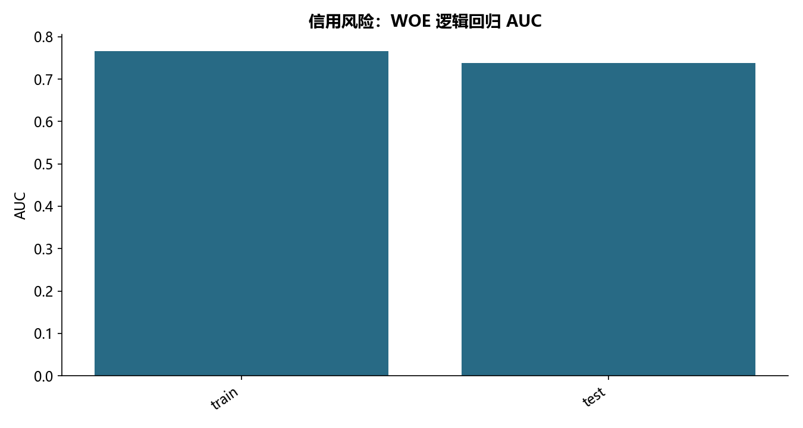

# F06 · 第5章贷前信用风险预测模型（A卡）代码通过

理解Vintage、A卡或B卡的业务口径与风险建模流程。

## 实现与调整

离线重建SQL备份、账户观察窗口、分箱WOE和评分卡；核查关联与成熟账龄。只发布聚合统计，不发布客户行或数据库连接信息。

保留缺失/零方差/IV 筛选、决策树分箱、Age 人工切点、WOE、相关筛选、双向 AIC、VIF、PSI 与 600/35/50 评分卡。仅在训练集学习分箱、WOE及筛选。修复源代码把 WOE 数据再次当原始数据评分的风险，用原始输入评分并独立核对 log-odds 转分。末尾数据库列表属环境演示，替换为本地备份表清单；Vintage 查询见同批 F05 的完整离线实现。

## 运行结果

完整聚合结果见 [metrics.csv](metrics.csv)，原单元格去向见 [notebook-map.md](notebook-map.md)。

源文件按 SHA-256 校验；不加载教材附带的序列化模型。本报告的运行通过表示代码可执行并完成内部校验，不表示与旧 Notebook 的随机结果或未提供的线上结果完全一致。
