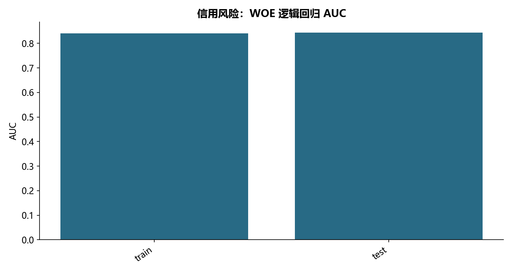

# F07 · 第6章贷中信用风险预测模型（B卡）代码通过

理解Vintage、A卡或B卡的业务口径与风险建模流程。

## 实现与调整

离线重建SQL备份、账户观察窗口、分箱WOE和评分卡；核查关联与成熟账龄。只发布聚合统计，不发布客户行或数据库连接信息。

保留还款、逾期、额度使用、趋势/波动、账户汇总及 3/6/12 月窗口。严格取截至 Period=12 的窗口；提供文件中的第13期不进入任何特征。修复源循环累加导致重复特征和窗口后缀多次追加，以及 Spend_CV 错用 Balance_CV；账户额度关联按客户+账户校验 many-to-one，避免连接放大。额度为零按缺失处理。标签文件未给表现窗口日期，因此这里只验证给定标签下教学留出，不能声称通过真实业务的时间外验证。

## 运行结果

完整聚合结果见 [metrics.csv](metrics.csv)，原单元格去向见 [notebook-map.md](notebook-map.md)。

源文件按 SHA-256 校验；不加载教材附带的序列化模型。本报告的运行通过表示代码可执行并完成内部校验，不表示与旧 Notebook 的随机结果或未提供的线上结果完全一致。
