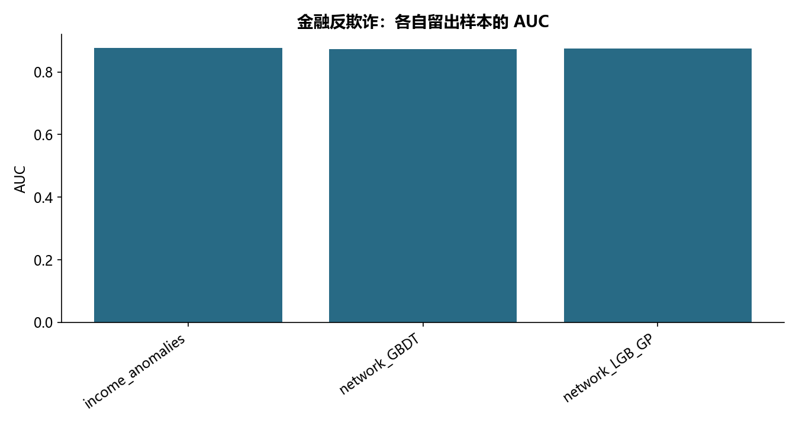

# F08 · 第8章申请反欺诈模型代码通过

结合收入一致性和申请时点的关系网络理解反欺诈建模。

## 实现与调整

重建按日关系特征、训练内异常特征和多模型搜索；已披露历史风险与申请者自身结果分离，所有个人关系与评分留在本地。

保留收入残差/标准化绝对偏离、GBDT、连通分量、Louvain、按日关系特征、五种重采样演示和 LightGBM 贝叶斯调参。特征工程在 CV 折内拟合，重建全量关系日志的按日特征，替代源脚本因 dat 被社区子集覆盖而导出的少量特征。修复联系人集合更新缩进；坏标签仅按披露时间使用且排除申请者自身。原表有重复客户，保留申请行并按客户分组划分留出和CV，防止同人跨分区。Louvain 社区编号不稳定，因此以规模排序替代硬编码 675/10500。GP+期望改进保留高斯过程贝叶斯搜索原理，默认 5 初始点 + 10 次迭代、三折 AUC，未执行源 50 次迭代。基础表未给申请日期，因此匹配关系日志中该用户最后申请快照；无法核验多次申请与快照逐次时间对齐，不能声称完成严格线上时点验证。新增申请与历史图的匹配比例单独报告；未匹配按缺失处理，不暗示每个新客都有完整关系图。图表 AUC 来自两组不同申请样本，不能直接作单变量增益实验。节点标识、关系边、个人残差和评分均不公开。

## 运行结果

完整聚合结果见 [metrics.csv](metrics.csv)，原单元格去向见 [notebook-map.md](notebook-map.md)。

源文件按 SHA-256 校验；不加载教材附带的序列化模型。本报告的运行通过表示代码可执行并完成内部校验，不表示与旧 Notebook 的随机结果或未提供的线上结果完全一致。
