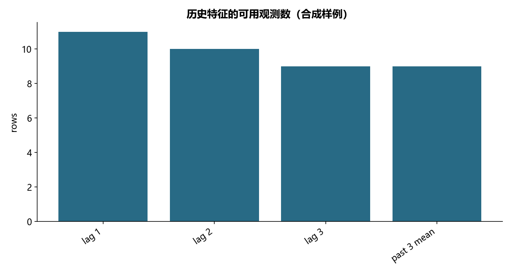

# F09 · 第9章算法工程化代码通过

把时间特征整理为可复用、可克隆的 sklearn 转换器。

## 实现与调整

保留日期、布尔日历和历史窗口三类特征；修正 shift(1) 被重复使用的错误，滚动相关仅使用当前时点之前的数据。

修复源示例不同 lag 均调用 shift(1) 及全序列自相关泄露未来信息。历史特征按输入行先后计算，调用者必须先按实体和时间排序；不自动跨 transform 调用拼接历史。日期示例和扩展时序均为合成数据。存储格式与性能建议仅解释适用条件，不声称执行源注释中未实现的基准。

## 运行结果

完整聚合结果见 [metrics.csv](metrics.csv)，原单元格去向见 [notebook-map.md](notebook-map.md)。

源文件按 SHA-256 校验；不加载教材附带的序列化模型。本报告的运行通过表示代码可执行并完成内部校验，不表示与旧 Notebook 的随机结果或未提供的线上结果完全一致。
