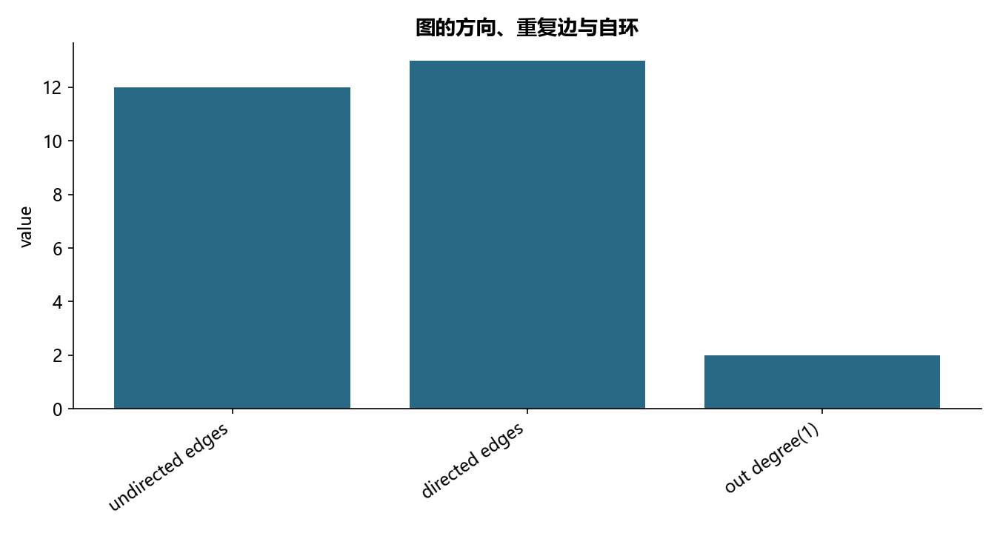

# F10 · 02-社交网络-基本理论CODE

理解关系网络、路径搜索、中心性或交易圈社区。

## 实现与调整

采用 NetworkX 图模型；自编算法与独立库或数学恒等式核对。社区模型采用无权目标和固定种子，客户关系明细不公开。

简单图重复边覆盖属性；反向边在无向图中合并，自环对无向度贡献 2。原图的九个演示节点为教材虚构编号。

## 运行结果

完整聚合结果见 [metrics.csv](metrics.csv)，原单元格去向见 [notebook-map.md](notebook-map.md)。

源文件按 SHA-256 校验；不加载教材附带的序列化模型。本报告的运行通过表示代码可执行并完成内部校验，不表示与旧 Notebook 的随机结果或未提供的线上结果完全一致。
