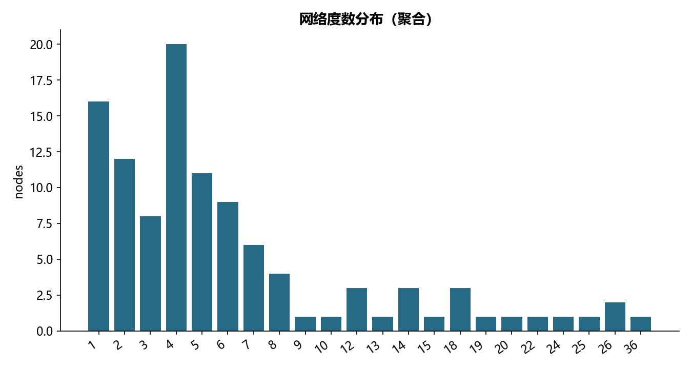

# F14 · 04-社交网络算法-小案例

理解关系网络、路径搜索、中心性或交易圈社区。

## 实现与调整

采用 NetworkX 图模型；自编算法与独立库或数学恒等式核对。社区模型采用无权目标和固定种子，客户关系明细不公开。

原 Notebook 用 python-louvain，迁移为 NetworkX 内置 Louvain，固定随机种子。保留原简单无向图和默认无权社区目标；Weight 大写字段原本不会被默认 weight 参数使用。不同实现的启发式分区允许不同，不宣称逐节点复现。图布局和节点明细留在本地；公开图仅展示规模或度分布。

## 运行结果

完整聚合结果见 [metrics.csv](metrics.csv)，原单元格去向见 [notebook-map.md](notebook-map.md)。

源文件按 SHA-256 校验；不加载教材附带的序列化模型。本报告的运行通过表示代码可执行并完成内部校验，不表示与旧 Notebook 的随机结果或未提供的线上结果完全一致。
