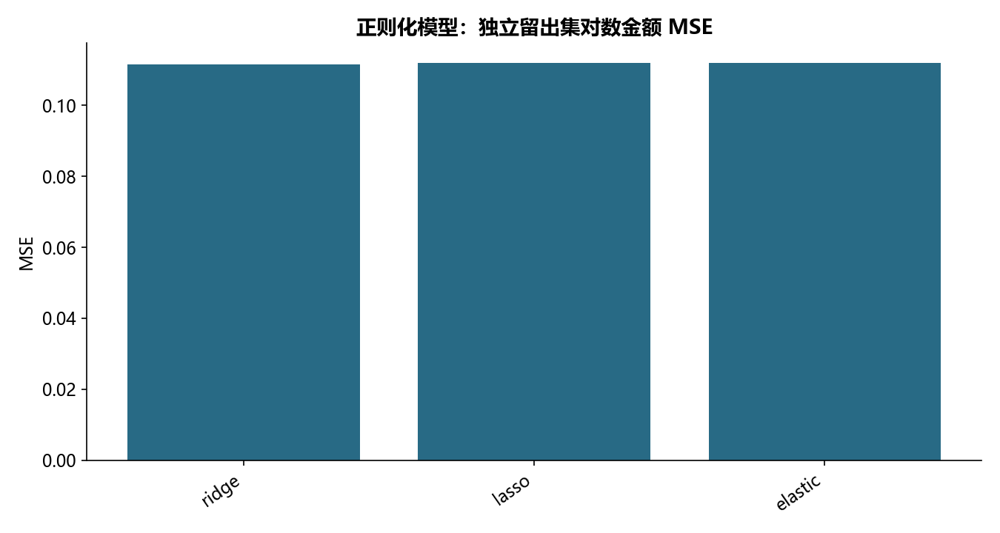

# M01 · 2.1线性回归

理解客户金额、客户响应或贷款营销的回归与样本外评分。

## 实现与调整

保留源模型、诊断及选择方法，修复指标口径与清洗不一致；模型选择和预处理只拟合训练范围，个人评分不公开。

OLS 诊断、异常值删除及 AIC 选择仅作教材解释性分析；正则模型另在未按残差过滤的样本上留出测试集，预处理在交叉验证折内拟合。不同响应尺度的 R² 不用于直接选胜者。exp(对数预测) 是条件中位数尺度的回变换，未做均值偏差校正。edu_class=0→1 保留教材明确的业务概化；不发布个人预测。

## 运行结果

完整聚合结果见 [metrics.csv](metrics.csv)，原单元格去向见 [notebook-map.md](notebook-map.md)。

源文件按 SHA-256 校验；不加载教材附带的序列化模型。本报告的运行通过表示代码可执行并完成内部校验，不表示与旧 Notebook 的随机结果或未提供的线上结果完全一致。
