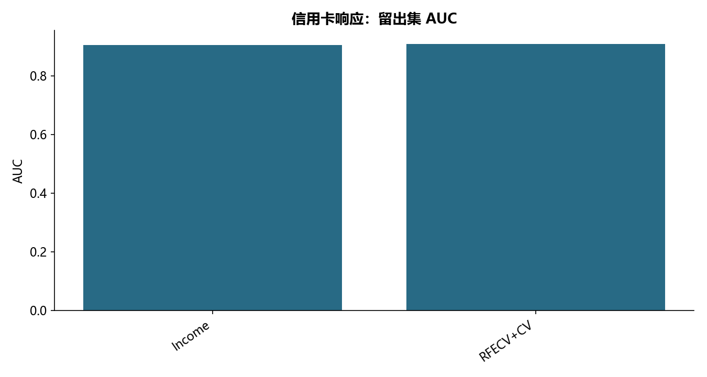

# M02 · 2.2逻辑回归

理解客户金额、客户响应或贷款营销的回归与样本外评分。

## 实现与调整

保留源模型、诊断及选择方法，修复指标口径与清洗不一致；模型选择和预处理只拟合训练范围，个人评分不公开。

保留原 sample(frac=0.7, random_state=1234) 划分。RFECV、缩放与正则搜索在训练范围内嵌套；修复原阈值表将 precision/recall/specificity 名称混淆的问题。类别编码按源示例作为数值输入；edu_class 概化赋值生效。只回读本次新训练的私有模型。

## 运行结果

完整聚合结果见 [metrics.csv](metrics.csv)，原单元格去向见 [notebook-map.md](notebook-map.md)。

源文件按 SHA-256 校验；不加载教材附带的序列化模型。本报告的运行通过表示代码可执行并完成内部校验，不表示与旧 Notebook 的随机结果或未提供的线上结果完全一致。
