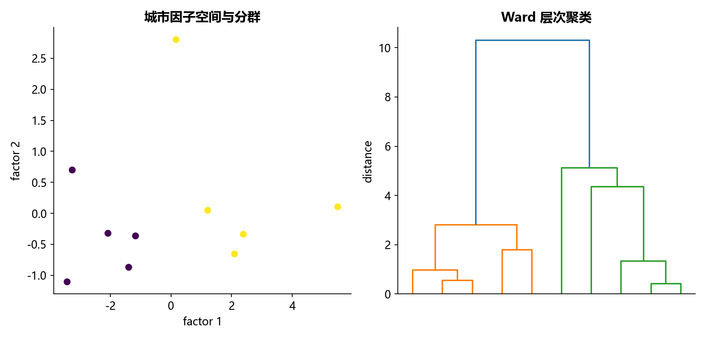

# M06 · 2.3.4层次聚类(经济发展数据)

理解变量压缩、经济特征与客户细分，形成可解释的聚合画像。

## 实现与调整

保留标准化、主成分/旋转方向、稀疏性或聚类的教学目标。固定随机种子；旋转单位特征向量以保持 fa_kit 语义；不发布客户逐行得分。

主成分符号、旋转因子顺序与聚类编号不构成业务等级。代表变量法修复教材辅助脚本的状态与索引错误。

## 运行结果

完整聚合结果见 [metrics.csv](metrics.csv)，原单元格去向见 [notebook-map.md](notebook-map.md)。

源文件按 SHA-256 校验；不加载教材附带的序列化模型。本报告的运行通过表示代码可执行并完成内部校验，不表示与旧 Notebook 的随机结果或未提供的线上结果完全一致。
