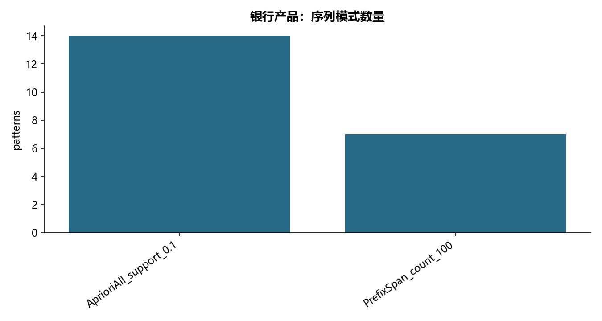

# M09 · 2.4.2.序列模式（银行产品交叉销售分析）

用银行产品篮子和订单先后关系发现交叉销售模式。

## 实现与调整

独立实现精确 Apriori 与完整有序项集模式增长，替换旧包和辅助脚本。以客户数作为支持度分母，不把订单内共现误记为先后。

以客户为支持度分母；同一订单为无序项集，订单之间有先后。采用完整模式增长重建两种阈值的结果；不依赖旧教学脚本。OrderNumber 仅是教材顺序代理，不能推断真实时间间隔。

## 运行结果

完整聚合结果见 [metrics.csv](metrics.csv)，原单元格去向见 [notebook-map.md](notebook-map.md)。

源文件按 SHA-256 校验；不加载教材附带的序列化模型。本报告的运行通过表示代码可执行并完成内部校验，不表示与旧 Notebook 的随机结果或未提供的线上结果完全一致。
