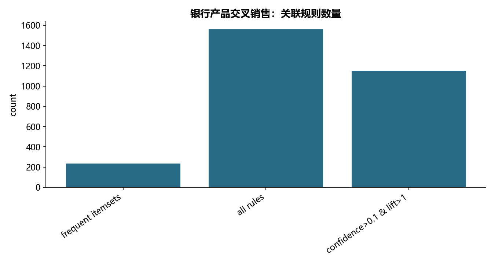

# M10 · 上课版-银行产品交叉销售分析-mlxtendApriori copy

用银行产品篮子和订单先后关系发现交叉销售模式。

## 实现与调整

独立实现精确 Apriori 与完整有序项集模式增长，替换旧包和辅助脚本。以客户数作为支持度分母，不把订单内共现误记为先后。

布尔篮子以客户去重，重复购买不重复计数。修正旧 FP-growth 示例以交易行数作分母的问题；原先 mlxtend / Orange 的规则定义由精确 Apriori 重建，支持度、置信度、提升度逐式计算。规则描述共现，不能视为营销的因果效果。

## 运行结果

完整聚合结果见 [metrics.csv](metrics.csv)，原单元格去向见 [notebook-map.md](notebook-map.md)。

源文件按 SHA-256 校验；不加载教材附带的序列化模型。本报告的运行通过表示代码可执行并完成内部校验，不表示与旧 Notebook 的随机结果或未提供的线上结果完全一致。
