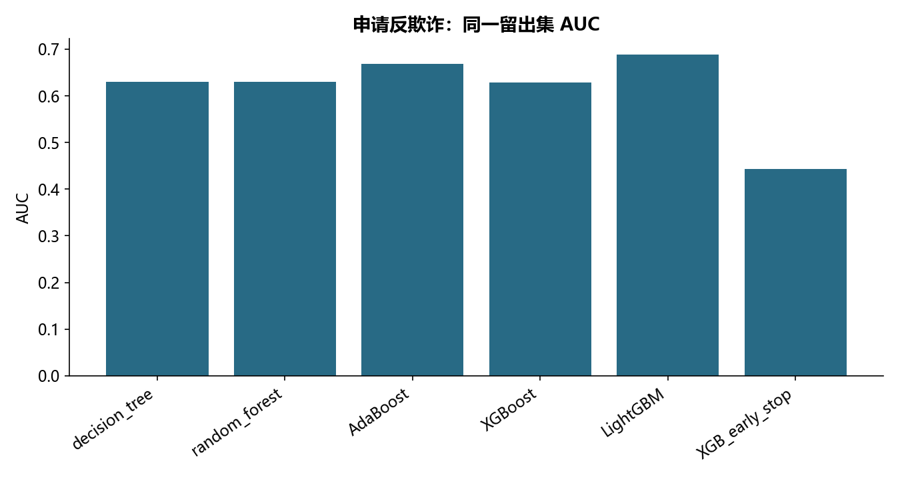

# M12 · 3.1.1-3.1.2分类（反欺诈_DT_EnsembleMethods）

理解模型、参数选择、解释与评估之间的关系。

## 实现与调整

保留各源主题的模型族和主要方法；实际搜索预算在报告公开。折内预处理、训练内验证及独立留出防止信息泄露；所有标签约定与抽样范围显式记录。

```text
|--- net_size <= 16.00
|   |--- degree <= 1.50
|   |   |--- percentage <= 0.29
|   |   |   |--- average_neighbor_degree <= 1.50
|   |   |   |   |--- class: 0
|   |   |   |--- average_neighbor_degree >  1.50
|   |   |   |   |--- class: 0
|   |   |--- percentage >  0.29
|   |   |   |--- class: 0
|   |--- degree >  1.50
|   |   |--- average_neighbor_degree <= 1.17
|   |   |   |--- degree <= 2.50
|   |   |   |   |--- truncated branch of depth 2
|   |   |   |--- degree >  2.50
|   |   |   |   |--- class: 0
|   |   |--- average_neighbor_degree >  1.17
|   |   |   |--- class: 0
|--- net_size >  16.00
|   |--- class: 1

```

保留五类分类器、四折搜索与训练内早停。默认树网格 min_samples 取 2/6/10、XGB reg_lambda 取 .01/.41/.81；LightGBM 随机搜索由 300 缩为 24 个候选，实际候选数随表发布，不声称跑完原耗时网格。早停不观察测试集。

## 运行结果

完整聚合结果见 [metrics.csv](metrics.csv)，原单元格去向见 [notebook-map.md](notebook-map.md)。



源文件按 SHA-256 校验；不加载教材附带的序列化模型。本报告的运行通过表示代码可执行并完成内部校验，不表示与旧 Notebook 的随机结果或未提供的线上结果完全一致。
