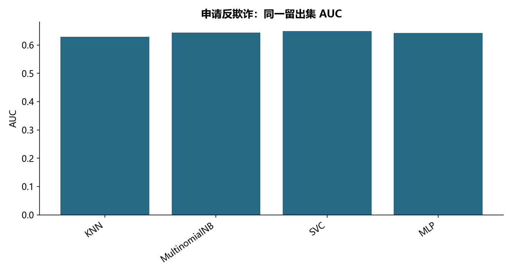

# M13 · 3.1.3-3.1.6分类（反欺诈_KNN_NB _SVM_MLP）

理解模型、参数选择、解释与评估之间的关系。

## 实现与调整

保留各源主题的模型族和主要方法；实际搜索预算在报告公开。折内预处理、训练内验证及独立留出防止信息泄露；所有标签约定与抽样范围显式记录。

保留 KNN、多项式朴素贝叶斯、线性/RBF SVC 和 MLP。所有缩放放入搜索 Pipeline，每折只拟合折内训练样本；朴素贝叶斯按教材使用原非负特征。SVC 的 C/gamma 网格各取 .01/.31/.61/.91；MLP 保留 20 次随机搜索。

## 运行结果

完整聚合结果见 [metrics.csv](metrics.csv)，原单元格去向见 [notebook-map.md](notebook-map.md)。

源文件按 SHA-256 校验；不加载教材附带的序列化模型。本报告的运行通过表示代码可执行并完成内部校验，不表示与旧 Notebook 的随机结果或未提供的线上结果完全一致。
