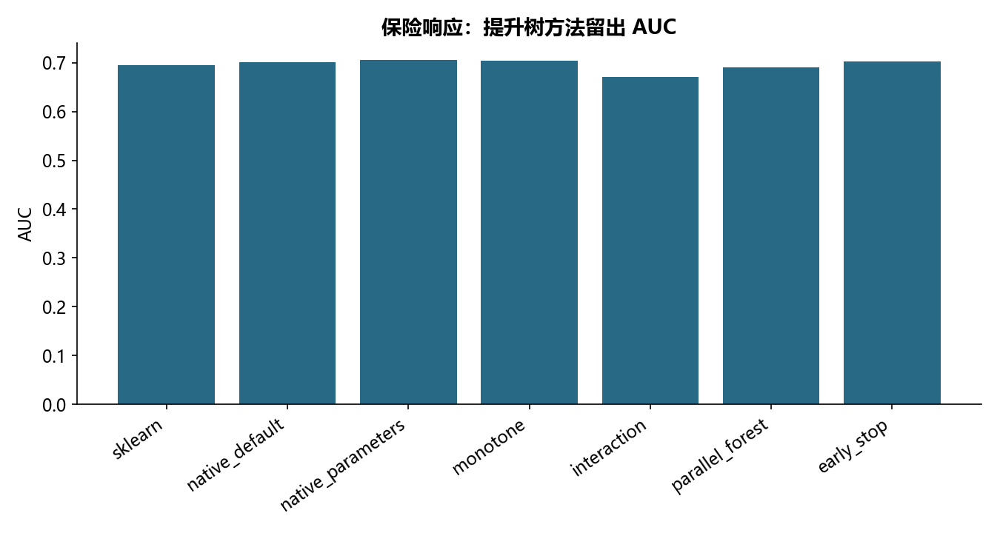

# M14 · 1_XGBoost专题_课堂代码

理解模型、参数选择、解释与评估之间的关系。

## 实现与调整

保留各源主题的模型族和主要方法；实际搜索预算在报告公开。折内预处理、训练内验证及独立留出防止信息泄露；所有标签约定与抽样范围显式记录。

原生接口显式指定 binary:logistic，修正源代码空参数默认回归目标被当分类概率的问题。保留 sklearn/原生 API、参数、早停、单调/交互约束和单轮并行森林。约束是教学演示，不代表已确认的业务因果方向；单调向量按实际列数构造。

## 运行结果

完整聚合结果见 [metrics.csv](metrics.csv)，原单元格去向见 [notebook-map.md](notebook-map.md)。

源文件按 SHA-256 校验；不加载教材附带的序列化模型。本报告的运行通过表示代码可执行并完成内部校验，不表示与旧 Notebook 的随机结果或未提供的线上结果完全一致。
