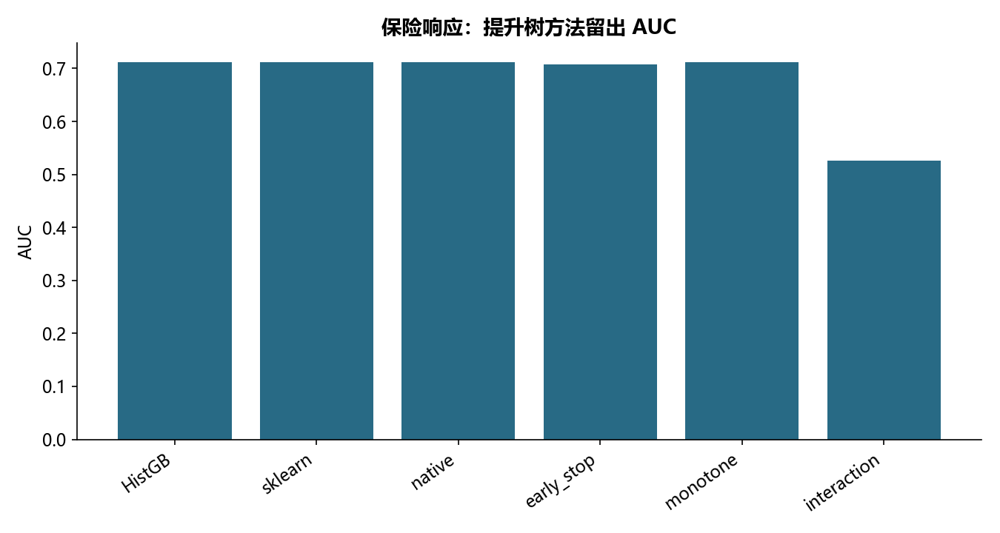

# M15 · 2_LightGBM专题_课堂代码

理解模型、参数选择、解释与评估之间的关系。

## 实现与调整

保留各源主题的模型族和主要方法；实际搜索预算在报告公开。折内预处理、训练内验证及独立留出防止信息泄露；所有标签约定与抽样范围显式记录。

保留 HistGradientBoosting、sklearn/原生 LightGBM、二进制数据集回读、类别声明、早停、模型文本回读及单调/交互约束。原生目标显式 binary；类别特征与单调数值演示采用各自数据集。预处理只拟合对应训练段。

## 运行结果

完整聚合结果见 [metrics.csv](metrics.csv)，原单元格去向见 [notebook-map.md](notebook-map.md)。

源文件按 SHA-256 校验；不加载教材附带的序列化模型。本报告的运行通过表示代码可执行并完成内部校验，不表示与旧 Notebook 的随机结果或未提供的线上结果完全一致。
