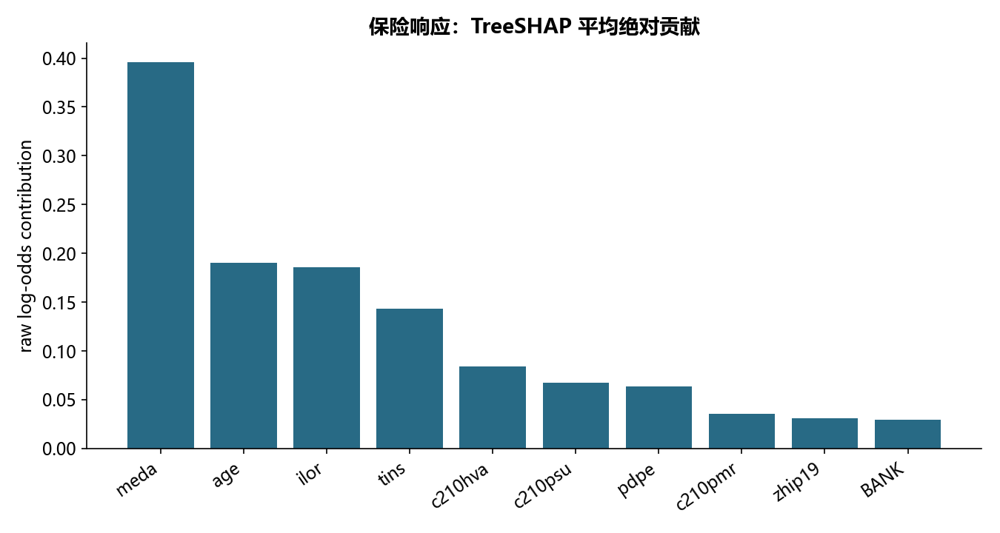

# M16 · 3_模型解释性专题_课堂代码

理解模型、参数选择、解释与评估之间的关系。

## 实现与调整

保留各源主题的模型族和主要方法；实际搜索预算在报告公开。折内预处理、训练内验证及独立留出防止信息泄露；所有标签约定与抽样范围显式记录。

用 XGBoost 内置精确 TreeSHAP 替代额外 shap 包，核验贡献和等于模型 raw margin；只发布聚合贡献与偏依赖，不公开单个客户路径/蜂群点。固定 sklearn 版本在双取值二分类偏依赖网格有形状兼容问题，按替换单特征再平均正类概率的定义显式重建。偏依赖组合可能偏离相关变量的真实联合分布，不作因果解释。随机反事实采用训练集经验取值重组与模型翻转检验，重建 dice 随机搜索的教学意图；未加入现实可行动约束，不能作为客户改进建议。

简化树规则：

```text
|--- meda <= 60.50
|   |--- ilor <= 8.50
|   |   |--- age <= 72.50
|   |   |   |--- c210hva <= 370.50
|   |   |   |   |--- c210hva <= 136.50
|   |   |   |   |   |--- class: 1
|   |   |   |   |--- c210hva >  136.50
|   |   |   |   |   |--- class: 1
|   |   |   |--- c210hva >  370.50
|   |   |   |   |--- meda <= 49.50
|   |   |   |   |   |--- class: 1
|   |   |   |   |--- meda >  49.50
|   |   |   |   |   |--- class: 0
|   |   |--- age >  72.50
|   |   |   |--- meda <= 39.50
|   |   |   |   |--- c210hva <= 544.50
|   |   |   |   |   |--- class: 1
|   |   |   |   |--- c210hva >  544.50
|   |   |   |   |   |--- class: 0
|   |   |   |--- meda >  39.50
|   |   |   |   |--- c210hva <= 75.50
|   |   |   |   |   |--- class: 0
|   |   |   |   |--- c210hva >  75.50
|   |   |   |   |   |--- class: 0
|   |--- ilor >  8.50
|   |   |--- c210hva <= 378.50
|   |   |   |--- tins <= 4.50
|   |   |   |   |--- ilor <= 13.50
|   |   |   |   |   |--- class: 0
|   |   |   |   |--- ilor >  13.50
|   |   |   |   |   |--- class: 0
|   |   |   |--- tins >  4.50
|   |   |   |   |--- meda <= 30.50
|   |   |   |   |   |--- class: 1
|   |   |   |   |--- meda >  30.50
|   |   |   |   |   |--- class: 0
|   |   |--- c210hva >  378.50
|   |   |   |--- age <= 71.50
|   |   |   |   |--- meda <= 49.50
|   |   |   |   |   |--- class: 1
|   |   |   |   |--- meda >  49.50
|   |   |   |   |   |--- class: 0
|   |   |   |--- age >  71.50
|   |   |   |   |--- tins <= 6.50
|   |   |   |   |   |--- class: 0
|   |   |   |   |--- tins >  6.50
|   |   |   |   |   |--- class: 0
|--- meda >  60.50
|   |--- c210hva <= 181.50
|   |   |--- meda <= 68.00
|   |   |   |--- ilor <= 18.50
|   |   |   |   |--- age <= 69.50
|   |   |   |   |   |--- class: 1
|   |   |   |   |--- age >  69.50
|   |   |   |   |   |--- class: 0
|   |   |   |--- ilor >  18.50
|   |   |   |   |--- tins <= 10.50
|   |   |   |   |   |--- class: 0
|   |   |   |   |--- tins >  10.50
|   |   |   |   |   |--- class: 0
|   |   |--- meda >  68.00
|   |   |   |--- ilor <= 9.50
|   |   |   |   |--- tins <= 1.50
|   |   |   |   |   |--- class: 1
|   |   |   |   |--- tins >  1.50
|   |   |   |   |   |--- class: 0
|   |   |   |--- ilor >  9.50
|   |   |   |   |--- tins <= 3.50
|   |   |   |   |   |--- class: 0
|   |   |   |   |--- tins >  3.50
|   |   |   |   |   |--- class: 0
|   |--- c210hva >  181.50
|   |   |--- ilor <= 8.50
|   |   |   |--- age <= 67.50
|   |   |   |   |--- meda <= 73.50
|   |   |   |   |   |--- class: 0
|   |   |   |   |--- meda >  73.50
|   |   |   |   |   |--- class: 0
|   |   |   |--- age >  67.50
|   |   |   |   |--- c210hva <= 187.50
|   |   |   |   |   |--- class: 1
|   |   |   |   |--- c210hva >  187.50
|   |   |   |   |   |--- class: 0
|   |   |--- ilor >  8.50
|   |   |   |--- tins <= 6.50
|   |   |   |   |--- meda <= 65.50
|   |   |   |   |   |--- class: 0
|   |   |   |   |--- meda >  65.50
|   |   |   |   |   |--- class: 0
|   |   |   |--- tins >  6.50
|   |   |   |   |--- ilor <= 19.50
|   |   |   |   |   |--- class: 0
|   |   |   |   |--- ilor >  19.50
|   |   |   |   |   |--- class: 0

```

## 运行结果

完整聚合结果见 [metrics.csv](metrics.csv)，原单元格去向见 [notebook-map.md](notebook-map.md)。



源文件按 SHA-256 校验；不加载教材附带的序列化模型。本报告的运行通过表示代码可执行并完成内部校验，不表示与旧 Notebook 的随机结果或未提供的线上结果完全一致。
