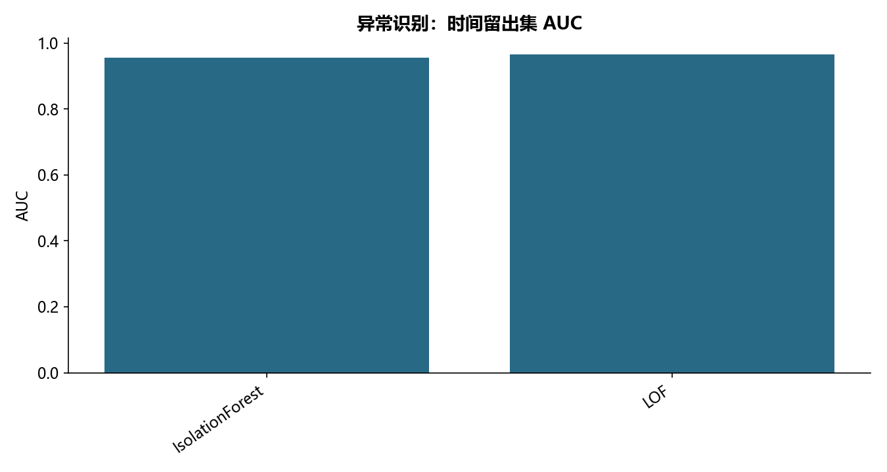

# M17 · 3.2违规识别(IsolationForrest_LOF无监督)

理解模型、参数选择、解释与评估之间的关系。

## 实现与调整

保留各源主题的模型族和主要方法；实际搜索预算在报告公开。折内预处理、训练内验证及独立留出防止信息泄露；所有标签约定与抽样范围显式记录。

模型拟合不使用标签；孤立森林参数用独立验证段标签选取，故明确称为标签辅助选择。默认从前 60% 时段无标签抽 5000 条拟合，保留 LOF 500 邻居，在后 20% 全量评估；这是可复现教学子样本，不是源全样本运行。修复 novelty=True 的 LOF 在其拟合样本上 predict 的误用。

## 运行结果

完整聚合结果见 [metrics.csv](metrics.csv)，原单元格去向见 [notebook-map.md](notebook-map.md)。

源文件按 SHA-256 校验；不加载教材附带的序列化模型。本报告的运行通过表示代码可执行并完成内部校验，不表示与旧 Notebook 的随机结果或未提供的线上结果完全一致。
