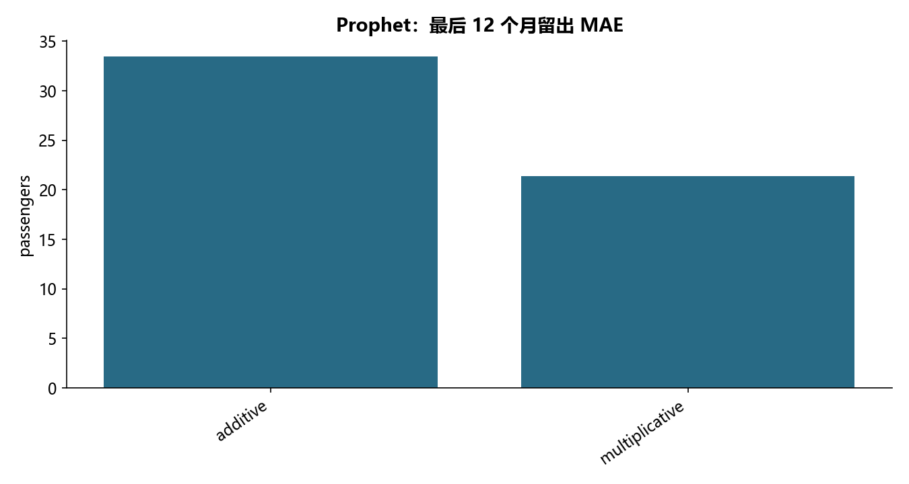

# M18 · 4.1.1销售数据预测(趋势分解法-不建议学习)

理解趋势、季节性、自相关或循环神经网络预测。

## 实现与调整

使用时间先后划分训练、验证及留出；预测窗口严格早于目标日。保留原算法族，并区分未来投影与已有真值的回测。

fbprophet 迁移到 Prophet，保留加法趋势与中国节假日乘法模型。月度数据不应过度解释日级节假日系数；36 月未来预测无真实标签，另留最后 12 月报告泛化误差。

## 运行结果

完整聚合结果见 [metrics.csv](metrics.csv)，原单元格去向见 [notebook-map.md](notebook-map.md)。

源文件按 SHA-256 校验；不加载教材附带的序列化模型。本报告的运行通过表示代码可执行并完成内部校验，不表示与旧 Notebook 的随机结果或未提供的线上结果完全一致。
