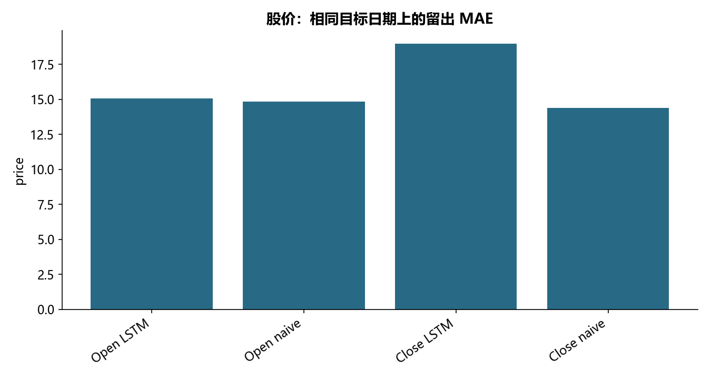

# M20 · 4.1.3股价预测(LSTM)

理解趋势、季节性、自相关或循环神经网络预测。

## 实现与调整

使用时间先后划分训练、验证及留出；预测窗口严格早于目标日。保留原算法族，并区分未来投影与已有真值的回测。

保留双层各 32 单元 LSTM、Dropout 0.2、双输出、Adam/MSE、100 epoch。独立训练内验证段替代原测试集验证；归一化仅拟合训练段。修复 Open 预测与 Close 真值混比和基线日期不齐；测试首日可以使用切分点前已观测历史，所有窗口严格早于目标日。

## 运行结果

完整聚合结果见 [metrics.csv](metrics.csv)，原单元格去向见 [notebook-map.md](notebook-map.md)。

源文件按 SHA-256 校验；不加载教材附带的序列化模型。本报告的运行通过表示代码可执行并完成内部校验，不表示与旧 Notebook 的随机结果或未提供的线上结果完全一致。
