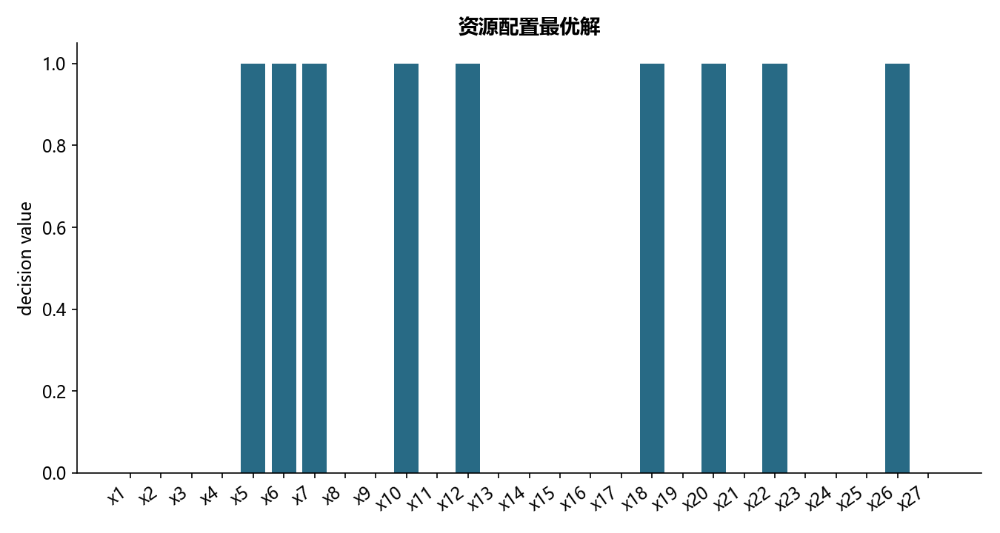

# M23 · 4.2.2整数规划

将资源配置模型的目标、边界、约束和变量类型迁移为可求解问题。

## 实现与调整

逐项读取受支持 LP 语法，使用 SciPy HiGHS 或二次优化；验证约束、最优性和数值残差，不依赖商业 CPLEX。

教材 campaign.lp 漏写 x19 的 Generals 声明：主结果按文件保留该变量连续；另求所有变量整数的教学意图版本，并比较目标值。不擅自隐藏原模型差异。

## 运行结果

完整聚合结果见 [metrics.csv](metrics.csv)，原单元格去向见 [notebook-map.md](notebook-map.md)。

源文件按 SHA-256 校验；不加载教材附带的序列化模型。本报告的运行通过表示代码可执行并完成内部校验，不表示与旧 Notebook 的随机结果或未提供的线上结果完全一致。
