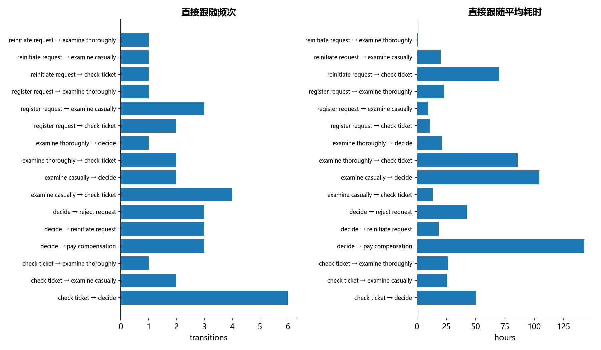

# M25 · 流程挖掘pm4py

从事件日志提取流程关系频次和环节耗时。

## 实现与调整

使用标准库 XML 解析 XES，验证导出回读及事件计数；按原始 trace 内事件顺序统计直接跟随图。

原 Notebook 只使用 pm4py 的 XES 读写、直接跟随频次和平均耗时；迁移用标准 XML 和显式统计重建这些功能，不声称实现 Petri 网或一致性检验。trace 内事件按源顺序保留，不把不同案例拼接。原日志、资源与单案事件留在本地，只发布活动对的聚合统计。

## 运行结果

完整聚合结果见 [metrics.csv](metrics.csv)，原单元格去向见 [notebook-map.md](notebook-map.md)。

源文件按 SHA-256 校验；不加载教材附带的序列化模型。本报告的运行通过表示代码可执行并完成内部校验，不表示与旧 Notebook 的随机结果或未提供的线上结果完全一致。
