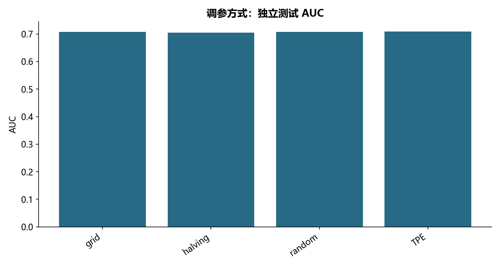

# M26 · 5.1 模型参数优化方法

理解模型、参数选择、解释与评估之间的关系。

## 实现与调整

保留各源主题的模型族和主要方法；实际搜索预算在报告公开。折内预处理、训练内验证及独立留出防止信息泄露；所有标签约定与抽样范围显式记录。

保留网格、逐次减半、随机和 TPE 搜索。默认减半在与网格相同的 24 组候选上比较，随机/TPE 各 12 次，以控制教学运行成本；不声称完成源 3750 组减半和 100 次 TPE。修复原 TPE 反复用测试集作为优化目标的问题，所有目标来自训练三折 AUC，预处理随折重拟合。

## 运行结果

完整聚合结果见 [metrics.csv](metrics.csv)，原单元格去向见 [notebook-map.md](notebook-map.md)。

源文件按 SHA-256 校验；不加载教材附带的序列化模型。本报告的运行通过表示代码可执行并完成内部校验，不表示与旧 Notebook 的随机结果或未提供的线上结果完全一致。
