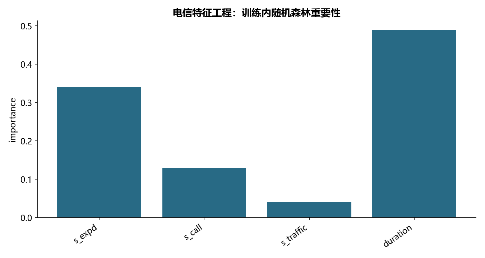

# M28 · Feature-engineering

理解数据清洗、表示、降维和特征筛选的各类方法。

## 实现与调整

逐项重建源演示，增加编码、归一化和白化恒等式校验；这是样本内教学分析，不声称模型泛化。

这是预处理与特征选择方法演示，沿用源样本内拟合口径；LDA 准确率不是泛化估计。回归 F 示例把 s_expd 同时放在输入和目标中，仅演示 API，不能当预测方案。等频分箱遇重复边界明确合并。时间截止按教材 2015-01-01 固定；TAC 是字符串前六位教学示例，不发布终端标识。

## 运行结果

完整聚合结果见 [metrics.csv](metrics.csv)，原单元格去向见 [notebook-map.md](notebook-map.md)。

源文件按 SHA-256 校验；不加载教材附带的序列化模型。本报告的运行通过表示代码可执行并完成内部校验，不表示与旧 Notebook 的随机结果或未提供的线上结果完全一致。
